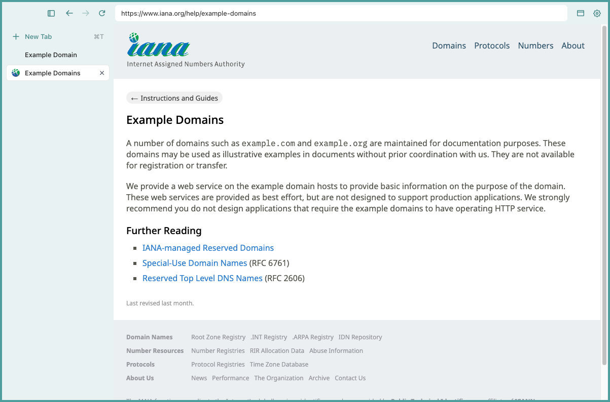
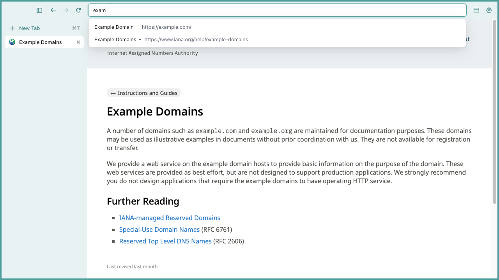
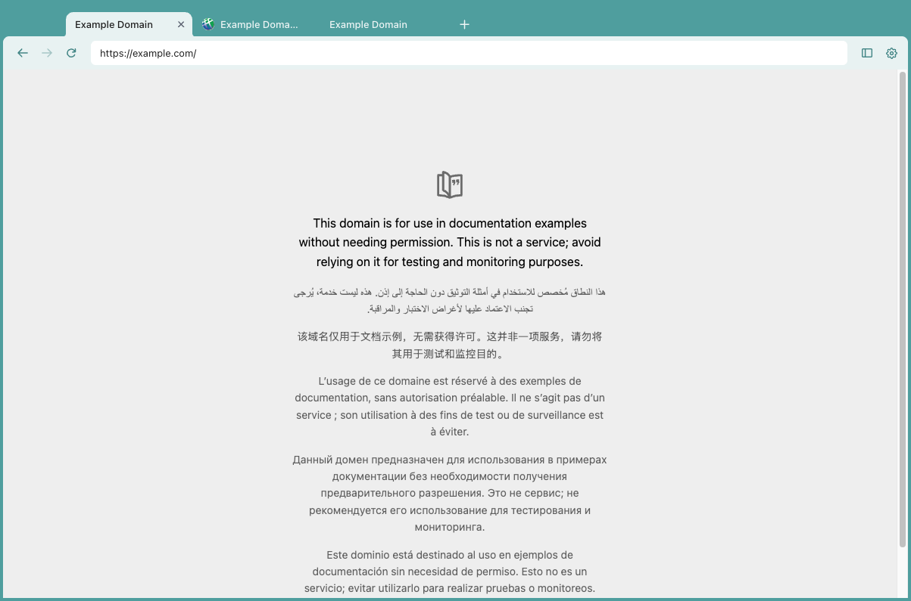
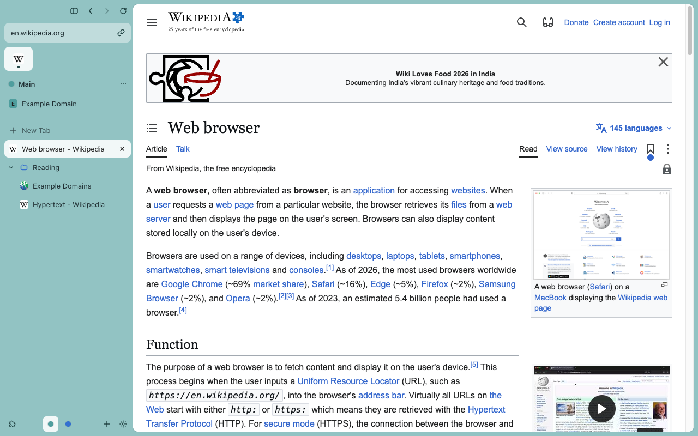
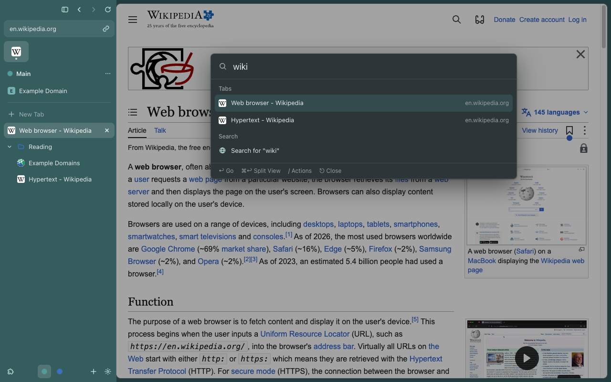
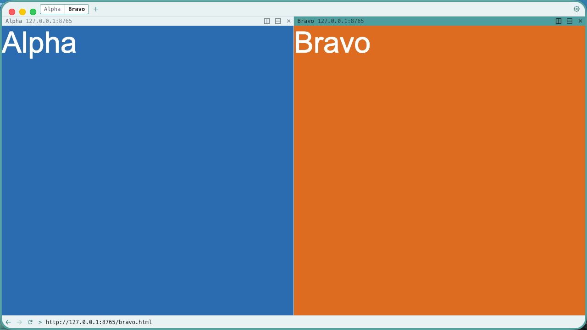
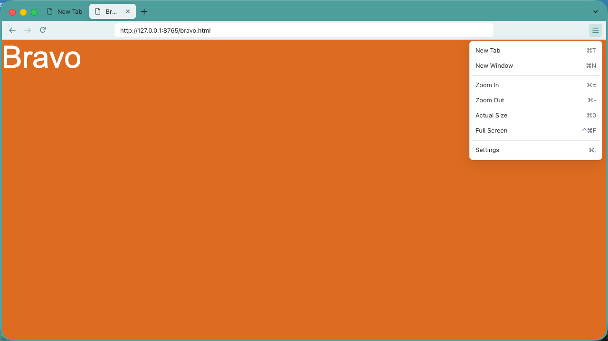
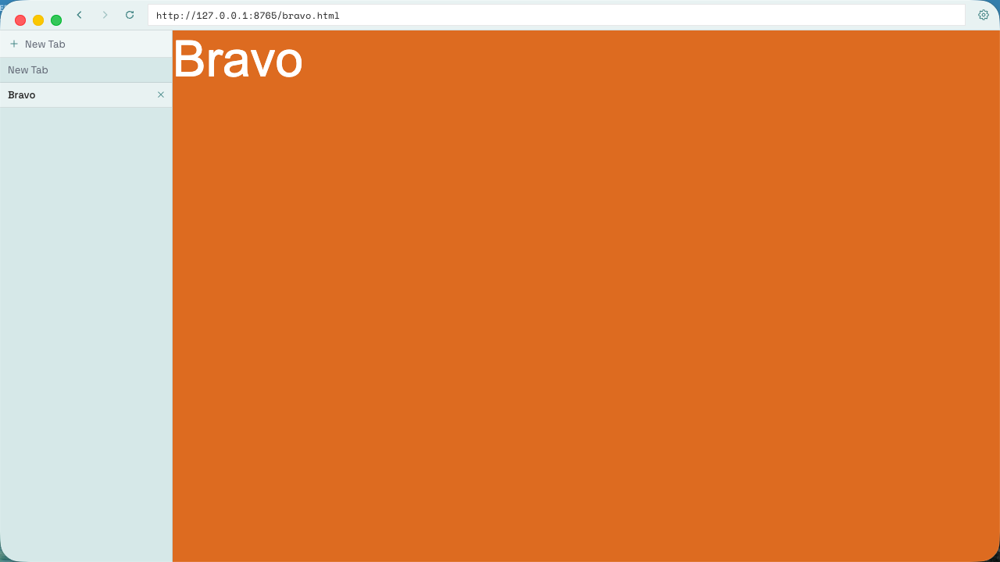

# Project B

**An experiment in better browser architecture. Development is ongoing.** It is not a finished
product or an enterprise browser: it asks what the browser part of a browser looks like when
it is built again above Chromium's content layer.

- **A web-based shell anyone can customise.** The whole interface (tabs, the address field,
  menus, settings) is a web page. Restyle it, swap it, or write your own.
- **A small, safe Go core that owns every decision.** Tabs, windows, profiles, history,
  bookmarks, downloads, site settings and updates are plain Go. It knows nothing about how
  pages render.
- **A performant engine behind one interface.** Chromium's content layer (155.0.8059.41,
  unpatched) loads and renders pages through a thin C++ adapter. A mock engine sits behind the
  same interface, so the shell and the core run and are tested without a Chromium build.

It runs on Apple silicon Macs and arm64 Android phones, and as a preview on arm64 Linux, from
one tree, and installed copies update themselves. The
[latest release](https://github.com/sudiptadeb/project-b/releases/latest) has them all. More at
[debkosh.com/project-b](https://debkosh.com/project-b).

## Why it is built this way

Most browsers are a fork of the whole Chromium browser, with changes carried as patches and
rebased on every Chromium release. Project B starts one layer lower. The content layer, the
part that loads and renders pages, comes in as it is, with no patches. Everything above it is
ours.

    +-----------------------------------------------------------+
    |  Shell: a web page                         shell/         |
    |  draws what the core tells it, sends back what you do     |
    +-----------------------------------------------------------+
                  |  messages (state down, actions up)
    +-----------------------------------------------------------+
    |  Go core                                   core/          |
    |  tabs, windows, profiles, history, bookmarks, downloads,  |
    |  site settings, the ad blocker, updates: every decision   |
    +-----------------------------------------------------------+
                  |  one engine interface (core/engine, a plain C ABI)
    +-----------------------------+   +-------------------------+
    |  C++ adapter      engine/   |   |  Mock engine            |
    |  Chromium 155 content       |   |  core/mockengine        |
    |  layer, unpatched           |   |  for development, tests |
    +-----------------------------+   +-------------------------+

- The engine gives the core page views and nothing more. The window is ours: Go decides what
  it shows and where. [docs/engine-interface.md](docs/engine-interface.md)
- A shell is held only to its messages with the core, so it is written and tested on the mock
  engine in a browser tab. [docs/shells.md](docs/shells.md)
- The same core, adapter and shell run on Android's content layer.
  [docs/android.md](docs/android.md)

## Where it stands

Working today:

- The Standard shell on the desktop and the Mobile shell on a phone. These two are the focus;
  the other shells in the tree (Glide, Terminal, Fox, Minimal) are experiments, parked.
- Per-site settings from the address field: an ad blocker, blocking links to other sites, and
  Sparks, your own userscripts for the pages they match.
- Downloads, printing, find in page, history, and bookmarks in folders.
- Sync between your devices, end to end encrypted, through a sync server you choose:
  bookmarks, history, passkeys and saved passwords. [More below](#sync-is-end-to-end-encrypted).
- Passkeys of its own, and saved passwords brought over from another browser, listed in
  Settings on the desktop and on a phone.
- A first-run welcome, and Project B as the system's default browser.
- Releases that update themselves on both platforms.

Not there yet:

- Saved passwords aren't filled into pages yet, and a page's new password isn't offered to
  be saved. No Safe Browsing warnings, no popup blocker.
- Chrome extensions are in every build but off behind a flag (Settings, Flags).
- Apple silicon Macs and arm64 Android (10 or newer) only.
- The Mac app is signed with the project's own key, not notarized by Apple.

The gaps, row by row: [docs/daily-use.md](docs/daily-use.md). What is decided and not built:
[docs/todo.md](docs/todo.md).

## Sync is end to end encrypted

Bookmarks, history, the addresses you type, passkeys and saved passwords sync between your
devices through a sync server you choose. Every item is sealed on your device before it
leaves, under a key the server never has: the server stores and hands on what it cannot
read. The protocol and its library are [synckosh](https://github.com/sudiptadeb/synckosh),
a separate project; the detail of what follows is in
[docs/sync.md](docs/sync.md#who-can-do-what). Setting it up, step by step:
[docs/setting-up-sync.md](docs/setting-up-sync.md).

**A sync server, and anyone who breaks into it or sits on the connection, cannot:**

- read anything you sync: no address, title, bookmark, username, password or passkey;
- change an item, forge one, mark one deleted or move one without your devices refusing
  it. Each item's seal covers its content, its name, its time and whether it is deleted, and
  an item that doesn't check changes nothing on a device.

**It still can:**

- see how many items you have of each kind, how big each is and when they change, so
  roughly when you browse, and which two items are the same thing, though not what it is;
- keep items back, stop answering, or lose its copy. Your devices keep theirs: nothing the
  server does deletes what is on a device;
- hand a device an older version that one of your devices once really wrote, so a device
  you add can get old data or miss a delete. A device that holds a newer version keeps it;
- say the bucket was reset, which stops sync on your devices until you set it up again;
- try passphrases against its sealed copy of the key, as fast as its own hardware allows.
  Each try costs it 64 MiB of memory and three passes of Argon2id, and a passphrase is at
  least 12 characters, but one a person can guess is the weak point.

**The other way round:**

- An app with no token for your bucket reaches nothing of it: the server keeps each bucket
  apart.
- An app that has your bucket's token and not your passphrase can't read anything, and
  can't make your devices take anything. It can spoil or erase the server's copy, which
  can't tell your sealed items from junk, so treat the token as a secret. Your devices keep
  what they have; resetting the bucket and setting sync up again puts it right.
- A device you set up with the passphrase is trusted in full. It reads and writes
  everything, and what it deletes goes from every device. There is no way yet to remove one
  device, or to change the key, short of resetting the bucket and setting sync up again
  with a new passphrase.

## Try it

Get the DMG or the APK from the
[latest release](https://github.com/sudiptadeb/project-b/releases/latest). Install once; from
then on the app updates itself.

- **Mac (Apple silicon).** Open the DMG and drag Project B to Applications. The app is not
  notarized, so macOS blocks the first launch: open System Settings, Privacy & Security, and
  choose Open Anyway. Or clear the download flag yourself:

      xattr -dr com.apple.quarantine "/Applications/Project B.app"

- **Android (arm64, Android 10 or newer).** Install the APK, allowing your browser or file
  manager to install apps when Android asks.

- **Linux (arm64, a preview).** It installs as a Flatpak, from
  [our repository](https://projectb.debkosh.com/). On Ubuntu, add Flatpak and GNOME
  Software's Flatpak support first, once (Ubuntu's own App Center doesn't open Flatpak links);
  Debian, Fedora, Arch and KDE's own distros have them or they're one command away:

      sudo apt install flatpak gnome-software-plugin-flatpak

  Then open [project-b.flatpakref](https://projectb.debkosh.com/project-b.flatpakref):
  GNOME Software or KDE Discover shows the app, its permissions, and Install. The first
  install also brings the shared Freedesktop runtime from Flathub, which Flatpak asks to add.
  Or in a terminal:

      flatpak install --from https://projectb.debkosh.com/project-b.flatpakref

  Flatpak updates it with your other apps. It's a preview: the window, the system's file and
  notification dialogs, and printing are still being built.

## Build it from source

How the pieces fit, with measurements: [docs/first-app.md](docs/first-app.md). Or hand
[requirements.prompt](requirements.prompt) to a coding agent on the machine and let it do
these steps.

**No Chromium needed to start.** The shell and the Go core run on the mock engine in a minute,
with Go 1.26 or newer and Node:

    git clone https://github.com/sudiptadeb/project-b
    cd project-b
    (cd shell && npm install && npm run build)
    (cd core && go run -tags sqlite_fts5 ./cmd/dev -shell ../shell/dist)    # then open http://127.0.0.1:8765

The browser tab stands in for the OS window: mock pages, with the real shell and the real
settings page over them, unchanged.

**The real app:**

1. The machine: an Apple silicon Mac with the full Xcode app (not only the command line
   tools) and about 150 GB free.

       sudo xcode-select -s /Applications/Xcode.app
       brew install go node python

2. Chromium, about 60 GB, no patches:

       tools/fetch-chromium.sh

3. Build. The first build is a full Chromium build: about an hour on a 32-core Mac, several
   hours on a laptop. Later builds take under a minute.

       tools/build.sh

The app is `build/pb/project_b`, a copy of what the build made in `chromium/src/out/pb`, which
every checkout on the machine shares and the next build replaces. Run the copy directly.

Android is built in a Linux VM on the same Mac: [docs/android.md](docs/android.md).

## Docs

- [docs/status.md](docs/status.md): where the project stands, and an index of every doc.
- [docs/first-app.md](docs/first-app.md): the pieces, the boundary between Go and C++, the
  window, measurements, packaging.
- [docs/engine-interface.md](docs/engine-interface.md): what an engine must implement.
- [docs/shells.md](docs/shells.md): choosing, building and testing a shell.
- [docs/android.md](docs/android.md): the same browser on Android.
- [docs/design-system.md](docs/design-system.md): how our UI looks, for anyone drawing any of it.
- [docs/logging.md](docs/logging.md): how every feature logs and times itself.
- [docs/updates.md](docs/updates.md) and [docs/releasing.md](docs/releasing.md): how an
  installed copy updates itself, and how a release is made.

## More screenshots

The address field's suggestions, and tabs on top:

 

The parked experiments, each a web page on the same core: Glide and its Command Bar, the
Terminal shell with two panes, Fox, and Minimal.

 

  

These come from the last release's test runs: `tools/readme-shots.py` refreshes them.

## Test it

Test tools go in `.tools/` inside the repo, which git ignores. `npm install` in `shell/`
already brought Playwright; it needs its browser once:

    (cd shell && npx playwright install chromium)

ChromeDriver, pinned to the Chromium we build:

    mkdir -p .tools/chromedriver && cd .tools/chromedriver
    curl -LO https://storage.googleapis.com/chrome-for-testing-public/155.0.8059.41/mac-arm64/chromedriver-mac-arm64.zip
    unzip chromedriver-mac-arm64.zip && cd ../..

The tests come in six groups, by what each needs. One command runs a group, and a group
that lacks what it needs says so and stops before running anything:

| Group | What it runs | What it needs |
|---|---|---|
| `tools/test.sh mock` | Go's tests, and every shell, the settings page and the picker in a browser on the mock engine, with the check every shell passes ([docs/shells.md](docs/shells.md)) | Go, `npm install`, Playwright's browser. No Chromium build; runs anywhere |
| `tools/test.sh app` | The real app through its own driver, and through Google's ChromeDriver | The build, and ChromeDriver; with extensions in, Go, the mock store (`tools/fetch-extensions.sh`, then `tools/pack-test-extension.py`) and the network. No display: it runs from ssh or an agent session |
| `tools/test.sh basics` | One check per area of the whole-browser checklist on the real app; most fail today, as a map of what isn't built | As for `app`, and the network for the Safe Browsing check |
| `tools/test.sh screen` | The real app in a person's desktop session: full screen, copy and paste, and the first page's paint in the real window | **A person logged in at this Mac's screen**, with it unlocked, and `deskrig` (below) |
| `tools/test.sh vm` | Real clicks, drags and keys in a macOS VM | **A person to have logged in at this Mac's desktop once since it booted**, then the VM: [docs/vm-testing.md](docs/vm-testing.md) |
| `tools/test.sh android` | The Android app on an emulator | The emulator running, and the APK: [docs/android.md](docs/android.md) |

`PB_BIN` points the Mac groups at another binary, such as an installed app's
`Contents/MacOS/project_b`, and `PB_APK` the Android group at another APK. Each test prints
`ok` or `FAIL` per check, and the group ends with one line per test: `passed`, `FAILED` or
`DID NOT RUN`.
A test also runs alone, as the top of its file says: `python3 tools/drive_first_app.py settings`
runs only the menus, keys and settings page.

Chrome extensions are in every build (`WITHOUT=extensions tools/build.sh` leaves them out) and run
only with their flag on, in Settings, Flags: [docs/extensions.md](docs/extensions.md) and
[docs/flags.md](docs/flags.md).

### The groups that need a person

A session over ssh, an agent's session and a background job have no screen of their own.
An app a background job starts can't enter full screen or reach the clipboard, and its
window may not be on the screen at all.
So the `screen` group starts its tests inside the desktop session of whoever is logged in,
through `tools/on_screen.py`, and refuses to run when nobody is. Run alone, that says
whether someone is there:

    tools/on_screen.py

The app's window shows on that person's screen while the group runs, and takes all of it
for a few seconds; the copy and paste check replaces what they had copied. Logging in
over Screen Sharing counts.

First paint looks at the real window through [deskrig](https://github.com/sudiptadeb/deskrig),
which takes window captures and gives real clicks and keys from any session, on this Mac or
in the VM. Install it and allow it once:

    deskrig setup permissions         # after installing it, as its README says

`deskrig --target local status` says what's missing. `DESKRIG` and `CHROMEDRIVER` point the
tests at other copies; a machine that already has ChromeDriver elsewhere can link
`.tools/chromedriver` to it.

The `vm` group needs the login for another reason: macOS only starts a macOS VM after
someone has logged in at the desktop since the last boot. Nobody has to stay at the screen.

Packaging a signed DMG and publishing a release need the signing key, which stays on the
build Mac: [docs/updates.md](docs/updates.md).

## Licence

MIT. See [LICENSE](LICENSE).
Chromium keeps its own licences.
