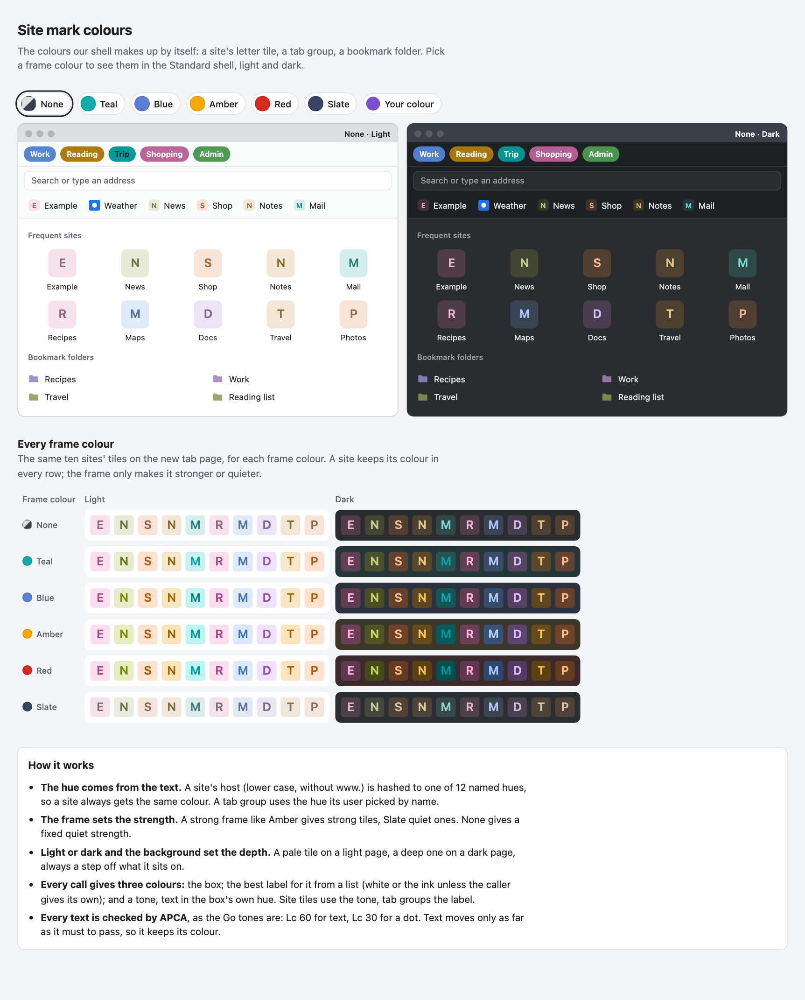
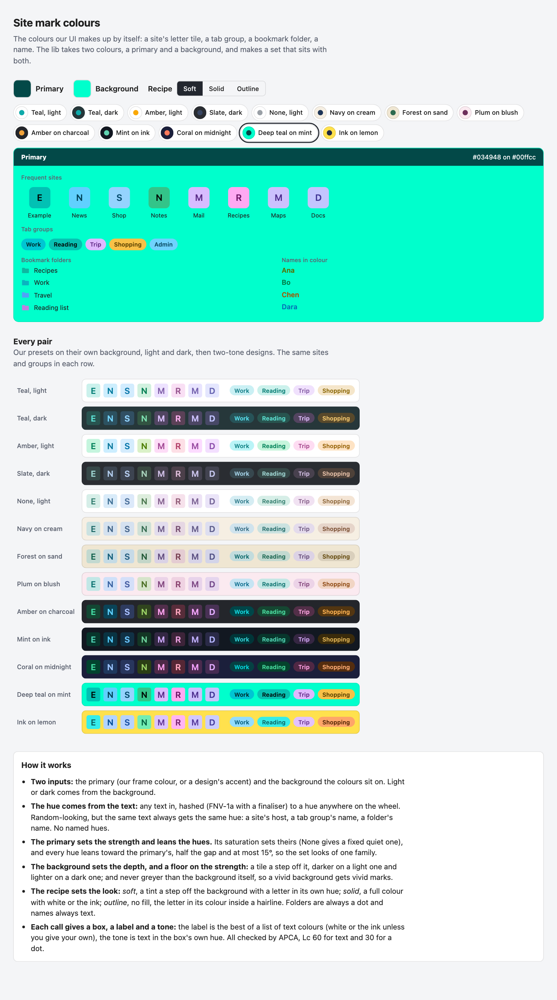

# The colour util

The colours our UI makes up by itself: a site's letter mark where it has no favicon
(bookmarks, frequent sites, sites in settings, the Mobile new tab), and later a tab group's
or a bookmark folder's colour. One util makes them all, from the theme the user picked, so
they sit with it in light and dark rather than standing out as random colours.

Status: decided. The util became a library of its own, **gulal**
([github.com/sudiptadeb/gulal](https://github.com/sudiptadeb/gulal), playground at
[debkosh.com/gulal](https://debkosh.com/gulal)), with its spec and Go and TypeScript
implementations. Project B uses it to colour site marks and bookmark folders; the design
below is how it got there, and gulal's spec is now the contract.

## Why

Today's letter tiles take `hsl(hue 45% 42%)` with white letters, the hue from a hash of the
host (`shell/src/apps/shell/standard/SiteMark.vue`, `shell/src/apps/shell/mobile/Mark.svelte`).
The owner, 2026-11-18: "the rounded squares with random colors feels very odd and does not sit
with our theme design". He asked for a standard util that takes the theme colour, light or
dark, its saturation and the background, and gives the same colour for the same text every
time.

## The design

Three layers, each doing one thing.

1. **The hue.** Any text in, hashed to a hue anywhere on the wheel: FNV-1a, then murmur3's
   finaliser so that similar texts (hosts of one domain) still spread. Random-looking, and
   deterministic: the same text gets the same hue in every shell, light or dark. A site's
   host (lower case, without `www.`), a tab group's or a folder's name. No named hues. With
   no text, a random hue, for what needs no memory.
2. **The colour.** `colour({ hue, primary, background, strength, recipe, labels })`. Two
   colours go in, so a two-tone design gets a set that sits with both: the **primary** (our
   frame colour, or a design's accent) and the **background** the colours sit on. Light or
   dark comes from the background.
   - **background floor:** the strength is never weaker than the background's own chroma,
     so a vivid background gets vivid marks rather than greyish ones; and a soft tile stands
     off the background by an OKLab distance of 0.05, more on a vivid one, even when its hue
     is the background's own.
   - **mid backgrounds:** where a coloured letter can't read either way, a soft tile is pale
     (it can hold a coloured letter) and a solid one at least 0.15 deeper or paler than the
     background, never at its lightness. Text goes lighter or darker from its own colour,
     whichever passes sooner.
   - **harmony:** every hue leans toward the primary's, half the gap and at most 15°, as
     Material's harmonize does, so the set looks of one family. A primary with no colour of
     its own (None) leans nothing.
   - **strength** is the chroma. "Follow the frame": 80% of the frame's own, from 0.03 to
     0.13 (the primary's), so Amber's colours are strong and Slate's quiet. None has no saturation of its own
     and takes a fixed quiet 0.06. "Muted" is half; "full" is 0.13.
   - **recipe** is the look, an input like the colours: *soft*, a tint a step off the
     background (pale in light, deep in dark) with text in its own hue; *solid*, a mid fill
     with the label; *outline*, no fill, text in its colour inside a hairline; *text*, the
     colour as text on the background; *dot*, a mark with no text.
   - In our shells the primary is the frame colour and the background is the tones'
     `--bar` or `--surface` that the mark sits on, both of which Go already sends.
   - It returns three colours: **fill**, the box; **label**, the best of `labels` on the
     fill (white or the ink unless the caller gives its own list); and **tone**, text in the
     fill's own hue that reads on it. Text moves in lightness only as far as it must to
     pass, so it keeps as much of its colour as it can.
3. **Configs**: each place that colours something says how, once, and never writes a colour:
   - site marks: hue from the host, strength from the frame, soft, the tone for the letter;
   - tab groups: hue from the group's name, the theme's strength, solid, the label for the
     name;
   - bookmark folders: hue from the folder's name, strength from the frame, a dot.

The theme never changes a hue: light, dark, the frame and the background change only how
deep and how strong a colour is, so a site stays "the green one" everywhere.

## Contrast

Every text is checked by APCA, the same function `core/tones` uses for a primary button's
label (branch `tones-apca`): Lc 60 for text, Lc 30 for a dot. The two must never disagree.

WCAG 2 and APCA give nearly the same letters on the soft tiles; they differ on solid fills,
where WCAG 2 puts the ink on mid blues, teals, pinks and ambers, and APCA white:

Every preset, light and dark:

Two-tone designs, a primary on a background of its own:

## What the research says

- **Colour harmony studies** (Ou and Luo, two-colour pairs, tested across eight countries):
  two colours look harmonious when their hue and their chroma are alike, with a moderate
  lightness difference, neither none nor the most, and more so when both are light. So the
  util matches saturation to the theme, leans hues toward the primary, and keeps lightness a
  fixed step off the background.
- **Material's harmonize** (Material Color Utilities, `Blend.harmonize`): turns a colour's
  hue toward the source's by half the gap, at most 15°, keeping its chroma and tone. The
  util's lean is the same rule.
- **Material's tonal palettes** (HCT, on CAM16 and L*): a palette keeps a hue and chroma and
  varies only tone, so colours of one tone weigh the same whatever their hue. The util gives
  every item of a set one lightness for the same reason.
- **Perceptual spaces:** a hash onto HSL's hue clusters into greens and purples, as HSL's
  greens take a third of the wheel; OKLCH (or HCT) spaces hues evenly by eye.
- **Contrast against a background** (Adobe's Leonardo, used in Spectrum): colours made to a
  target contrast with the background they sit on, which is why the util takes it as input.
- **APCA levels** (Bronze simple mode): Lc 75 for body text, 60 for other content text, 45
  for large text, 30 for what isn't read as text. A mark's single letter is other content
  text: Lc 60. A dot: Lc 30.
- **Simultaneous contrast:** one colour looks different on different backgrounds, and
  contrast ratios measure lightness, not hue. So the util never relies on hue for contrast,
  and the mocks show every colour in place.
- **Design systems** (Atlassian, Primer, Cognite's Aura, Dovetail): decorative colours for
  tags and avatars are their own token set, mapped for light and dark, never one-off hex.
- **Hue templates** (Matsuda, used by Cohen-Or's colour harmonization) restrict hues to
  sectors around a key hue; the templates were never rigorously tested, so the util doesn't
  use them.

- **Our own console's avatars** (another project of ours): the same hash, FNV-1a with an
  avalanche, onto a continuous OKLCH hue, kept as a list of bands so a hue can be left out
  later. Seeded from the item's immutable id, not its name, so a rename keeps the colour, and
  salted per use (`id + "#colour"`) so the colour and the pattern hash apart. Two fixed
  tones per item, a dark (L 0.40, C 0.13) and a light (L 0.86, C 0.11) at least a quarter
  turn apart in hue, so each avatar has an edge that shows on light and on dark: identity
  colours that ignore the theme, where ours follow it. Out-of-gamut colours are clipped per
  channel, as Chromium draws an `oklch()` fill; ours keep the hue and trim chroma instead.

None of these gives one colour per item from text, so the util is our own, about a hundred
lines.

## Decisions

The owner, 2026-11-18:

- **APCA** for the util's check, at Lc 60 for text and Lc 30 for a dot: "lets say yes to both
  for now".
- **None** takes a fixed quiet strength rather than grey: same answer.
- **Two inputs, a primary and a background**, "since there might be a two tone design where
  this lib should be able to generate good sets of colors".
- **No named hues; the hue is hashed from text:** "the hues should not be names because we
  need to have a feaure with takes a text inout and hases it and that is used to generate
  the colors... since we need an deteminitic option to generate random colors".
- **The background's saturation counts too**, after a deep teal on bright mint looked off
  with greyish marks: "may be becuase we match the intensity of only the primary color".
- **Saturation is what fits a set to the theme; lightness is only for reading:** "yes its
  more about saturation than lightness". Every colour takes the theme's saturation, the
  stronger of the primary's and the background's, tab groups too (no "full" for them).
- **Mid backgrounds** handled after pine on sage (`#104746` on `#608a82`) showed solid tiles
  vanishing into it and soft letters turning black.
- **The recipe is an input too:** "add the recipies as another input option".

## Open

- Seed from a stable id where an item has one (a tab group, a folder), so a rename keeps
  its colour; a site's host is its own id. A purpose salt, as the console's avatars have.
- Hue bands to leave out, such as the danger red, so a mark never reads as an error.

- Recipe for site marks: soft is the UX session's pick and ours.
- Where it lives: one JS module, `shell/src/ui/tint.js`, its constants in it, reading the
  frame, light or dark and the background from the tones Go sends. A native shell that ever
  needs marks ports it and checks a shared file of test vectors (the UX session's view, and
  ours).
- The design-system rule: "A colour made up for an item comes from tint(), never a literal",
  with what seeds it.
- Tab groups and workspaces store a colour code today; moving them to a colour from their
  name is its own change, after site marks.
