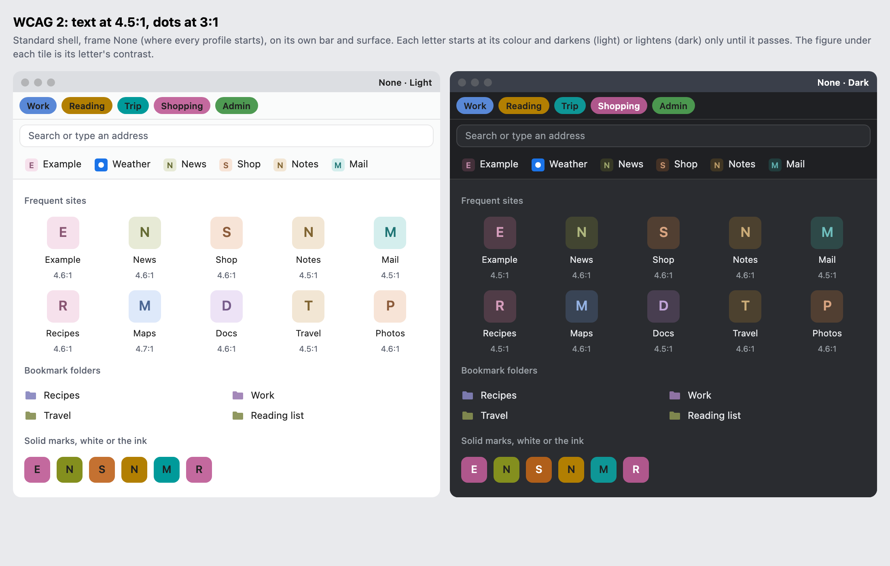
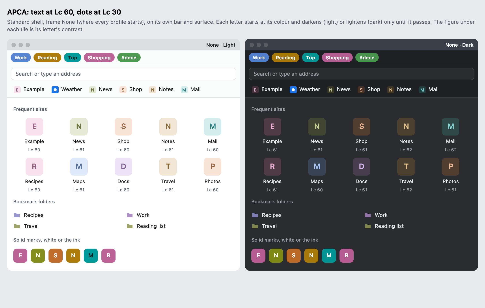

# The colour util

The colours our UI makes up by itself: a site's letter mark where it has no favicon
(bookmarks, frequent sites, sites in settings, the Mobile new tab), and later a tab group's
or a bookmark folder's colour. One util makes them all, from the theme the user picked, so
they sit with it in light and dark rather than standing out as random colours.

Status: design, agreed in part. No code yet; the marks change once the util is decided.

## Why

Today's letter tiles take `hsl(hue 45% 42%)` with white letters, the hue from a hash of the
host (`shell/src/apps/shell/standard/SiteMark.vue`, `shell/src/apps/shell/mobile/Mark.svelte`).
The owner, 2026-11-18: "the rounded squares with random colors feels very odd and does not sit
with our theme design". He asked for a standard util that takes the theme colour, light or
dark, its saturation and the background, and gives the same colour for the same text every
time.

## The design

Three layers, each doing one thing.

1. **The hue.** A number on the wheel, from:
   - **text**, such as a host (lower case, without `www.`) or a folder's name: FNV-1a, then
     murmur3's finaliser so that hosts of one domain still spread, onto one of **12 named
     hues** spaced evenly by eye in OKLCH (red, orange, amber, lime, green, mint, teal, sky,
     blue, indigo, purple, pink). The same text gets the same hue in every shell;
   - **a slot** the user picked by name, such as a tab group's "teal", which is then the
     same teal a site hashed to teal gets;
   - **near the frame**: within 40° of the frame's hue;
   - **random**, for what needs no memory.
2. **The colour.** `colour({ hue, strength, recipe, on, labels })`:
   - **strength** is the chroma. "Follow the frame": 80% of the frame's own, from 0.03 to
     0.13, so Amber's colours are strong and Slate's quiet. None has no saturation of its own
     and takes a fixed quiet 0.06. "Muted" is half; "full" is 0.13.
   - **recipe** is the lightness: *soft*, a tint a step off the background (pale in light,
     deep in dark); *solid*, a mid fill; *dot*, a mark with no text.
   - **on** is what it sits on, from the tones Go already sends: the frame, light or dark,
     and the background (the bar, the surface, a card).
   - It returns three colours: **fill**, the box; **label**, the best of `labels` on the
     fill (white or the ink unless the caller gives its own list); and **tone**, text in the
     fill's own hue that reads on it. Text moves in lightness only as far as it must to
     pass, so it keeps as much of its colour as it can.
3. **Configs**: each place that colours something says how, once, and never writes a colour:
   - site marks: hue from the host, strength from the frame, soft, the tone for the letter;
   - tab groups: the slot the user picked, full strength, solid, the label for the name;
   - bookmark folders: hue from the folder's name, strength from the frame, a dot.

The theme never changes a hue: light, dark, the frame and the background change only how
deep and how strong a colour is, so a site stays "the green one" everywhere.

## Contrast

Every text is checked by APCA, the same function `core/tones` uses for a primary button's
label (branch `tones-apca`): Lc 60 for text, Lc 30 for a dot. The two must never disagree.

WCAG 2 and APCA give nearly the same letters on the soft tiles; they differ on solid fills,
where WCAG 2 puts the ink on mid blues, teals, pinks and ambers, and APCA white:

Every preset, light and dark:

## What others do

- Material Color Utilities makes tonal palettes from one source colour: a palette keeps a
  hue and chroma and varies only tone. Our strength and recipe are a small form of it.
- Adobe's Leonardo makes colours to a target contrast against a background, which is why
  ours takes the background as an input.
- Radix Colors' 12-step scales, light and dark, put backgrounds low and text high: our soft
  recipe and its tone.
- Hashing a name onto HSL's hue clusters colours into greens and purples, as HSL's greens
  take a third of the wheel; OKLCH spaces them evenly by eye.

None of them gives one colour per item, so the util is our own, about a hundred lines.

## Decisions

The owner, 2026-11-18:

- **APCA** for the util's check, at Lc 60 for text and Lc 30 for a dot: "lets say yes to both
  for now".
- **None** takes a fixed quiet strength rather than grey: same answer.

## Open

- Recipe for site marks: soft is the UX session's pick and ours.
- 12 named slots, or any hue: slots tie marks to tab groups and keep out muddy in-between
  hues; any hue shares less.
- Where it lives: one JS module, `shell/src/ui/tint.js`, its constants in it, reading the
  frame, light or dark and the background from the tones Go sends. A native shell that ever
  needs marks ports it and checks a shared file of test vectors (the UX session's view, and
  ours).
- The design-system rule: "A colour made up for an item comes from tint(), never a literal",
  with what seeds it.
- Tab groups and workspaces store a colour code today; moving them to a slot name is its own
  change, after site marks.
