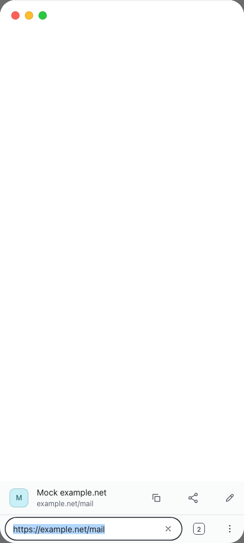
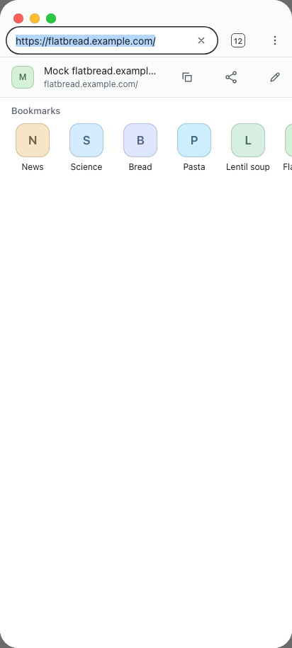
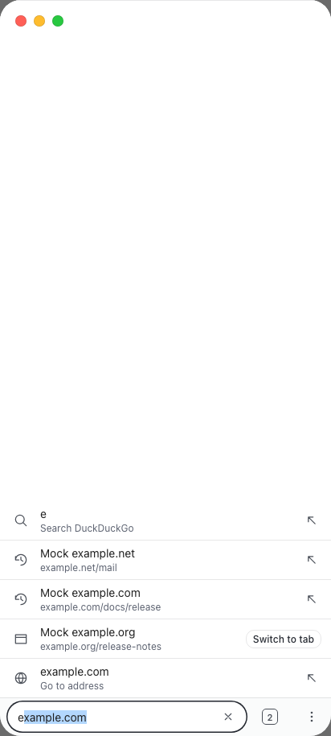

# The daily driver

What a browser needs before someone can use it all day: right-click, downloads, file upload and
the page's own dialogs. Built in this order, one branch each, in Standard first, then Curve, then
the other shells through their owners. Mac first, then Android where it applies.

One rule for all four. **Go owns each request a page makes:** what is asked, the choices, how long
it lives, and what the answer does. The shell only draws it and sends back the choice. Each live
request has an id and sits in the state the SDK keeps; the shell answers by that id, and Go ignores
an answer to one it has dropped. What the OS already draws stays native: the file chooser and the
Save panel.

## Where it stands (2026-11-16)

**Done**, on the Mac in every desktop shell and on Android in both Mobile shells unless noted:
right-click, downloads (with Retry and Copy link, and a stalled connection resumed after
sleep), file upload (Mac), the page's dialogs, find in page, video full screen, sign-in to a
site, search engines with one suggestion source, permissions, tabs coming back, History
and Bookmarks (desktop; Cmd+D bookmarks in every shell), error pages with certificate
warnings (Standard and the Mobile web shell), printing through the system's panel, and a
new tab page (Standard's box and the Mobile web shell, which reaches History and Bookmarks
from it). The list with owners is
[daily-use.md](daily-use.md).

Bringing bookmarks, history and the search engine over from Chrome, Edge, Brave, Arc,
Firefox and Safari (once the app has Full Disk Access), in the welcome and Settings' Import
([onboarding.md](onboarding.md#built)).

**Planned**, decided and not started ([todo.md](todo.md#daily-driver)): bookmarks in the
address bar's suggestions as you type.

**Needs discussion** ([todo.md](todo.md#daily-driver)), in this order: saved passwords and
autofill, engine-fetched search suggestions (off by default if built), and where a phone's
downloads go.

## Right-click

A right-click in a page, or a long press on a phone, reaches Go through content's
`HandleContextMenu`, which Go answers as handled. Go works out what can run there and sends it to
the window's shell as `contextMenu`. The shell designs and draws the menu, and sends back the
action chosen. Go runs it.

**The context.** `state.contextMenu` is `null`, or:

| Field | What it is |
|---|---|
| `id` | This menu's number. A newer right-click replaces it |
| `tab`, `x`, `y` | The tab, and where in its page, in the page's CSS pixels |
| `link`, `linkText` | The link pressed on, and its words |
| `src`, `media` | An image's address, or another medium's, and which: `image`, `video`, `audio` |
| `selection` | The text selected |
| `editable` | The press was in a field, for cut, copy, paste and select all |
| `actions` | What can run here: `{id, title, group, enabled}`, and `actions` of its own for a submenu |
| `thumb` | A phone's picture of the image pressed, a PNG data URL; Go sends the menu again with it once the engine has fetched it |

**The actions.** Go lists only what it can run here and now. Ids never change once released, so a
shell may give an id an icon, or leave it out.

| Group | Actions |
|---|---|
| `link` | `link.newTab` Open Link in New Tab, `link.workspace` Open Link in Workspace (a submenu, `link.workspace.<id>` per other workspace), `link.newWindow` Open Link in New Window, `link.copy` Copy Link, `link.saveAs` Save Link As…; on a phone, in place of Save Link As, `link.copyText` Copy Link Text, `link.download` Download Link and `link.share` Share Link |
| `image` | `image.newTab` Open Image in New Tab, `image.saveAs` Save Image As…, `image.copyAddress` Copy Image Address; on a phone, in place of Save Image As, `image.download` Download Image, `image.copy` Copy Image and `image.share` Share Image |
| `selection` | `selection.copy` Copy, `selection.search` Search for "…" |
| `edit` | `edit.undo`, `edit.redo`, `edit.cut`, `edit.copy`, `edit.paste`, `edit.selectAll` |
| `page` | `page.back` Back, `page.forward` Forward, `page.reload` Reload, `page.print` Print… |

Back and Forward come disabled when there is nowhere to go. A press on a link in a field gets both
groups. Save Link As and Save Image As come with downloads, Copy Image and Inspect when the engine
has them, and View Source later. `page.print` Print… follows Reload ([Printing](#printing)).

**The messages.** The shell sends `contextMenuChoose {id, item}` to run an action, or
`contextMenuClose {id}` when the menu goes without one. Go then sends `contextMenu` with `null`.
Go also drops the menu, and sends `null`, when its tab closes, navigates or stops being the active
one. Copying is Go's, through the engine's clipboard, so no shell needs `navigator.clipboard`.

**The design is the shell's.** It may order, group and leave out Go's actions, and add actions of
its own (Curve's Pin, say). Separators are its choice; `group` is there to help. In Standard it is
the design system's menu ([design-system.md](design-system.md)), at the press, kept inside the
window.

**A shell that draws nothing** shows no menu: content's own on the Mac is none. The contract's
rule 16 ([shells.md](shells.md#what-every-shell-does)) is what catches it.

**Android.** Go sends only presses on a link or an image. A long press on text or in a field keeps
Android's own selection bar, which already copies, pastes and selects. The phone shells' sheet
opens on the same message, and builds its Open items from the press itself.

**A phone's actions** come when the chosen shell is a phone's, so the mock tests see them too.
A phone has no Save panel, so its menu downloads at once, into Downloads as a page's own download
does (`DownloadURL` without the panel), and shares. Share Link hands the address to Android's
chooser as text. Copy Image and Share Image need the image itself: the engine fetches it as its
page would, from the cache when it has it (`save_image`, content's `DownloadImage`), and writes it
as a PNG in the profile's `shared` folder, which the FileProvider serves. Copy Image puts that file
on the clipboard as a content URI; Share Image offers it to the chooser as an image. For the sheet's
head, Go fetches the image the same way at 120 pixels and sends the menu again with it as `thumb`,
since a shell page loads no image from the web. The `shared` folder is emptied at each start.

## Downloads

Today the engine has no `DownloadManagerDelegate`, so content refuses every download. The
engine gets one; Go decides where each file goes and keeps the list; the shell draws the list;
the Save dialog is Chromium's own (`engine/browser/choose_path.cc`).

**The flow.** A page starts a download, or a menu's Save Link As does. The engine asks Go
where it goes (`PB_EVENT_DOWNLOAD_TARGET`: the download's id, its tab, address, suggested
name and type). Go answers with a path, with whether to show the Save panel at it first, or
with nothing to refuse it, as policy says. By default a file goes to `~/Downloads` under its
own name, with ` (1)`, ` (2)` added when that name is taken, and no panel; Save Link As and
Save Image As show the panel, and so does every download with Settings' Ask where to save
each file on (a pref, `askWhereToSave`, off by default; not on a phone, whose engine has no
panel). The engine then reports each change
(`PB_EVENT_DOWNLOAD_UPDATED`: progress, done, cancelled, failed, paused), and Go keeps the
list.

**The list.** `state.downloads` is this profile's, newest first, each `{id, name, url,
path, state, received, total, paused, reason}`, `state` being `progress`, `done`, `cancelled`
or `failed`, and `reason` why a failed one failed, from content's interrupt reason
(`PB_EVENT_DOWNLOAD_UPDATED`'s last value): `connection` (its connection failed or dropped,
a timeout among them), `server` (the server refused it) or `disk` (no room), or none. The
shell says it in plain words: "Failed: the connection stopped", "Failed: the server
refused it", "Failed: not enough disk space", or "Failed" for any other reason; Mobile's
download bar, "Couldn't download x.zip: the connection stopped" and so on. A file the app made itself and kept as a finished download, a saved crash report,
has no `url` and says what it is in `from` instead. Go keeps the finished ones in the profile's `downloads.json`, the last 100, so the
list is there after a restart; one still running when the app quit comes back `failed`.
The shell asks for one action at a time, `downloadAction {id, action}`: `open` the file,
`reveal` it in Finder, `cancel`, `pause`, `resume`, `retry`, or `remove` it from the list
(the file stays). `clearDownloads` removes every finished one.

**Open: here or in the OS.** The app decides first, and only what it doesn't keep reaches oskit.
A file the engine shows itself opens in a new tab of the app's own, in the window in front: a
page (.html, .htm, .xhtml, .svg), a PDF, an image (.png, .jpg, .jpeg, .gif, .webp, .avif) or
plain text (.txt, .json), by its file:// address on the desktop and its content:// copy on a
phone (`downloads.ShowsItself`). Anything else, a zip or a document, goes to the OS's app for
it through oskit/open (his call, 2026-11-22).

**The shell.** A control named Downloads shows once the list has one, and opens the list:
each download a `listitem` by its file name, its progress while it runs, Open and Show in
Finder once done, Pause (or Resume), Cancel and Retry while it runs, and Retry once it failed
or was cancelled. Every progress has Retry and Cancel while it runs (the UX guide,
`docs/ux-guide.md`); Retry sits a little apart from Pause and Cancel, as it throws away what
has arrived: Go stops the engine's copy, whose late news it then ignores, and starts the
address over in the same row, under the same name. A running row has no remove button,
Cancel being there. Mobile's download bar has Cancel and Retry while one runs, and its
Downloads page has Pause too. Standard
puts the control in its toolbar and shows a download's progress on it; Open and Show in
Finder are icons there, so the name has the row. The contract's rule 17 checks it, by role
and name.

**Details** (owner, 2026-11-18). Each row of Standard's list and of the Downloads page opens
out at its Details control (`aria-expanded`): From, the whole address with Copy link
(`copyLink`), or for a file the app kept itself what it is (`from`, as Crash report); and
Saved in, the folder on the Mac or Downloads on a phone, where the file is. A closed row is
as it was, so the list stays short.

**A download you see start** (owner approved, item 9 of the UX comparison). When a tab of
the window in front begins a download, Go tells that window's shell, `downloadStarted {id}`,
after the `downloads` that lists it, and marks `download.started` on the timeline; a window
behind hears nothing. Go knows which of the app's windows is in front, not whether the app
is, so the shell also checks that its page is visible. Standard's Downloads list then opens
by itself under its button, the same floating list the button opens, so the newest is at
its top with its progress. It closes after five seconds, unless the pointer is over it or a
control in it has the keyboard, and at once on Escape or a press outside it. Unlike the list
the button opens, it has no cover: the page around it stays usable. It takes the keyboard
while it shows, so Escape reaches it and a press on the page, which takes the keyboard from
the shell, closes it, and it gives the keyboard back as it closes; a download begins from a
press, so no typing is lost. A press on the button makes it the person's list, which stays;
a list the person opened stays as it is.

**A connection that goes silent.** Across the Mac's sleep a download's connection can die
without a word, and content waits on it for good. The engine watches every running download,
but a paused one, which never times out: one that receives nothing for 30 seconds of waking
time, the same 30 as the updater's (updates.md), is interrupted as a network timeout,
which content resumes at once on a new connection from where the file got to. When resuming
fails too, the download shows as failed, with Retry and Copy link (`downloadAction` `retry`,
`copyLink`). Retry resumes one this run still has, or starts it over as a new download of its
address in the same row (`download_url` with tab 0, the browser's own). The app's own update
download is watched the same way: one silent for 30 seconds fails, Settings shows Try again,
and the next check downloads it again.

**The Downloads page.** A page of ours, in a tab of ours as History and Bookmarks are
(`downloads.show`, "Downloads", Shift+Cmd+J, in the Window menu): the same list, newest
first, with Pause or Resume and Cancel while one runs, Open (a tap on its name too) and Show
in Finder, or Show in Downloads on a phone, once done, Retry once it failed or was
cancelled, Details, a × to take one off the list, and Clear all. Go sends it the list in its snapshot and on each change, and takes
`downloadAction` and `clearDownloads` from it as from a shell. A phone's shells reach it from
their menu, always there, with how many are running beside it (owner, 2026-11-15).

**On a phone** the page is the dense one (design-system.md, "On a phone", owner 2026-11-19;
`PhoneDownloads.vue`): a 52px bar with ← (`close`: the tab used before takes its place, as
the back key does), the title, Search, by name or host, and ⋮ with Clear all; the downloads
under the day each started, Today, Yesterday, then the date; one 56px row each, its kind's
icon, the name and one line, how far it has got, its size and host, or why it failed. A tap
opens a finished one; a failed one carries Retry in its row; everything else is in its ⋮,
a sheet of actions (`ui/ActionSheet.vue`) whose head is the name and the address: Share,
Show in Downloads and Copy link, then Remove from list and Delete, last, in `--danger`;
Pause or Resume, Cancel and Retry while it runs. Delete asks first, then deletes the copy in
the phone's Downloads and takes the download off the list (`deleteDownload`, the engine's
`delete_download`). The Mac's downloads are the user's own files, and its page doesn't
offer it. Share (`downloadAction` `share`) hands the copy in the phone's Downloads to
the system's share sheet. The back key closes the search or the sheet first.

**Android.** There is no Save panel: a download goes where Go says, the profile's own
Downloads folder. Once done, the engine copies it into the phone's shared Downloads through
MediaStore, where the Files app and other apps find it, removes the app's own copy, and tells
Go the copy's content:// address (`PB_EVENT_DOWNLOAD_PUBLISHED`), which is the download's path
from then on, as Chromium's is. Open (oskit/open) opens that address with the app the phone
picks, Share and Delete hand it on, and Show opens the phone's own list of downloads. Open and
Share pressed while the copy is made wait for it, so they work the moment a download ends; its
"Downloaded" notification comes once Go has the address. 0.3.9 and before kept each copy's
address in the app instead: the first start after the update hands those to Go once.

**A phone's notification.** Go shows each download where the system shows such things
(`ShowDownload`, the engine's `show_download`; nothing on the Mac): on Android, a
notification per download, its progress while it runs (once a second at most) as
"16 MB of 42 MB · 1 min left", the time left at the speed so far in Chrome's words, with
Pause and Cancel, or "Paused · 16 MB of 42 MB" with Resume and Cancel; "Downloaded" with
the size once done, which opens the file at a tap as Open does (the tap reaches Go as
`PB_DOWNLOAD_OPEN`, Go's Open deciding where; one that starts the app waits for Go); and "Download failed"; a
cancelled one goes. Pause, Resume and Cancel come back to Go as `PB_EVENT_DOWNLOAD_ACTION`,
by Go's id, and do what the Downloads page's buttons do. Two quiet channels, as Chrome's:
"Downloads in progress" and "Completed downloads".

**A download outlives the app's screen**, as Chrome's does. Swiping the app away from the
recent apps ended its activity, and the app ended its process with it (Go's state lives as
long as its window), so every running download died (his phone, 2026-11-27). Now, while one
runs (not paused), the activity goes and the app runs on with no screen:

- **Kept alive** by a foreground service (`DownloadService`, type `dataSync`), whose
  notification is one running download's own, so nothing new shows. When that one ends or
  pauses, the service stops and the next running one takes it at its next news. Android 12
  and later refuse to start it from the background, where the download goes on without it.
- **Go's window stays**, its tabs and shell as they were, with nothing on screen: the native
  window lets go of the activity's views and compositor (`detach`) and keeps its layers.
- **Opening the app again** attaches the new activity to it (`attach`): the shell, every
  page, the shown one and the layout are given to the new views, and a native shell asks Go
  for a snapshot as it does at a start.
- **The end:** once no download runs and no finished one is being copied into the shared
  Downloads, Go stops, saving the profile, and the app ends, as it did when its screen went.
  A paused download doesn't keep it running.

**Asking for notifications.** Android 13 and later show them only once the person allows
them. The app never asks in the middle of a download: the welcome's last step asks, and
otherwise the first download's bar offers, once, "Downloading big.bin" with "Show progress
in notifications?" on a line of its own and Allow, which opens Android's question
(`system.System.AskNotifications`). Shown, the offer never comes again, taken up or not
(`notificationsOffered` in downloads.json); after that the bar is the only sign, and the
phone's Settings can still turn them on.

**A navigation that becomes a download** shows nothing instead, so the tab stays at the page
it shows: the engine ends it as a failure with no failure named, at that page's address, and
Go puts the tab's address back. Before, the tab kept the download's address, and a restart
loaded it and downloaded the file again.

## File upload

The panel is the system's own, so no shell draws anything. A page's `<input type=file>`
reaches the engine (`RunFileChooser`), which asks Go first (`PB_EVENT_FILE_CHOOSER`: the tab,
whether it picks one file, several, a folder or a file to save, and the types it accepts).
Go lets it open while the page's address is one policy allows, and names the folder: the one
files were last chosen from in this run, or the system's choice. The engine then shows the
open panel as a sheet on the page's window, limited to the accepted types with All Files
still offered, and hands the page what was chosen; a folder upload gets every file under
it. The engine tells Go where they came from (`PB_EVENT_FILES_CHOSEN`) for the next panel.
Cancelling, or a refusal, answers the page with nothing, as a cancelled panel does.

**Android.** The phone's own picker already opens through content, without Go. Bringing it
through Go's policy comes with the Android pass.

## JavaScript dialogs

`alert`, `confirm`, `prompt` and the leave-page question. The engine's
`JavaScriptDialogManager` tells Go of each (`PB_EVENT_DIALOG_OPENED`: its id, tab, kind,
words, a prompt's text, the asking frame's origin, and whether a leave-page question is for a
reload) and holds the page until Go answers (`answer_dialog`). Go keeps them in
`state.dialogs`, oldest first, each with the title and the buttons' words every shell shows:
"example.com says" with OK and Cancel (OK alone for an alert), or "Leave site?" with Leave and
Cancel ("Reload site?" with Reload). When content gives up on one, as when its tab navigates or
closes, the engine says so (`PB_EVENT_DIALOG_CLOSED`) and it leaves the list unanswered.

A shell shows its active tab's, over that page only, so the tabs and the toolbar still work;
another tab shown hides it and the page keeps waiting. It answers with `answerDialog {id, ok,
text}`; Escape answers no. In Standard it is the design system's dialog over the page. The
contract's rule 15 holds every shell to it.

A page's passkey request is a dialog too, of kind `passkey`, whose card changes at each step:
[passkeys.md](passkeys.md).

**Android.** The same on a phone: the engine gives every dialog and sign-in to Go, and the
Mobile shell draws them, its back key answering Cancel.

## Find in page

Find…, Find Next and Find Previous are Go's actions, `find.open`, `find.next` and
`find.previous` (Cmd+F, Cmd+G and Shift+Cmd+G on the Mac), in the Edit menu's Find submenu.
Each tab keeps its own search while its bar is open. Go runs it through the engine's `find`
(content's `WebContents::Find`) and hears the count from content's `FindReply`; it sends the
window's shell the active tab's search as `state.find`, `{tab, text, matches, active}`, or
`null`, and `focusFind` when the find key is pressed. The shell draws the bar and sends
`findText` as the text changes, `findNext` for Enter and Shift+Enter, and `findClose`, each
naming the tab whose bar it is, so a key typed as another tab comes forward goes nowhere; closing
keeps the match shown selected. A bar opened afresh starts with the last text searched for,
and a page that loads again is searched again. Contract rule 20 holds every desktop shell to
it. In Standard the bar hangs from the page's top right.

## Video full screen

A page's `requestFullscreen`, as a video's full screen button calls, reaches Go through
content's `EnterFullscreenModeForTab`. Go puts the window in full screen, unless it is already,
and tells its shell, `state.pageFullScreen`, the tab, or 0; the engine then has the page sized
again, and content asks Go (`IsFullscreenForTabOrPending`) whether the page has the screen,
which settles the page's promise. The shell lays that page across the whole window, with no
band and nothing of its own. It ends when the page calls `exitFullscreen`, when Escape is
pressed (Go takes it before the page, and asks the engine's `exit_page_full_screen`), when
another tab shows or the tab closes, and when the window leaves full screen through its own
button. The window then goes back to how it was. Contract rule 21 holds every desktop shell to
it.

**Android.** A phone's window already fills the screen, so a page in full screen there is the
window without the system's status and navigation bars (a swipe from an edge shows them for a
moment), and the phone's back key ends it before it goes back in the page's history.

## Sign-in to a site

A site or a proxy that answers 401 or 407 asks for a username and password. Content asks the
embedder (`CreateLoginDelegate`), and the engine makes it one of the page's dialogs: Go hears
it as `PB_EVENT_DIALOG_OPENED` with the kind `signin`, the site's realm as its words, and the
origin asking; `state.dialogs` carries it titled "Sign in", with "example.com asks for a
username and password." (or "The proxy …"), the realm as `realm`, and the Sign in and Cancel
buttons. The shell asks for the username and the password and answers with `answerDialog {id,
ok, text, password}`, the username as `text`; Go hands them to the engine's `answer_sign_in`,
which answers content outside its own call, as content asks. When content drops the request,
as when its tab navigates, the dialog goes. Contract rule 22 holds every shell that draws
dialogs to it. Nothing is remembered yet: saved passwords are a later step.

## Search engines and one suggestion source

Two things that go together: which search engine a typed text goes to, and one list of
suggestions for every place text is typed: the address field, Curve's Command Bar, and the
command box a new tab shows in the page's place.

**Search engines.** Go has a short built-in list (`core/search`): DuckDuckGo, Google, Bing,
Brave Search and Ecosia, each an id, a name and an address with the words' place in it. The
profile's `searchEngine` pref names one; DuckDuckGo until it is set. Everything that turns
words into a search uses it: the address field's Enter, the right-click menu's Search for,
and the suggestion list's search row. The settings page has a Search engine row, a select
of the list. The engine's name comes in the snapshot (`searchEngine: {id, name}`), for a
field's placeholder, "Search DuckDuckGo or type a URL". Adding one's own engine is a later
step.

**The suggestion source.** `core/suggest` answers a query with one ranked list, at most ten
rows, each tagged with where it comes from:

| `kind` | What it is | It carries |
|---|---|---|
| `address` | What was typed, read as an address | `url` |
| `search` | "Search DuckDuckGo for …" | `url`, the search |
| `tab` | A tab open in any window and workspace of the profile, matched by title or address, but never the tab the field is over | `tab`, `url`, `workspace` |
| `history` | A page visited before | `url` |
| `action` | An action that can run now, matched by its title | `action` |
| `bookmark` | A bookmark whose title or address holds the text, or with nothing typed one of the newest ([A new tab](#a-new-tab)) | `url` |
| `closed` | A tab closed lately, with nothing typed only ([A new tab](#a-new-tab)). Choosing it reopens that tab | `url` |

Every row has `kind`, `title` and `detail`, a second line: the address's host, the tab's
workspace, or an action's key. The order, the matching and how many rows come are in
[What the address field suggests, and when](#what-the-address-field-suggests-and-when).
With nothing typed, the list is what a new tab offers ([A new tab](#a-new-tab)).

**Inline completion,** all local, as the owner approved (item 5 of the UX comparison). When
the text has no space and the bare address (no scheme, no `www.`) of a page from history or
a bookmark starts with it, that row comes first, before what Enter would
otherwise do, and carries `inline`: the rest of the address after what was typed, which the
field shows selected after the caret. The page visited most wins, then the newest bookmark.
While the text is still inside the host it completes to the host alone, as Chrome does:
`wikip` gives `edia.org`, on the row of the host's own page when it was visited, else on an
`address` row for the host, in the scheme and `www.` the page had. Past the host (`docs.test/gu`),
or for a shell that asks for no `address` rows, it completes to the whole address, in its own
case. A typed scheme or `www.` stays (`https://www.wiki` gives `pedia.org`). Only web
addresses complete, and a shell that names no kinds never gets one. A completed page open in
a tab is that tab's row, listed once, so Enter shows the tab rather than loading the page a
second time. Enter takes the first row, so it goes where the field shows.

Standard's address field shows the completion as Chrome and Safari do: the rest selected
after the caret. A key that matches its next letter carries it on at once, without waiting
for Go; Backspace takes the selected part away first, and the next answer then completes
nothing, the completing row moving a place down so Enter is what was typed; the arrow keys
replace it with the row they choose; the first Escape drops it with the list. The row has
no heading over it, as it is what the field shows. Bookmark rows carry the star.
Enter takes the first row, or the completion, only while it belongs to the text in the
field now: the completion shown is that row's rest after what was typed, or the list
answers what is typed now. Before Go's answer for the latest text, as after fast typing,
Enter takes what was typed, never a row of the list for an earlier text; a row the arrow
keys or a click chose is taken as always. Standard's command box takes the same rule from
0.2.76, and Mobile's field the same rule since the framework below.

**The messages.** As today, `suggest {id, text}` and `suggestions {id, items}`, with three
additions. `rows` says how many rows the shell has room for, besides the actions; without
it Go uses its own caps. The shell names the kinds it draws, `kinds: ["tab", "history", …]`; without it the
list is history alone, as it was, so a shell that hasn't changed still works. And a shell runs
a row with `chooseSuggestion {row, newTab}`: Go loads the address or the search in the active
tab, or a new one, shows the tab, in whichever window it is, or runs the action. The SDK has
`suggest(text, kinds)` and `chooseSuggestion(row, newTab)`. A shell with a split or a mode of
its own may still act on a row's `url` itself.

**Speed.** A key must not scan and lowercase everything again: at 100,000 visits that took
30 to 38 ms a key. History is in the profile's store, with each address and title lowercased
as it is stored, and its search is one query per tier with a `LIMIT`, through an index, on the
store's worker: well under a millisecond a key at the median at 50,000 addresses
([store.md](store.md#suggestions)). Addresses typed in the field come first for the text they
start. The actions are few, so they are matched as they are. A benchmark in `core/suggest`
measures it.

**Not in this step.** Suggestions fetched from the search engine as one types: they send every
keystroke to the engine, so they are a setting to decide, off by default if added; the owner
keeps them off.

**The new tab.** A tab with nothing in it shows the shell's own command box where the page
would be, drawing this list; the look is the standard shell session's mock. Curve's Command
Bar moves onto this list, in place of its own search of tabs and actions. In Standard, New Tab
goes to the window's new tab, opening one when there is none, and the box shows on it
(the owner, 2026-11-18, [windows.md](windows.md#every-window-has-a-tab-decided-2026-11-18)); the box over a page, with
its scrim, went then.

## What the address field suggests, and when

The owner approved this on 2026-11-20 from the ux session's mocks, and it was built on the
`suggest-framework` branch. What changed: a phone's field showed everything it had as it was
tapped (open tabs, closed tabs, the sites visited most, the bookmarks as folder chips and
tiles), under four headings, over a new tab page that showed most of the same things; and
one typed letter matched inside almost every title and address, so ten rows came back, most
of them under the keyboard.

The owner's answers, 2026-11-20: Recently closed only on the new tab page; sites and
bookmarks separate, never mixed; and "Rank by visits when suggesting. One typed letter
showing the sites that start with it is expected; showing sites with nothing typed is not."

**How Chrome does it**, from Chromium's source and launch notes, leaving out what depends on
Google being the search engine (we use DuckDuckGo, and send no keystrokes anywhere). On
Android, tapping the field on a page shows that page first, with Copy, Share and Edit, then
one row of most-visited tiles; tapping the new tab page's box with another engine than
Google drops nothing down, the page staying the list. On a desktop, focusing the field on a
page with another engine shows nothing until you type; the new tab page's box shows 8 rows
at most. Typed: at most 8 rows on a desktop, and on Android as many as fit above the
keyboard, never fewer than 5. The first row is always what Enter does, completed in the
field; an address shows once, and an open tab offers Switch to tab rather than a second copy.

### The rules

1. **One layer.** While the field is focused, either its list covers the page down to the
   keyboard, or nothing covers it. A list never sits over a new tab page.
2. **Each thing once on screen.** An address shows once, as the highest of its kinds: an
   open tab, then a bookmark, then history. A bookmarked page from history is one row, with
   the star. The tab the field is over is never offered as a tab to switch to, as in Chrome:
   its page is a row like any other.
3. **Short text matches starts only.** Under three characters, a row matches only where its
   host starts with the text, or a word of its title does. From three characters on, a
   match anywhere counts.
4. **Enter's row comes first.** That's the completion, else the address, else the search.
   The search row goes last whenever it isn't first.
5. **Headings only with nothing typed.** A typed list has none, as each row's icon says its
   kind.
6. **No folders in the field's list.** Folders live on the new tab page and in All
   bookmarks. With nothing typed, bookmarks show as their own row of tiles while their pref
   is on, never mixed with sites. Once you type, they join the rows.
7. **Nothing leaves the device.** No suggestions fetched from the search engine, as before.
   The clipboard ("Link you copied") isn't in this round.

### Each state

| State | Phone | Desktop (Standard) |
|---|---|---|
| Nothing typed, on a new tab | No list: the new tab page is the list, in the order Frequently visited, Recently closed (3 at most), Bookmarks. | The new tab's command box, as before: 8 rows at most of sites and bookmarks. The address bar shows no list. |
| Nothing typed, on a page | The page's own row, with Copy, Share and Edit, and nothing else: no sites, no closed tabs. While Bookmarks in the address bar is on, the bookmarks follow as their own row of tiles. | No list. |
| 1–2 characters | Enter's row and up to 4 more: open tabs (2 at most), then the pages from history and the bookmarks by their visits, then the search. Starts only. | The same, with up to 5 more. |
| 3 or more characters | Enter's row, then rows in the same order, as many as fit above the keyboard: at least 5 in all, 6 on a common phone, 8 at most. | 8 rows at most, and up to 2 actions besides in Curve's Command Bar. |

**Ranking.** Rows rank by visits: a page visited more comes first, and a visit typed in the
field counts three, a clicked one one. A bookmark goes ahead of another page only when their
visits are equal; a bookmark never visited ranks as none. Recently closed tabs show only on
the new tab page, and sites only once something is typed, never in the field's list with
nothing typed.

### How it is built

- **Go (`core/suggest`, `core/history`).** History's search matches under three letters only
  where a bare address starts with the text or a word of a title does; each row says how
  often it was typed. `core/suggest` puts Enter's row first, then up to two open tabs (not
  the one the asking window shows), then
  the pages and bookmarks together by their visits (a typed visit weighing three), the
  bookmark first of two with as many, then up to two actions, then the search; a page from
  history that is bookmarked is a `bookmark` row. A list has `rows` rows besides the
  actions, the shell's number, or 6 under three letters and 8 from three.
- **The phone (`shell/src/apps/shell/mwshell/Address.svelte`).** Tapped over a new tab it
  asks for nothing and draws nothing. Over a page it draws the page's row from the tab it
  has, with Copy (`copyText`), Share (`shareText`, the system's share sheet) and Edit (the
  caret to the address's end), and the bookmarks' tiles while `bookmarksCommandBox` is on.
  Typed, it asks for `address`, `search`, `tab`, `history` and, while that pref is on,
  `bookmark`, with `rows` 5 under three letters and otherwise the 48px rows that fit
  between the field and the keyboard, 5 to 8. It completes in the field as Standard does,
  and Enter takes the first row while the list answers what is typed, else the text.
- **The phone's new tab page (`NewTab.svelte`).** Frequently visited, then Recently closed,
  then the bookmarks.

**Checked** by Go's tests (`core/suggest`, `core/history`, `core/app`) and the mobile
shell's tests on the mock engine, 2026-11-20: the page's row and each of its buttons, the
covering list, one letter's five rows, the completion kept by a matching key and dropped by
Backspace, the rows asked for from three letters, Enter on a completed open tab, Switch to
tab, a fast typist's Enter, a new tab's field drawing nothing, and the bookmarks' row with
the bar on top and at the foot, and with the pref off.

## Permissions

**The interface.** The owner, 2026-11-14: "we should have an interface for it and not just
follow contents stuff... keep that decoupled behind the engine interface". So a page's
request crosses into Go in our own terms, and every request feature after this one follows
the same shape:

- The engine interface (`core/engine`, `pb_abi.h`) names things as the web platform does,
  never as content does: a kind is the Permissions API's name (`camera`, `microphone`,
  `notifications`, `clipboard-write`, `geolocation`...), a status is ours (`ask`, `granted`,
  `denied`, numbered 0, 1, 2 by us). Another engine could implement it unchanged.
- The C++ adapter, `engine/browser/permissions.cc`, is the only code that knows content's
  permission types and statuses and its camera path; it translates both ways
  and decides nothing.
- Go's sites manager, `core/sites`, is the one place a decision is made. Every kind a page
  can ask for reaches it, as a request or a read, even those answered without a prompt:
  clipboard write is granted there, and a kind it doesn't know is denied there.
- The kinds are one table in Go (`sites.Kinds`): its title, whether a page asks for it,
  whether it can be asked about, its answer otherwise, whether its prompt needs a press, and whether it offers Allow this time.
  Adding geolocation is one row there and the adapter's name for it.
- The shell only draws what Go sends and sends back the choice.

**Where per-site settings live.** The owner, 2026-11-14: "we might have other site level
permissons or configs that we might want later and go core should own those... like down
the line we can have an option to let extensions content script run on a page or some other
injected script based feature for the page and that time the config to diable that would
live in that domain and should ideall sit with the site permissions". So `core/sites` is the
home of every setting kept per site, not a copy of the web's permission list. A kind is ours:
some are what a page asks for (camera, microphone, notifications, clipboard), and a later
kind may be a switch of our own that no page asks for, which is one more row in the table
with `Requested` off. The store is per site (`sites.json`: origin, then kind, then value),
the messages and the settings section speak of a site's settings with Go's title for each,
and nothing in them assumes a kind came from the engine. Only the kinds built here exist.

Before this, the engine's delegate granted clipboard write and denied everything else
itself, so `getUserMedia` failed with NotSupportedError and `Notification.requestPermission()`
answered `denied` (basics 16 and 17). The OS's own question, macOS asking once whether the
app may use the camera, stays the system's.

**What Go offers.** Three kinds can be asked about: `camera`, `microphone` and
`notifications`. `clipboard-write` is granted without asking; every other kind is denied
without asking until it gets a row. Content keeps these from insecure pages, so only
`https` pages and `localhost` ask. Our own pages, which are in no tab, get each kind's
answer with no prompt.

**The flow.** A page asks (`getUserMedia`, `Notification.requestPermission()`). The engine
sends `PB_EVENT_PERMISSION_REQUEST`: the request's id, its tab, the origin asking, the kinds,
and whether a user gesture led to it. Go answers later, with the engine call
`answer_permission(id, statuses)`, one status per kind. A page reading the state
(`navigator.permissions.query`, `Notification.permission`, a device's label) asks
synchronously, `PB_EVENT_PERMISSION_STATUS`: tab, origin and kind, answered with a status.
For `getUserMedia`, the adapter asks for `camera` and `microphone` the same way, then gives
the page the devices it named, or the system's first.

**What Go decides.** The person's decisions are the profile's, in `sites.json`, by origin
and kind: `allow` or `block`. A kind already decided is answered at once, with no
prompt. A kind whose prompt needs a press (`notifications`), asked without one, is answered
`ask` with no prompt, so a page can't put one up on load (the page sees `default`). Anything
else undecided becomes a prompt.

**The prompt.** `state.permissionPrompts` is every prompt open in the profile, one per tab at
most, each `{id, tab, origin, kinds, once}`; a second request from the same tab waits behind
the first. A shell shows the one on its active tab, and sends `permissionAnswer {id, choice}`:

| `choice` | What Go does |
|---|---|
| `allow` | Grants it and keeps `allow` for the origin |
| `once` | Grants it until the tab leaves the origin or closes; offered (`once`) when every kind asked offers it: camera and microphone |
| `block` | Denies it and keeps `block` |
| `dismiss` | Answers `ask`, keeping nothing: the prompt was closed |

Go drops a prompt, answering `dismiss`, when its tab closes or navigates to another
document, and ignores an answer to a prompt it dropped.

**The site settings page.** The owner: "we should have a page which shows either all site
settings or jsut the current pages permissions... like who chrome shows the site settings
icon in the omnibox.. but make it look like ours". One section of settings, Site settings,
with two views by its address: `sites`, every site with a setting, a row each saying how
each is by Go's title, which opens the site's view, and a menu to reset one or Remove them
all; and `sites/<origin>`, one site alone, every setting settings can set (Go's
`siteKinds`), each Ask, Allow or Block (`setSiteSetting`). The address is all the section
reads, so it shows the same once settings is a tab of its own. A shell's control named Site
settings sends `openSiteSettings`, and Go opens settings at the active tab's site. In
Standard it is an icon at the start of the address field, on every web page. The contract's
rule 31 checks it.

**Notifications** a page shows are the system's: the engine sends each to Go
(`PB_EVENT_NOTIFICATION_SHOW`, with its title, body, origin and tab), Go checks the origin
is allowed and posts it to macOS's notification centre itself (`core/system`). A click on it
comes to Go from the system, which fires the page's `click` event through the engine
(`click_notification`), then brings the tab's window to the front and makes the tab active.
One the page closes, the engine says (`PB_EVENT_NOTIFICATION_CLOSED`), and Go takes it off the
system. A packaged app only: a bare binary can't post to the notification centre.

**The shell.** In Standard the prompt is the design system's floating surface, from the
address field's start: a glyph of what is asked, then "*site* wants to use your camera and
microphone". Where Go offers this time, its buttons are Block, Always allow and Allow this
time, the primary, as a quick press should give the least; otherwise Block and Allow. It is
a `dialog` named by that sentence; Escape dismisses it. It takes no focus, so a page can't
type into it, and follows the address field in tab order, so F6 then Tab reach it. The
contract's rule 30 checks it, by role and name, on the mock.

**The connection.** The owner: "clicking gives one list of everything site related... so the
button get gains the unsecure data and doenot loose the site settings data". Each tab says
how its page reached it, in our own terms: `tab.connection`, `secure` or `insecure`, absent
for our own pages and the blank page, and `tab.connectionNote`, why in one line. The adapter
maps content's security state (`PB_EVENT_CONNECTION_CHANGED`, 44: none, secure or insecure,
and a reason, `not-encrypted`, `certificate` or `mixed-content`), and Go words the note. A
shell draws any value other than `secure` as not secure: Standard's address-field slot
changes its icon and writes "Not secure" beside it, and its press opens the same one-site view, whose first row is the
connection of the site's open pages (`siteConnections`, by origin, insecure when any of
them is). The certificate warnings extend it: a page whose certificate the person went past
is `insecure` for `certificate`.

**The numbers.** Events 40 to 44 and 49: `PB_EVENT_PERMISSION_REQUEST`,
`PB_EVENT_PERMISSION_STATUS`, `PB_EVENT_NOTIFICATION_SHOW`, `PB_EVENT_CONNECTION_CHANGED`,
`PB_EVENT_NOTIFICATION_CLOSED`; 43 was the click.
Rules 30 and 31.

**Not yet expressed,** none needed now, each one engine call or one field when it is:

- **Telling an open page its setting changed.** A Reset or a change in Site settings
  doesn't fire the page's `permissionStatus.onchange`; it would be one engine call from Go,
  the origin and kind.
- **A permission's options.** Camera pan-tilt-zoom and MIDI with sysex are kinds of their
  own; any other option a page's request carries is dropped by the adapter.
- **Settings by the page a site is embedded in.** A setting is by the origin asking, not
  by that origin within another site.
- **Which camera or microphone.** The adapter gives the one the page named, else the
  system's first; Go has no say in it yet.

**Android, and the OS's own permission.** The same messages, and the Mobile shell's prompt as
a sheet (Curve's is a card over the tab's pane). Once a site is allowed the camera or
microphone, Go asks the OS for the app's own permission before the page gets a device:
Android's runtime question, macOS's Privacy & Security (oskit/media). The OS's no is the
prompt's state, `os` set, with Open settings and Not now (docs/media-permissions.md).
## Error pages and certificate warnings

A page that fails to load, crashes or is blocked, or has a bad certificate, has nothing to
show. Go says what the tab shows instead, a notice, and every shell draws it: Standard since
0.2.65, the Mobile web shell from its own notice to Go's after 0.2.74.

**The notice.** `tab.notice` is absent, or `{kind, title, detail, actions}` while the tab's
page has nothing to show: `kind` is `failed`, `crashed`, `blocked` or `certificate`; `title`
one plain sentence ("Can't reach example.com", "This page crashed", "example.com's
certificate has expired"); `detail` a second line where there is one, the error's own name
or what a certificate warning means; and `actions`, each `{id, title, primary}`, what the
person can do: `reload` (Try again, or Reload after a crash), `back` (Go back, when there
is a page to go back to) and `proceed` (Open anyway). The shell draws it over the tab's
page and sends `noticeAction {id, action}`, the tab's id; Go does it. The notice goes when
the tab loads anything.

**A bad certificate.** The engine asks Go about each certificate error, in our own terms
(`PB_EVENT_CERTIFICATE_ERROR`, 45: the tab, the address, why, one of `expired`, `untrusted`,
`wrong-host`, `revoked` or `invalid`, and whether it may be passed; answered at once, allow
or refuse). Go refuses, so the page doesn't load, and the tab's notice is the warning. Where
the error may be passed (content says not for a site that demands a valid certificate, as
HSTS sites do), the notice offers Open anyway: Go then allows that host's certificate
errors until the app quits, kept nowhere, and loads the page again. A page opened that way
is `insecure` for `certificate` ([the connection](#permissions)), so the address field's
slot and the site's view say so for as long as it shows.

**The shell.** In Standard the notice fills the page's area, on the bar's colour: an icon,
the title, the detail in the muted colour, and the actions as buttons, the primary one
first. It is an `alert`, its buttons by Go's titles. The contract's rule 32 checks it on the
mock: a load that fails brings an alert with Try again, which loads the page again, and a bad
certificate one with Open anyway. In the Mobile web shell it is the same, sized for a thumb:
48 px buttons in a row, the others quiet, and Share report beside Reload after a crash. Curve
and the native Mobile shell are still to take it.

**Android.** The same messages; the certificate question comes with the Mac's, as the
engine's client is shared.

## Printing

The owner, 2026-11-16: "yes system print is fine... under file is fine", and then "print can
be under file in system menu.. but for app menu it can be direct". The page prints through
the system's own print panel, which has its preview, the printers, the page range and Save
as PDF. There is no print preview of ours.

**How it prints.** Chromium's printing component, unpatched, renders the page to a PDF: a
printing helper in each frame's renderer, and in the browser a print manager per tab
(headless Chrome's, which only makes PDFs) and, where a page's frames of other sites run in
processes of their own, the print compositor in a utility process, which puts them together.
The engine hands the PDF to the system: on the Mac the print panel as a sheet on the tab's
window, its preview that PDF; on Android the print sheet (`PrintManager`, with a
`PrintDocumentAdapter` that writes the PDF). The page is drawn on the paper the default
printer uses on the Mac, and on the locale's usual paper, Letter or A4, on a phone, whose
sheet fits it to the paper chosen there. Margins are Chromium's default; no header or footer
and no backgrounds, as Chrome prints by default; a page's own `@page` size wins.

**Four ways in.** All end in the engine's `print(tab)`.

- **Print…, Cmd+P** (`page.print`), Chrome's key, in the File menu of the menu bar, enabled
  while the active tab shows a page.
- **The shell's menu** (Standard's ☰, the phone's ⋯ sheet) shows it at its top level, just
  after File: the menu tree marks it `"shell": "top"`
  ([menus-shortcuts.md](menus-shortcuts.md#the-shells-menu)).
- **A right-click** on a page, with nothing under the press: Print… in the `page` group,
  after Reload. A phone's long press has no page group, so the ⋯ sheet is its way in.
- **The page's own `window.print()`.** Chromium's helper hands it to the browser instead
  of printing (its delegate overrides it), on our `FrameHost` interface, by the frame that
  asked. The engine asks Go (`PB_EVENT_PRINT_REQUESTED`, 46, answered at once), which lets
  it print while its tab is the one its window shows; a tab behind waits for no panel. The
  frame that asked is what prints, as in Chrome. The call returns at once, and the page
  gets `beforeprint` and `afterprint` once, as its PDF is drawn.

**Checked** on the mock by Go's tests (`TestPrintingAPage`: the menu, the right-click, a
page's own call, and not from a tab behind). In the real app on the Mac, 2026-11-17: Cmd+P,
☰ › Print… and a page's `window.print()` each open the panel as a sheet with the page in
its preview, Cancel closes it, and the page's `afterprint` runs; deskrig has no right click,
so the right-click's Print… is the tests'. On an Android 16 emulator, ⋯ › Print… opens the
print sheet with the page, on Letter there by the locale.

## A new tab

The owner, 2026-11-16, approved the mocks: on a phone "tiles, recent bookmarks, then All
bookmarks and History", the keyboard staying down; and in Standard's box "yes to frequent
sites and latest bookmarks or stuff with a cap on how many to list total".

**One list from Go.** What a new tab offers is Go's suggestion list for nothing typed: the
sites visited most, as `history` rows, then the newest bookmarks not among them, as
`bookmark` rows, eight rows at most. A site is a host without www.; its visits are its pages'
added up, and its row is its page visited most (`history.TopSites`). Asked for both kinds,
the sites keep up to five rows when there are bookmarks to show, the bookmarks fill the rest,
and the sites any rows the bookmarks leave. Asked for one kind, it has all eight. Choosing a
row loads it as any row does.

**Closed tabs, for a phone's new tab page.** A shell that asks for `closed` with nothing
typed gets the tabs closed lately, the newest first, three at most, as `closed` rows
`{kind, title, detail: the host, url}`, ahead of the sites and the bookmarks it asks for, eight
in all, each address once. Choosing a `closed` row reopens the newest closed tab at its
address, the way History > Recently Closed does (`reopen` in `core/app/session.go`, the span
`tab.reopen`). A phone's field no longer asks for open or closed tabs as it is tapped
([What the address field suggests](#what-the-address-field-suggests-and-when)).

**Standard.** New Tab opens the command box ([shells.md](shells.md#a-shells-own-actions)),
which now shows the list before anything is typed, under Frequently visited and Bookmarks,
so Cmd+T and Enter goes to the top site. Typing replaces it with the usual list, and
emptying the box brings it back.

**The Mobile web shell.** The owner, 2026-11-19: "keep things minimal for now... new tab and
no tab look the same... rest you decide.. we will revisit later after some use". No tabs is a
new tab: closing the last tab, by its card, the strip, its group or the close on one of our
pages, leaves one new tab in the workspace new tabs open in, opened before the close so the
window always has a tab. Back on it closes it, and with it the app, as Back on any last tab
does. The native Kotlin shell does the same; it has no new tab page.

A tab with no page yet, a new tab, shows the new tab page over it
instead of a blank page: first the sites as tiles, under Frequently visited, four to a row,
each a letter on a colour taken from its host, with the page's title under it; then up to
three tabs closed lately, under Recently closed, each a 56px row of its site's mark, its
title and its host (Go's `closed` rows, asked for alone); a tap reopens it, and the new tab
it was chosen on goes, so the tab comes back in its place (the order since 2026-11-20,
[What the address field suggests](#what-the-address-field-suggests-and-when)). Then the
top bookmark folder as tiles while
`bookmarksNewTab` is on ([bookmark-folders.md](bookmark-folders.md#where-bookmarks-show));
then All bookmarks and History, which open those pages of ours (`bookmarks.show`,
`history.show`). It asks Go for the sites alone. The keyboard stays down, so nothing covers the tiles; a tap
on the address field starts typing. A long press on a tile shows a × on each, which takes
that site out of history, every page of it (`forgetSite {url}`); a tap elsewhere ends that.
The page goes as soon as the tab starts loading anything. A section with nothing in it isn't
drawn.

**Checked** on the mock by the mobile and Standard suites and the contract, and on an
Android 16 emulator, 2026-11-17: a new tab shows the tiles by host and the newest bookmark
with the keyboard down, a long press shows each tile's ×, and All bookmarks and History open
those pages, which the APK now carries as it carries Settings and Downloads.

**Not built:** pinned or edited tiles, a background picture, and on a phone a greeting, the
workspace or Reopen all. Curve and the other shells
keep what they had.

## Tabs come back, and closed ones reopen

The owner, 2026-11-15: "default is continue where you left off... and something cimila to
crtl at t for getting back recently closed tabs windows etc...". Before this, nothing of a
window's tabs was kept: the app always came back with one empty tab (basics 32).

**What Go keeps.** `session.json` in the profile: each window, in front-to-back order, with
its frame on screen and its tabs in order, each tab's address, title, workspace and tab
group, the active tab, and the window's groups (name, colour, folded); and what was closed
recently, newest first. Go writes it when any of that changes, a new file renamed over the
old, and only when what it would write differs from the last, so a page's loading progress
writes nothing. Quitting keeps it as it was before the quit began, and so does closing the
last window.

**When it comes back.** At every start, by default: the setting On start, in General, is
Where you left off, or Start fresh: a window opened as the profile's shell opens one,
Standard on its command box and other shells on a new tab. After a crash or a kill the
windows come back whatever the setting says. Go opens each window where it was, its tabs in
their workspaces and groups, the active one active, in place of the usual empty start. Each
window's active tab loads at once; every other tab shows its address and title and loads
when it is first made active, so a start doesn't start a renderer per tab. A shell sees such
a tab as any other. A tab whose workspace was deleted since goes in the first one. Addresses
given at the start open beside the windows that came back.

**Recently closed.** Go keeps the last 25 tabs and windows the person closed, newest first,
across restarts: a tab with its window, place, workspace, address and title; a window with
everything a window keeps above. Reopen Closed Tab (Shift+Cmd+T, Ctrl+Shift+T elsewhere, in
every keymap template) brings back the newest: a tab into its window at its place, or into
the window in front when its own is gone, made active and loading; a window where it was,
with its tabs. The History menu lists them as Recently Closed, each by its title, a window
as "N tabs", and choosing one brings that one back. Our own pages, such as settings, aren't
kept, and nor is a tab closed by quitting.

**What doesn't come back.** A tab's back and forward history (it loads its address alone),
its scroll position and form fields, and a shell's own per-window data.

**The shell.** Nothing new: it hears the windows and tabs as it does at any start, and the
action and the menu list are Go's. No rule.

**Android.** The same Go, so a phone's tabs come back too, in its one window.

## History and Bookmarks

Two pages of ours, each in a tab of ours, one per window, as Settings is: `chrome://history/`
and `chrome://bookmarks/`, the apps `shell/src/apps/history` and `shell/src/apps/bookmarks`.
Every page of ours in a tab talks to Go over one channel, `PB_EVENT_PAGE_MESSAGE` with the
page's name one way and the engine's `send_to_page` the other; Go hands each message to that
page's manager.

**History** shows the pages visited, the latest first and grouped by day, a hundred at a time
with Show more, and a search. A row opens its page in a new tab beside, can be removed, and
Clear history takes away the last hour, today, or everything. Go keeps one row per address,
and one per visit, in the profile's store ([store.md](store.md#history)); a removal deletes them,
so it stays gone after a restart. Show All History (Cmd+Y) is in the History menu.

**Bookmarks** keep folders, a tree in the profile's store
([bookmark-folders.md](bookmark-folders.md)). The address bar's star and Bookmark This Page…
(Cmd+D, in every shell) bookmark the page shown into the folder last saved in, and Standard and
the Mobile web shell show a panel to change its name and folder, or remove it. Bookmark
Manager (Option+Cmd+B) shows the folders on its left and the one chosen on its right, with a
search in every folder; entries move by a drag or Move to…, and each can be renamed,
re-addressed or deleted, a folder with what it holds; an address bookmarked twice is
refused. Import is a later step.
