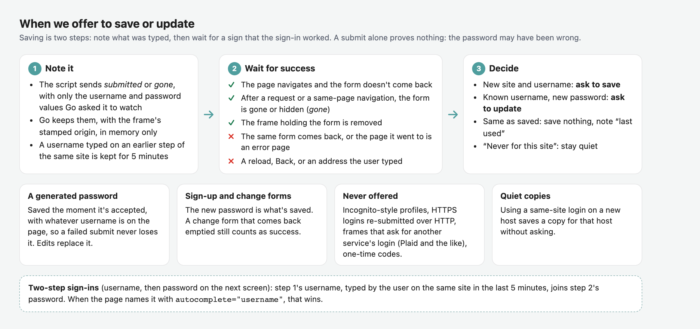

# Saved passwords and autofill: how others do it, and what Project B should do

Research for a design discussion, 2026-11-17, and what the owner has decided since. What is built of it is listed first. It covers how Chromium's
password manager, Safari with iCloud Keychain, Firefox, 1Password and Bitwarden find sign-in
fields, decide when to save, decide when to fill, generate passwords, and what attacks shaped
them. It ends with recommendations for Project B, each with its reason, and the questions for
Sudipta.

The detailed notes, with a file and line or a link for every fact, are in
[password-autofill/](password-autofill/):
[chromium.md](password-autofill/chromium.md) (read from our Chromium 155 checkout),
[safari.md](password-autofill/safari.md) (WebKit, Apple's docs and the macOS 26 SDK),
[firefox.md](password-autofill/firefox.md) (mozilla-central and Bugzilla), and
[managers.md](password-autofill/managers.md) (Bitwarden's source, 1Password's docs, and the
research papers).

## What is built

- **The store, sync and Settings' Passwords** ([passwords.md](passwords.md)): saved logins
  sealed in the profile's store, brought from other browsers, synced end to end encrypted,
  listed on a Mac and a phone.
- **Step 1 of filling, 2026-11-22: the page side and Go's rules, with no engine yet.**
  - `core/forms`: the page protocol's messages (`forms.go`), and `Roles`, which works out
    each field's role and each form's kind from what the form script reports (`roles.go`,
    its table of forms in `roles_test.go`). Since 2026-11-23 what a field is comes from
    DuckDuckGo's matching ([Detection](#detection)); the rules written here first are gone.
  - `core/forms/page/forms.js`: the form script. `shell/e2e/form-script.cjs` runs it in a
    real page.
  - `core/cmd/pwlab`: the test bench. `go run ./cmd/pwlab -extension /tmp/pb-form-lab
    -anywhere asha:made-up-password` from `core/` writes the test extension to that folder
    and answers it; in any Chrome, Extensions, Developer mode, Load unpacked, that folder.
    Its popup shows, for the page in front, the roles Go found in each frame and a button
    to fill a test login; the terminal says each thing the page side told. It holds test
    logins only, and tells a sent password by its length alone.
    `shell/e2e/form-lab.cjs` runs the whole of it in a real Chromium.
- **Filling, 2026-11-22**, on the Mac's Standard shell and the phone's Mobile shell:
  - **The carrier in the engine.** Go gives the engine the form script once
    (`Engine.SetFormScript`, `set_form_script`); the renderer runs it at document start in
    every frame of a web page, in a world of its own (`kFormsWorld`,
    `engine/common/worlds.h`), with its send function bound only in that world's context
    (`Forms` in `engine/common/renderer_client.cc`). A message reaches the browser on the
    frame's own channel (`FrameHost.FormMessage`), which stamps it from the frame itself
    (`engine/browser/forms.cc`: the tab, the frame, a name for the document that is new
    with each document, the committed origin, the tab's own frame or not, a frame of
    another origin above it, sandboxed or with no origin, https with a certificate that
    checks, and where the frame's view begins in the page) and tells Go
    (`PB_EVENT_FORM_MESSAGE`, `Listener.FormMessage`). Go's messages go back with
    `Engine.SendForm` (`form_send`), only to the document named. A page of ours, and a
    frame with no address of its own, run no script.
  - **Go's filling** (`core/passwords/fill.go`): `Filler` keeps what each document told,
    offers the frame's logins at a pressed field of a sign-in (`Manager.Matching`,
    `MayFill`), moves through them with the field's arrow keys, and fills a pick with
    `passwords.Checked`, so nothing asks the device to check the person.
    `core/app/password_fill.go` wires it to the engine and the tab's shell.
    On a page that isn't https with a certificate that checks, the offer says so
    (`insecure`), and the list carries one line over the logins: what is filled there
    could be read on the way. It is the address field's own "Not secure" rule, localhost
    included.
  - **The shells.** Standard: `PasswordOffer.vue`, the design system's floating menu under
    the field. Mobile: `PasswordBar.svelte`, chips in a bar over the foot of the page,
    above the keyboard when it is up. The state and the messages are in
    [shells.md](shells.md) (`passwordOffer`, `passwordPick`, `passwordAt`,
    `passwordDismiss`, `passwordsManage`).
  - **The keys.** The page keeps the keyboard while a list shows. Go asks the form script
    for the field's arrow keys, Enter and Escape (`keys`), and the script tells each
    (`key`) and keeps it from the page; Enter only once an arrow has moved, so before that
    it still sends the page's form.
  - **Tests:** `core/passwords/fill_test.go`, `TestFillingASavedLogin` in `core/app`,
    the ABI's event test; `shell/e2e/password-fill.cjs` and `password-fill-mobile.cjs` on
    the mock engine, where the test plays the form script; `tools/drive_first_app.py
    filling` on the real Mac app (a real sign-in page, real presses and keys);
    `tools/drive_android.py passwords_on_the_phone` on an emulator.
- **Save and Update, 2026-11-22**, on both shells:
  - **When.** Go asks the form script for the values of the fields it took for a role, and
    no others (`watch`), so a form that is sent, or that goes, tells them (`submitted`,
    `gone`). A form sent proves nothing: Go only notes what it held, in memory. It offers
    once the sign-in is seen to go through: the form went with its page staying (`gone`),
    or the tab went on and the page it came to, once loaded, showed no sign-in again within
    two seconds (`passwords.Settle`). A sign-in that comes back to a sign-in offers nothing.
  - **What.** A login saved as it is offers nothing, and counts as used. A saved username
    with another password offers Update, which gives that login the new password. Anything
    else offers Save. A username sent alone, the first step of a sign-in in two, is kept
    for five minutes for the password that follows on the same site in the same tab.
  - **Where not.** Nothing is offered where nothing is filled (`MayFill`: a frame with no
    origin of its own, https under a certificate that doesn't check), for a password of
    one character, which is a box of a code split in pieces, or on a site the person said
    Never for (`logins_never`, in the profile's store; saving a login for the site by
    another way ends it). A saved login's new password is still offered there.
  - **The answer** (`core/passwords/save.go`: `Filler.Answer`, `Manager.Add`, `Change`,
    `Never`): Save or Update, Not now, which keeps nothing, and Never for this site. The
    offer holds no password; Show asks Go for what was typed (`Filler.Typed`), which goes
    to the asking shell alone. An offer stays while its tab stays on the site it was made
    on, and goes when it is answered, another sign-in is sent in the tab, the tab goes to
    another site, or closes; Go then forgets what was typed.
  - **Never, undone.** Settings' Passwords lists the sites under Never saved, each with
    Remove (`Manager.NeverSites`, `Allow`; `passwordNeverRemove`). The list stays on the
    device: it doesn't sync.
  - **The shells.** Standard: a key in the address field, with `PasswordSavePanel.vue`
    hanging from it as the star's panel does, open as the offer comes; Escape or a press
    outside closes the panel and the key brings it back. Mobile: `PasswordSaveSheet.svelte`,
    the shell's bottom sheet; a tap outside it or a swipe down is Not now. The state and the
    messages are in [shells.md](shells.md) (`passwordSave`, `passwordSaveShown`,
    `passwordSaveAnswer`, `passwordSaveShow`).
  - **Tests:** `core/passwords/save_test.go`, `TestSavingALoginSignedInWith` in `core/app`,
    `shell/e2e/password-save.cjs` and `password-save-mobile.cjs` on the mock engine, where
    the test plays the form script.
- **Not built:** the key in the address field with the site's count; the generator;
  Android's switch to another service; saving a generated password before its form is
  sent.

## Detection

Decided 2026-11-22 and 23, the owner: asked "did we do any research on available libraries
for autofill detection", then "yes switch to ddg detection", and "make it so that we can just
pull the latest one from theirs during every release or during every upgrade content".

- **What finds the fields is DuckDuckGo's matching**
  ([duckduckgo/duckduckgo-autofill](https://github.com/duckduckgo/duckduckgo-autofill), Apache
  License 2.0), not rules of ours: their `Matching`, a table of selectors and words in many
  languages that takes each field for a username, a password (new or current), a code, an
  email address and so on, and their `FormAnalyzer`, which judges a form a sign-in or a
  sign-up. Both are used as they publish them. Their `Scanner` and `Form` are left out: they
  belong to their apps and draw into the page.
- **Our glue** (`core/forms/page/matching/entry.js`) calls the two the way their own Scanner
  and Form do: it groups fields into forms as their `getParentForm` does, and keeps their
  rule that in a sign-in with a password and no username, the one field that is unknown, a
  phone or a card number is the username. It reads the page and changes nothing in it: no
  attribute is set and nothing is listened for.
- **The form script is the adapter** (`core/forms/page/forms.js`): it asks the matching what
  each field is and reports that with the facts it already tells, as `guess` ("username",
  "password", "password.current", "password.new", "totp", "email") and `group`, the element
  taken for the field's form. Nothing else of the matching leaves the page.
- **Go still decides** (`core/forms/roles.go`): which of two or three password fields is the
  current one, the new one and its confirmation; which username goes with them, an email
  address beside a password being one; what the form is for; and that nothing a person can't
  see gets a role beside something they can. Offering, filling and saving are unchanged.
- **Built in, not fetched at run time.** `tools/form-matching.sh update` fetches their latest
  (or `update <commit>`), bundles the glue with their matching into
  `core/forms/page/matching.gen.js` (about 59 KB; Go embeds it before the form script), keeps
  their licence in `core/forms/page/matching/LICENSE`, scores the result, and records their
  commit, the file's SHA-256 and the scores in `core/forms/page/matching/SOURCE.json`.
  **Run it at each release and with each new version of content**, then `tools/test.sh mock`,
  and commit the three files. `tools/form-matching.sh check`, in the mock tests, fails when
  the built file isn't the one recorded.
- **The measure** is their own 564 saved forms, each field labelled by hand: the form script
  runs over each in a real Chromium with the network shut, Go gives the roles
  (`core/cmd/formroles`), and `tools/form-matching/score.py` counts them against the labels.
  Before and after the switch, on 2026-11-23, their matching at `4e39741`:

  | | Our own rules, before | Their matching, after |
  |---|---|---|
  | Password fields found, of 595 | 568 | 581; 13 of the rest are hidden in the page |
  | New and current passwords confused | 13 | 2 |
  | Username fields found, of 426 | 349 | 362 |
  | Other fields wrongly given a role, of 1,183 | 17 | 4 |

  Their rules were tuned on these forms and ours never saw them, so the comparison flatters
  theirs. A field hidden in the page is passed over on purpose. Their matching names all 8
  of the corpus's one-time code fields; Go gives one a role only beside a sign-in (2 of the
  8), as nothing is done with codes yet.
- **On live pages** nothing changed: of 25 sign-in pages read on 2026-11-23 with the old rules
  and the new (`core/cmd/pwlab`), every one read the same.
- **What it costs a page:** about 1 ms a frame to load on a Mac, and about 12 ms to read a
  page that has fields.

## The short version

- **Decided: our own form script in each frame, as the extension managers do it, with Go making
  every decision and the shell drawing every prompt.** No Chromium autofill or password manager
  code. The script and Go speak one page protocol, so the script can be swapped, run as a test
  extension in any Chrome, or later replaced by Chromium's form code giving Go the same facts.
  ([The shape](#the-shape))
- **Fill only when the user presses a field and picks a login. Never on page load.** Everyone
  who studied fill-on-load says it leaks passwords, and Chromium already refuses it on phones.
- **Draw the suggestion list outside the page.** In 2025, ten of eleven password managers leaked
  logins because their menus were drawn inside the page, where a script could fade them and
  steer the click.
- **Match by the frame's own origin.** Show other hosts of the same site with the site named.
  Show a short list of known related sites only after a confirmation.
- **Keep the passwords sealed with a key in the OS's key store** (the Mac's login keychain,
  Android Keystore). Keep a list without passwords beside them for the UI and for sync.


---

## How each one does it

### Finding the fields

| | Chromium | Safari | Firefox | Bitwarden / 1Password |
|---|---|---|---|---|
| `autocomplete` | Used, after an ML model and Google's server predictions | First: Apple tells sites to tag `username`, `current-password`, `new-password`, `one-time-code`. Ignores `autocomplete=off` | Barely: only `username` and `new-password` matter | Bitwarden: used first. 1Password: not public |
| Without it | Counts password fields and compares values: one is a sign-in, two equal are new plus confirm, two different are old plus new. The username is the nearest text field before the password | Walks focus order: the text field before a password is the username; an empty second password is the confirm | Same idea as Chromium, plus a trained model for "is this a new password" | Bitwarden: keyword lists (`register`, `confirm password`, `kennwort ändern`…) on names, labels and nearby text. 1Password: "rules, heuristics, even machine learning" |
| Learned from users | Google's crowdsourcing server: hashed form shapes in, field types out. Needs a Google API key | Apple tests its heuristics on an archive of live pages | No | Bitwarden: a new per-site selector feed |
| One-time codes | Recognised and kept out of passwords; no filling | Codes from Messages and Mail, shown for three minutes; a code ending `@site.com #123456` only on that site | Not handled (bug open since 2019) | Fill or copy TOTP codes the manager stores |

**What it teaches us.** Tags first, then a short set of structural rules. The rules don't need
machine learning or a server to cover ordinary forms, and Chromium's are written down with unit
tests we can reuse as our test table. Apple publishes per-site fixes (MIT licence) that every
manager borrows: password rules for 460 sites, 133 entries for sites that share one login,
change-password addresses, sites that append a 2FA code to the password, and payment frames that
ask for another service's login.

### Sign-in, sign-up or change

Nobody has a separate classifier. **The kind follows from the roles found**: a username and a
current password is a sign-in; a username and a new password is a sign-up; a current and a new
password is a change; a new password alone is a reset; a username alone is step one of a
two-step sign-in. The hard part is telling "new" from "current" without tags, which is the
value comparison above, keyword lists, or a model.

### When to offer to save



- **A submit is not proof.** Chromium only notes the form on submit, then calls the sign-in
  successful when the page moves on and the form doesn't come back, or, after a fetch, XHR or
  same-page navigation, when the form is gone or hidden. An error status or the same form
  coming back means it failed. Firefox does nearly the same. Bitwarden, being an extension,
  watches POST responses and falls back on a 1.5-second timer. Apple's newest API names the same
  triggers: the user asked, the form disappeared, or a generated password was filled.
- **Single-page apps** are covered by the "form disappeared after a fetch" rule. Everyone
  converged on it.
- **Two-step sign-ins.** Chromium keeps a username typed on the same site for 5 minutes and joins
  it to the next password. Bitwarden carries it per tab. Firefox still can't (bug open since 2006).
- **Update** is asked when the username is known and the password differs. Chromium always asks
  for updates. It saves without asking only a generated password, and a copy when a same-site
  or related-site login is used on a new host.
- **Generated passwords are saved before the form is sent**, by Chromium, Firefox, Safari and
  Apple's API alike. If the sign-up fails or isn't detected, the password still isn't lost.

### When and how to fill


- **Fill on page load.** Chromium does it on the desktop only for an exact match on an HTTPS main
  frame, and even then the page's scripts can't read the value until the user's first gesture.
  It never does it on phones. Firefox does it under similar limits, and its own engineers have an
  open proposal to remove it. Bitwarden has it off by default, with the warning "Compromised or
  untrusted websites can exploit autofill on page load". 1Password and Safari never do it.
- **Why fill-on-load is dangerous.** The 2014 study by Silver, Jana and Boneh stole about ten
  passwords a second with hidden frames to many login pages ("sweep attacks"). Tracking scripts
  have been caught adding invisible login forms to read the email address a manager fills.
- **Iframes.** Chromium waits for a pick in any frame with a cross-origin parent, and refuses
  about:blank, srcdoc, data: and fenced frames outright. Firefox refuses to fill cross-origin
  frames. 1Password refuses logins there. Bitwarden asks "The form is hosted by a different
  domain…", after Flashpoint showed in 2023 that it filled them. **The lesson everyone learned
  separately: judge a frame by its own origin, never by the tab's address.**
- **Matching.** Everyone matches the same origin. Chromium and Firefox show other hosts of the
  same site (Public Suffix List) in the list only. Bitwarden matches the whole registrable domain
  by default, which Flashpoint abused through shared hosting, and it now blocks `google.com`
  logins on `script.google.com`. Related sites come from Google's affiliation server (Chromium),
  Apple's shared-credentials list (Safari, and free for anyone), a Mozilla list (Firefox, off by
  default) or a 22-group list (Bitwarden).
- **The menu.** Chromium draws its list in the browser, outside the page, and ignores clicks in
  its first 500 ms. The extensions draw theirs inside the page, which is why Marek Tóth's 2025
  clickjacking research made them invisible and still clickable: 10 of 11 managers leaked
  logins, 9 leaked TOTP codes, 8 leaked passkeys. Bitwarden has fixed it. 1Password was still
  listed in January 2026 and calls it "a browser-level limitation".

### Generated passwords

| | Default | Site rules |
|---|---|---|
| Chromium | 15 characters, letters and digits, no look-alikes (`l I 1 O 0 o`) | Learned from Google's server, by a hashed domain |
| Safari | 20 characters as `hupvEw-fodne1-qabjyg`: one capital, one digit, two hyphens, 71 bits. Easy to type on a phone; the hyphen satisfies "needs a symbol" | The page's `passwordrules` attribute, plus Apple's list of 460 sites |
| Firefox | 15 characters, no look-alikes | Apple's list |
| Bitwarden | 14 characters, no symbols | None |

### Storage

| | Where | Sealed with |
|---|---|---|
| Chromium | SQLite in the profile. No stable id per login | One AES key; on the Mac it is a "Safe Storage" item in the login keychain. On Android, Chrome hands passwords to Google Play Services; Chromium's own database isn't even built there |
| Safari | The keychain, one item per login, synced end-to-end | Per-item keys through the Secure Enclave |
| Firefox | `logins.json`: a GUID, three timestamps and a use count per login | A key in `key4.db`, sealed by the optional primary password. Without one, the two files decrypt everything |
| Bitwarden, 1Password | Their own vaults | The user's master password |

For a browser **other than Safari**, the Mac's Passwords app is closed. There is no public API to
read or fill iCloud passwords for websites. Chrome, Firefox and Edge get them only through Apple's
"iCloud Passwords" extension and a system helper that Apple limits to a signed list of browsers.
The only public route in is the user exporting: a CSV file today, or Credential Exchange on
macOS 26, which needs a credential provider extension on our side.

---

## The shape

**Decided 2026-11-18.** The owner: "i donot want to bring chromium in for this feature", and
"the go side and the script side should be decoupled behind an interface so we can later change
the script or use chromiums script to give go the same sets of information... for now we go with
script based detection and refer the research... we should also be able to easily bundle this as
an extension for testing purposes".

Three ways were compared:

| | A. Chromium's whole password manager | C. Chromium's renderer agents, Go's decisions | **D. Our own form script, Go's decisions** |
|---|---|---|---|
| What we link | `password_manager` and `autofill` with sync, signin and optimization_guide: several hundred thousand lines | The renderer agents: about 31,000 lines | Nothing |
| What we write | Two client classes, a store backend, all UI, the glue //chrome normally has | Three Mojo drivers (about 37 calls), Go's rules, the store, all UI | A form script, one engine call, Go's rules, the store, all UI |
| Who decides | C++ in the browser process | Go | Go |
| Risk | Large, and its decisions sit outside Go | Chromium-internal Mojo calls change under us at each update | Edge cases are ours to find: Bitwarden's form reading and field sorting are about 3,600 lines of TypeScript |

**D is how the extension managers work** ([managers.md](password-autofill/managers.md)), and
how Firefox's own manager works ([firefox.md](password-autofill/firefox.md): a JavaScript
actor per frame reads and fills, the parent decides). A content script in each frame reads
the fields, watches for a submit and fills on command; the extension's background, told by
the browser which frame sent each message, decides. Their one weakness, a menu drawn inside the
page, we don't share: our shell draws it.

What Chromium's agents had that D gives up: hiding a filled value from the page's scripts until
a gesture. It only matters for filling on load, which we don't do (recommendation 2).

### The pieces

- **The form script** (JavaScript, ours). Injected into every frame in an isolated world of its
  own, the way [sparks](site-features.md#sparks) are, so the page's scripts can't see or call it.
  It reports facts and fills on command. It knows nothing of logins and decides nothing.
- **The carrier** gets the script's messages to Go and Go's back, and adds what the page can't
  fake. In Project B it is the engine: the script reaches it through one new `FrameHost` call
  bound only in the script's world, and the engine stamps each message.
- **Go** (`core/passwords`) works out each field's role and the form's kind from the facts, using
  the rules in the research (tags first, then Chromium's and Apple's structural rules, then
  Apple's per-site fixes), matches, decides, stores, and drives the shell.
- **The shell** draws the list, the prompts and Settings, outside the page.

### The page protocol

The one interface between the page side and Go. The owner, 2026-11-18: "for now username and
password is fine later we should be able to expand this to generic autofill like address credit
card etc too". So nothing in it is about passwords: it carries fields, roles to watch and values
to fill. Go's form layer (`core/forms`) owns the protocol and the carriers and works out each
field's role; `core/passwords` is the first thing using it, and addresses or cards later would be
others, with roles of their own. Each message is JSON. Go's side of it is a Go
interface in `core/passwords`; nothing in Go knows which page side or carrier is on the other
end.

**Stamped by the carrier, on every message from the page side:** the tab, a frame id, the
frame's committed origin, whether it is the top frame, whether any parent is of another origin,
whether the frame is sandboxed or opaque (about:blank, srcdoc, data:), and whether its
certificate is good. A field from the page naming an origin is ignored; only the stamp counts.

**From the page side:**

- `fields`: the frame's fields, sent when it has some and again when they change. Each has a
  ref (the script's own id, per frame), its form's ref (or none), tag, type, name, id,
  autocomplete, placeholder, label, aria-label, nearby text, maxlength, whether it was ever a
  password field, visible, focusable, read-only, and whether it is empty. Each form has a ref,
  its action and method, and the text of its buttons. No values.
- `pressed`: a field was pressed or focused by the user; its ref and box, in the frame. The
  carrier turns the box into window coordinates.
- `submitted`: a form was sent (its submit event, a press on a button that looks like submit, or
  Enter in a field), with the values of the fields Go asked to watch.
- `gone`: a form was removed or hidden after a request, with the same values.

**From Go:**

- `watch`: the refs whose values to send with `submitted` and `gone`: only the fields Go took for
  a role something uses, which for now is a username or a password. Nothing else on the page
  ever leaves it (decided 2026-11-18).
- `fill`: values for refs. The carrier delivers it only to the same document that sent the
  fields (Bitwarden's rule: a frame that has navigated since gets nothing), and the script
  fills only fields still visible and focusable, then answers `filled` with the refs it filled.

Whether a sign-in went through comes from the carrier too: Go already hears each navigation of
the tab.

### Carriers

- **Project B's engine,** as above. The first one built.
- **A test extension** for any Chrome, Project B with extensions on, or stock Chrome. The same
  script is its content script, unchanged; its service worker is the carrier, stamping from
  `sender.origin`, `sender.frameId` and `sender.tab`, as the browser fills them in. It connects
  to a small Go program (`core/cmd/pwlab`) on 127.0.0.1 (decided 2026-11-18), a dummy password
  manager: the real `core/forms` and `core/passwords` rules over a store of test logins, so detection
  and decisions can be tried on real sites without building Chromium. Its toolbar popup lists
  what Go found on the page and offers the matching logins (an extension can't draw outside the
  page; the popup is the nearest thing, and it's a test tool).
- **Later, if wanted,** Chromium's renderer agents with a driver that turns their messages into
  the same protocol.

---

## Recommendations

Each is a proposal for the discussion. The reason follows each one.

1. **Shape D** (above, decided). Our own form script in each frame, the page protocol, and the
   manager in Go as `core/passwords`.
2. **Fill on press only.** Pressing a sign-in field shows the list. Picking a login fills it.
   Nothing fills on load, on any platform. *Why:* sweep attacks and form-harvesting scripts need
   fill-on-load. Safari and 1Password never had it, Chrome on phones never has it, Firefox is
   debating dropping it, and Bitwarden warns against it. The cost is one click on the desktop.
   To keep that cheap, a page with exactly one matching login opens the list when the field is
   focused, but still fills nothing until it is picked.
3. **The list is drawn by the shell, outside the page**, as Standard's and Mobile's other popups
   are. It shows the frame's site whenever that differs from the tab's, and ignores clicks in its
   first 500 ms, as Chromium does. *Why:* the 2025 clickjacking results, and Silver's "trusted
   browser UI that JavaScript cannot interact with".
   **Decided 2026-11-18** (2 and 3, and 4 below): "nice i like the design and plan". The key
   that marks saved logins, in the list and in the address field, is a line icon in the design
   system's style (16px at a 1.5px stroke, in `--icon`; 14px at 1.4 in the address field's
   right end, as the popups-blocked button), never an emoji. The address field keeps its
   site-settings slot at the start ([design-system.md](design-system.md#the-address-fields-slot)).
4. **Matching by the field's frame, as in the [fill rules](screenshots/passwords/fill-rules.png):**
   - the same origin, first;
   - other hosts of the same site, with "saved for …", and a copy saved once used;
   - Apple's shared-credentials groups, under "From related sites", after a confirmation;
   - an HTTPS login never on HTTP; an old HTTP login may fill its own host on HTTPS;
   - nothing with a certificate error, and nothing in about:blank, srcdoc, data: or sandboxed
     frames.

   *Why:* this is Chromium's and Firefox's rule set, plus Bitwarden's lesson about frames and
   shared hosting. Apple's list is open, needs no server, and Apple's rule for it, "only when the
   site it was saved for is clearly stated", is the confirmation.
5. **Field detection, in Go, from the script's facts: tags first, then the structural rules
   Chromium and Safari use, then Apple's per-site fixes.** No crowdsourcing server. *Why:* the server needs Google's keys and sends form hashes
   to Google. Tags and structure cover ordinary forms. Apple's MIT-licensed fixes are the curated
   part, shipped with each release.
6. **Saving uses Chromium's success signals** ([picture](screenshots/passwords/save-flow.png)):
   Save, Update, Not now, Never for this site. A username typed in the last 5 minutes on the same
   site joins a two-step sign-in. Nothing is saved from frames that ask for another service's
   login (Apple's list: Plaid and the like). Sites that add a 2FA code to the password don't get
   Update prompts. *Why:* "a submit proves nothing" and "the form went away" are where every
   product ended up.

   **Decided 2026-11-18:** "flow fine".
7. **The generator, only on demand, in several kinds** ([picture](screenshots/passwords/generate.png)).
   **Decided 2026-11-18:** "generates password only on demand... with a generate item..
   generate different types of password like alphanumeric.. with num.. with symbols etc.. so
   that its easy to pick one based on the requirement".
   - **Asked for, never offered.** One Generate password row (the key icon with a small +, so it
     reads as a new key beside Manage passwords', never a sparkle, which reads as AI) in the list on a password field,
     under any saved logins and above Manage passwords…, the same in the right-click menu, and a
     Generate chip in the phone's logins bar. Nothing opens by itself, on a sign-up or anywhere.
   - **Minimal, in the same list** (the owner: "make it minimal... these are components of a
     native browser so it should be efficient in space also"). Generate opens in place: a
     heading row with − length + and ↻ for new ones, then one 32px row per kind, the password
     in `ui-monospace` (so l, 1, I, 0 and O differ) with a short muted tag: `abc 123` letters
     and numbers, `abc 123 #!` with symbols, `easy` (Apple's `xxxxxx-xxxxxx-xxxxxx`, without l,
     1, I, 0 or O, as it is typed by hand). A `123` row, numbers only, joins only when the field
     asks for digits (`inputmode="numeric"`, or a pattern or `passwordrules` of digits only), at
     the length its rules set. Length 20 to start, from 8 to 64 or what the rules allow, − or +
     dimmed at the end; the buttons are named Shorter, Longer and New passwords. On a phone the logins bar
     grows into the same rows above the keyboard, 44px each, its buttons 44px targets; no sheet. The owner, on this
     drawing, 2026-11-18: "generate ui looks nice"; ux's review the same day changed the icon,
     the tags and the numbers row.
   - **The page's rules narrow it:** a kind its `passwordrules`, `maxlength` or `pattern` rules
     out is left out, and the length starts within them; Apple's site rules fill in for pages
     that don't say.
   - **Picking one** fills the field and its confirm field and saves the login at once, before
     the submit. Escape goes back to the list; nothing is filled until one is picked.

   *Why the save at once:* Chromium, Firefox, Safari and 1Password all save a generated password
   before the submit, so a form that fails or a tab that closes never loses it.
8. **Storage: a simple base first, features on top** (the owner, 2026-11-18: "check the
   synckosh for ideas about sealing and storing secrets... design a simple clean base then add
   features later"). Proposed, the same on both platforms:
   - **A login is a synckosh item**, as [synckosh](https://github.com/sudiptadeb/synckosh)'s
     SPEC defines it: collection `logins`, datatype `login`, a UUIDv7 id, the time of its last
     edit. Plain (the public part): the site's origin and when it was saved. Sealed (the private
     part): the username and the password.
   - **Each login is sealed on its own** with synckosh's seal: XChaCha20-Poly1305 under the
     profile's data key, with the item's collection, datatype, id and time bound in, so a login
     can't be read, changed, swapped for another or moved without the key. One damaged login
     loses that login, not the rest.
   - **The data key:** 32 random bytes, one per profile, kept in the OS's key store (on the Mac
     an ordinary item in the login keychain, which another app reaches only after the Mac asks
     you; on Android wrapped by a Keystore key). Never shown, never exported. **Decided
     2026-11-18:** "lets not go the app only level for now... since we cannot give the same level
     in windows and linux".
   - **One file in the profile,** `logins.json`, the list of items, rewritten whole on each change
     (a temporary file, then a rename).
   - **Kept apart, local only:** when each login was last used, so filling isn't an edit; and the
     Never for this site list, plain sites in the profile's prefs.

   *Why:* matching needs only the site, so the site stays plain and nothing is opened until a
   login is filled or shown. The username is sealed too: it says who you are on which site.
   Using synckosh's item and seal now means sync, later, sends these items as they are, with no
   second format and no conversion.

   **Later, on top, without changing the base:** Touch ID or the device's lock before Show, Copy
   and Export, and "Ask before filling" (below); Export; a backup code (synckosh's passphrase
   copy of the key); sync (the bucket's key, the same items); old passwords kept on change;
   notes; passkeys.
9. **Touch ID or the device's lock: for Settings, never for a fill.**
   - Before Show and Copy in Settings, once for the page, held five minutes
     ([passwords.md](passwords.md)).
   - A fill asks nothing: picking a login from the list fills it. There is no "Ask before
     filling" setting.
   - A locked profile is the keys' business, not filling's: filling asks for the password
     through the one call that opens it, and when a profile is locked that call is what
     asks for the passphrase.

   **Decided 2026-11-22**, the owner: "filling doesnot ask for fingerprint... only if
   profile is locked we can ask the passphrase but that should come automatically from we
   calling the get password call not something we should be worrying about". So filling
   opens a password with `passwords.Checked`, which has no device check, and adds no
   unlock logic of its own.
10. **Phones.** Keep our own manager. Later, add Chrome's "Autofill using another service" switch,
    which sends forms to Android's autofill framework through Chromium's `android_autofill`, as
    WebView does. Then 1Password and Bitwarden users get their own manager in Project B. *Why:*
    Chrome made this switch in version 135, and it is cheap for us. The AutoSpill lesson (2023)
    is that every field needs its own frame's web domain, and Chromium's code already does that.
11. **Not in the first version:**
    - one-time codes (the field is recognised and left alone);
    - passkeys;
    - leak checks;
    - iCloud Passwords.

    Each is its own later piece. For Apple users, importing a CSV from the Passwords app is the
    way in, through onboarding's importers.

### The UI

From the ux session's review, 2026-11-18. The pictures follow it.

- **The list** ([picture](screenshots/passwords/fill-desktop.png)) is the shell's float menu, as
  the command box's suggestions are: a row per login with the key, the username and the
  password's dots; ↑↓ choose, Enter fills, Escape closes; Manage passwords… at its foot. The key
  at the address field's right end counts the logins this frame's site has, the same number
  the list shows.
- **Save and Update on a desktop** ([picture](screenshots/passwords/save-desktop.png)) are the
  same panel as the bookmark star's ([bookmark-folders.md](bookmark-folders.md)), hanging from
  the key as that one hangs from the star: the username with a person icon, the password with
  a lock and Show. Save is the primary button on the right, Not now beside it, Never for this
  site a quiet text button on the left. **Enter saves; Escape or a press outside closes it with
  nothing saved**, which counts as Not now. Save's words are `--on-accent`, white or the ink as
  gulal picks for the accent by APCA (the owner, 2026-11-18: "the save button is wrong", then
  "we are following gulal for color decisions"; branch `tones-apca`). On the teal frame they
  are white.
- **On a phone** ([picture](screenshots/passwords/phone.png)) the logins are chips in a bar of
  the Mobile shell's, just above the keyboard, following
  [Bars that hide on scroll](shells.md#bars-that-hide-on-scroll). The key at the bar's end opens
  Passwords in Settings and is named Manage passwords (on the desktop the key means this site's
  logins). Whether the foot bars stay
  while the keyboard is up is still the owner's open question, so both are drawn. Save and
  Update are the shell's sheet, as the bookmark sheet is, with the desktop panel's fields and
  Never for this site as a text button.
- **No second row of logins on Android.** Android's autofill framework and the keyboard's inline
  suggestions (Gboard's chips) only see a page's fields when the browser describes them to
  Android, which Chromium's `android_autofill` does for Chrome and WebView. We don't link it, so
  for web pages neither Android's autofill menu nor the keyboard's suggestions appear, and our
  bar is the only one. The address field and our own pages are ordinary Android text fields and
  keep the keyboard's usual suggestions. If the "use another service" switch comes later (10),
  turning it on hands the fields to Android and our bar steps aside.
- **Settings** ([picture](screenshots/passwords/settings.png)). In the one-page layout, a
  Passwords row under Privacy, with how many are saved on its right, opens a list page of its
  own with a back link, as Sites does: the switches above the list, the logins with the site's
  mark (the letter tile bookmarks use), Import and Export, and a card of its own, Never offered
  on, each site with Remove. In the sections layout, a Passwords section with its own icon,
  after Privacy and sites ([settings.md](settings.md); pictures: [the list page](screenshots/passwords/settings-list.png), [the sections layout](screenshots/passwords/settings-sections.png)).

### The security checklist

| Trap | Who was hit | Our guard |
|---|---|---|
| Fill on load, harvested by hidden frames or scripts | Most managers in 2014; tracker scripts since | No fill on load (2) |
| A menu drawn in the page and clickjacked | 10 of 11 extensions in 2025 | Shell-drawn list, 500 ms click guard (3) |
| A cross-origin frame filled with the tab's login | Bitwarden until 2023; Safari, CVE-2013-5227 | The frame's own origin decides; the engine stamps it (4) |
| Shared hosting on one registrable domain | Bitwarden's base-domain default | Exact origin first; same-site only with "saved for…"; the public suffix list's private section (4) |
| A page lying about its origin | — | Go trusts only what the carrier stamps; the page protocol carries no origin from the page |
| HTTP, or a broken certificate | All, before 2014 | No HTTPS login on HTTP; nothing with a certificate error (4) |
| A password read by the page before the user acts | — | Nothing is filled before the user picks a login (2) |
| A page reaching our script | — | The script runs in an isolated world, and its call to the engine is bound only there |
| A hidden or covered field | Firefox, open since 2016; Chromium has no hard check either | Go skips fields reported as not visible or not focusable, and the script checks again just before filling |
| A frame that navigated between offer and fill | Bitwarden's design rule | The carrier delivers a fill only to the document that sent the fields |
| Credentials leaking from a web view to an app | AutoSpill, 2023 | Each field carries its frame's domain (10) |
| A frame asking for another service's login | Plaid-style aggregators | Never offer to save there (6) |

---

## Questions for Sudipta

1. ~~Shape C~~ **Decided: shape D**, 2026-11-18 ([the shape](#the-shape)).
2. ~~Fill on press only, on the Mac too~~ **Decided: yes**, 2026-11-18, with the matching table.
3. ~~"Ask before filling" off by default~~ **Decided: a fill never asks, and there is no
   such setting**, 2026-11-22 ([recommendation 9](#recommendations)).
4. ~~Save flow as drawn~~ **Decided: "flow fine"**, 2026-11-18.
5. ~~Generator in Apple's format, offered on sure new-password fields~~ **Decided: on demand
   only, in several kinds**, 2026-11-18 ([recommendation 7](#recommendations)).
6. ~~On import, keep the saved login on a clash~~ **Decided: "both stays"**, 2026-11-18.

Settled with other sessions, whichever way these go:

- **Import, for onboarding** (agreed with the imports session, 2026-11-18). In `core/passwords`,
  the same on the Mac and Android, called from `core/app`:

  ```go
  type Login struct {
      Origin   string    // scheme://host[:port]
      Username string
      Password string
      Created  time.Time // zero when unknown
      LastUsed time.Time // zero when unknown
  }
  func (s *Store) Import(logins []Login) ImportResult
  type ImportResult struct{ Added, AlreadySaved, Skipped int }
  ```

  - The store gives each added login its id and modified time, and takes the origin down to
    scheme, host and port.
  - **Skipped:** anything not an http or https origin (Chrome's `android://` entries), an empty
    password, and HTTP authentication logins (a realm), which Project B doesn't fill.
  - **AlreadySaved:** the same login, origin, username and password, is in the store already.
  - **A clash keeps both** (decided 2026-11-18, the owner: "both stays"): a login with the same
    origin and username but another password is added beside the saved one, and counts as
    Added. The list and Settings tell them apart by the date each was saved and last used;
    removing the stale one is the user's call.
  - No unlock is needed: the store's key comes from the OS's key store without a prompt.
  - Not carried: form actions, notes, where a login came from, passkeys, and "never save" entries.
    None is in the store's model.
  - The importers (branch `password-import`) call it through `core/app`'s `PasswordStore`
    interface, set with `App.UsePasswordStore`. When the store lands, its branch adds the small
    adapter from `browserdata.Login` and the call at start.
- **For sync:** a fixed random id and a modified time on each login, plus a change hook carrying
  the login's id.

## Order of work, once agreed

**Decided 2026-11-22**, the owner: "yes auto fill next... and all platforms", and "yes fill
before save and update", "but fast follow": filling ships first, on the Mac, Android and
Linux, and Save and Update straight after it, with nothing else between.

1. `core/passwords`: the base (logins as sealed synckosh items, the profile's key), Import, the Passwords page in Settings
   ([picture](screenshots/passwords/settings.png)). This unblocks onboarding's importers.
2. The form script and the test extension with `pwlab`, so detection is tried on real sites
   first; then the engine carrier; Go's rules; fill on press on Standard
   ([picture](screenshots/passwords/fill-desktop.png)).
3. Save and Update ([picture](screenshots/passwords/save-desktop.png)).
4. Mobile ([picture](screenshots/passwords/phone.png)).
5. The generator.
6. Android's "use another service" switch.
