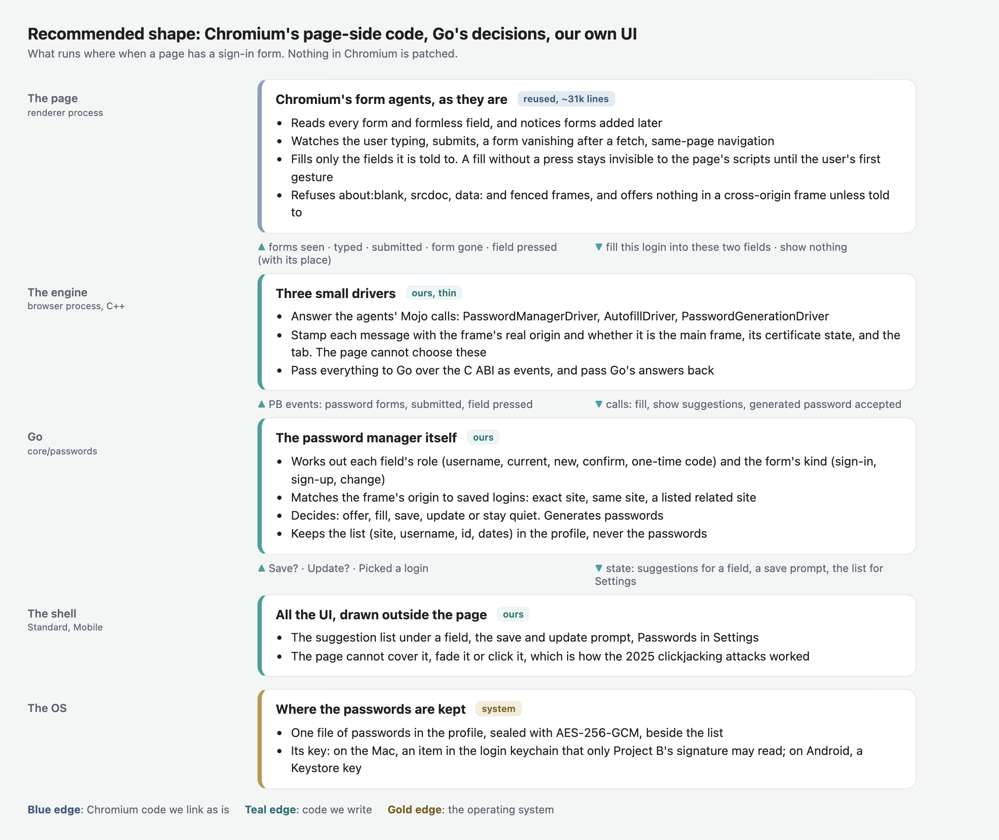
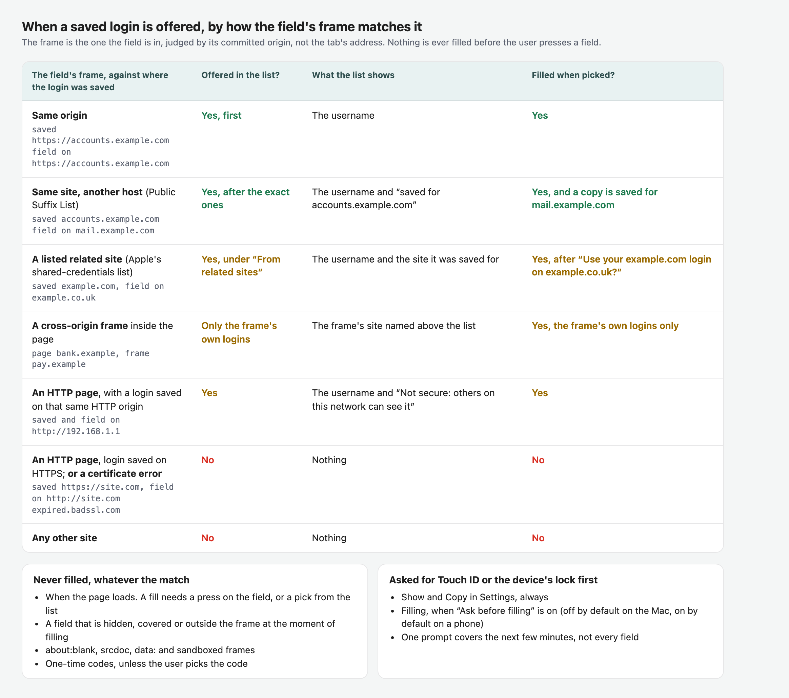

# Saved passwords and autofill: how others do it, and what Project B should do

Research for a design discussion, 2026-11-17. Nothing here is built. It covers how Chromium's
password manager, Safari with iCloud Keychain, Firefox, 1Password and Bitwarden find sign-in
fields, decide when to save, decide when to fill, generate passwords, and what attacks shaped
them. It ends with recommendations for Project B, each with its reason, and the questions for
Sudipta.

The detailed notes, with a file and line or a link for every fact, are in
[password-autofill/](password-autofill/):
[chromium.md](password-autofill/chromium.md) (read from our Chromium 155 checkout),
[safari.md](password-autofill/safari.md) (WebKit, Apple's docs and the macOS 26 SDK),
[firefox.md](password-autofill/firefox.md) (mozilla-central and Bugzilla), and
[managers.md](password-autofill/managers.md) (Bitwarden's source, 1Password's docs, and the
research papers).

## The short version

- **Build it on Chromium's page-side form code, with Go making every decision and the shell
  drawing every prompt.** Chromium's renderer agents already read forms, notice sign-ins and
  fill safely, and they link without the rest of Chromium's password manager. Go reads the
  forms they report, matches sites, decides what to offer or save, and keeps the store. Nothing
  in Chromium is patched. ([The shape](#the-shape))
- **Fill only when the user presses a field and picks a login. Never on page load.** Everyone
  who studied fill-on-load says it leaks passwords, and Chromium already refuses it on phones.
- **Draw the suggestion list outside the page.** In 2025, ten of eleven password managers leaked
  logins because their menus were drawn inside the page, where a script could fade them and
  steer the click.
- **Match by the frame's own origin.** Show other hosts of the same site with the site named.
  Show a short list of known related sites only after a confirmation.
- **Keep the passwords sealed with a key in the OS's key store** (the Mac's login keychain,
  Android Keystore). Keep a list without passwords beside them for the UI and for sync.

---

## How each one does it

### Finding the fields

| | Chromium | Safari | Firefox | Bitwarden / 1Password |
|---|---|---|---|---|
| `autocomplete` | Used, after an ML model and Google's server predictions | First: Apple tells sites to tag `username`, `current-password`, `new-password`, `one-time-code`. Ignores `autocomplete=off` | Barely: only `username` and `new-password` matter | Bitwarden: used first. 1Password: not public |
| Without it | Counts password fields and compares values: one is a sign-in, two equal are new plus confirm, two different are old plus new. The username is the nearest text field before the password | Walks focus order: the text field before a password is the username; an empty second password is the confirm | Same idea as Chromium, plus a trained model for "is this a new password" | Bitwarden: keyword lists (`register`, `confirm password`, `kennwort ändern`…) on names, labels and nearby text. 1Password: "rules, heuristics, even machine learning" |
| Learned from users | Google's crowdsourcing server: hashed form shapes in, field types out. Needs a Google API key | Apple tests its heuristics on an archive of live pages | No | Bitwarden: a new per-site selector feed |
| One-time codes | Recognised and kept out of passwords; no filling | Codes from Messages and Mail, shown for three minutes; a code ending `@site.com #123456` only on that site | Not handled (bug open since 2019) | Fill or copy TOTP codes the manager stores |

**What it teaches us.** Tags first, then a short set of structural rules. The rules don't need
machine learning or a server to cover ordinary forms, and Chromium's are written down with unit
tests we can reuse as our test table. Apple publishes per-site fixes (MIT licence) that every
manager borrows: password rules for 460 sites, 133 entries for sites that share one login,
change-password addresses, sites that append a 2FA code to the password, and payment frames that
ask for another service's login.

### Sign-in, sign-up or change

Nobody has a separate classifier. **The kind follows from the roles found**: a username and a
current password is a sign-in; a username and a new password is a sign-up; a current and a new
password is a change; a new password alone is a reset; a username alone is step one of a
two-step sign-in. The hard part is telling "new" from "current" without tags, which is the
value comparison above, keyword lists, or a model.

### When to offer to save

- **A submit is not proof.** Chromium only notes the form on submit, then calls the sign-in
  successful when the page moves on and the form doesn't come back, or, after a fetch, XHR or
  same-page navigation, when the form is gone or hidden. An error status or the same form
  coming back means it failed. Firefox does nearly the same. Bitwarden, being an extension,
  watches POST responses and falls back on a 1.5-second timer. Apple's newest API names the same
  triggers: the user asked, the form disappeared, or a generated password was filled.
- **Single-page apps** are covered by the "form disappeared after a fetch" rule. Everyone
  converged on it.
- **Two-step sign-ins.** Chromium keeps a username typed on the same site for 5 minutes and joins
  it to the next password. Bitwarden carries it per tab. Firefox still can't (bug open since 2006).
- **Update** is asked when the username is known and the password differs. Chromium always asks
  for updates. It saves without asking only a generated password, and a copy when a same-site
  or related-site login is used on a new host.
- **Generated passwords are saved before the form is sent**, by Chromium, Firefox, Safari and
  Apple's API alike. If the sign-up fails or isn't detected, the password still isn't lost.

### When and how to fill

- **Fill on page load.** Chromium does it on the desktop only for an exact match on an HTTPS main
  frame, and even then the page's scripts can't read the value until the user's first gesture.
  It never does it on phones. Firefox does it under similar limits, and its own engineers have an
  open proposal to remove it. Bitwarden has it off by default, with the warning "Compromised or
  untrusted websites can exploit autofill on page load". 1Password and Safari never do it.
- **Why fill-on-load is dangerous.** The 2014 study by Silver, Jana and Boneh stole about ten
  passwords a second with hidden frames to many login pages ("sweep attacks"). Tracking scripts
  have been caught adding invisible login forms to read the email address a manager fills.
- **Iframes.** Chromium waits for a pick in any frame with a cross-origin parent, and refuses
  about:blank, srcdoc, data: and fenced frames outright. Firefox refuses to fill cross-origin
  frames. 1Password refuses logins there. Bitwarden asks "The form is hosted by a different
  domain…", after Flashpoint showed in 2023 that it filled them. **The lesson everyone learned
  separately: judge a frame by its own origin, never by the tab's address.**
- **Matching.** Everyone matches the same origin. Chromium and Firefox show other hosts of the
  same site (Public Suffix List) in the list only. Bitwarden matches the whole registrable domain
  by default, which Flashpoint abused through shared hosting, and it now blocks `google.com`
  logins on `script.google.com`. Related sites come from Google's affiliation server (Chromium),
  Apple's shared-credentials list (Safari, and free for anyone), a Mozilla list (Firefox, off by
  default) or a 22-group list (Bitwarden).
- **The menu.** Chromium draws its list in the browser, outside the page, and ignores clicks in
  its first 500 ms. The extensions draw theirs inside the page, which is why Marek Tóth's 2025
  clickjacking research made them invisible and still clickable: 10 of 11 managers leaked
  logins, 9 leaked TOTP codes, 8 leaked passkeys. Bitwarden has fixed it. 1Password was still
  listed in January 2026 and calls it "a browser-level limitation".

### Generated passwords

| | Default | Site rules |
|---|---|---|
| Chromium | 15 characters, letters and digits, no look-alikes (`l I 1 O 0 o`) | Learned from Google's server, by a hashed domain |
| Safari | 20 characters as `hupvEw-fodne1-qabjyg`: one capital, one digit, two hyphens, 71 bits. Easy to type on a phone; the hyphen satisfies "needs a symbol" | The page's `passwordrules` attribute, plus Apple's list of 460 sites |
| Firefox | 15 characters, no look-alikes | Apple's list |
| Bitwarden | 14 characters, no symbols | None |

### Storage

| | Where | Sealed with |
|---|---|---|
| Chromium | SQLite in the profile. No stable id per login | One AES key; on the Mac it is a "Safe Storage" item in the login keychain. On Android, Chrome hands passwords to Google Play Services; Chromium's own database isn't even built there |
| Safari | The keychain, one item per login, synced end-to-end | Per-item keys through the Secure Enclave |
| Firefox | `logins.json`: a GUID, three timestamps and a use count per login | A key in `key4.db`, sealed by the optional primary password. Without one, the two files decrypt everything |
| Bitwarden, 1Password | Their own vaults | The user's master password |

For a browser **other than Safari**, the Mac's Passwords app is closed. There is no public API to
read or fill iCloud passwords for websites. Chrome, Firefox and Edge get them only through Apple's
"iCloud Passwords" extension and a system helper that Apple limits to a signed list of browsers.
The only public route in is the user exporting: a CSV file today, or Credential Exchange on
macOS 26, which needs a credential provider extension on our side.

---

## The shape

Three ways to build it, compared:

| | A. Chromium's whole password manager | B. Our own page code | **C. Chromium's page code, Go's decisions** |
|---|---|---|---|
| What we link | `password_manager` and `autofill` with sync, signin and optimization_guide: several hundred thousand lines | Nothing | The renderer agents: about 31,000 lines, needing only `autofill/core/common` and `password_manager/core/common` |
| What we write | Two client classes (39 and 43 required methods), a store backend, all UI, the glue //chrome normally has | A form reader, submit detection, fill, frame checks, all in the page process | Three Mojo drivers (about 37 calls, most ignored), Go's parser and rules, the store, all UI |
| Who decides | C++ in the browser process | Our C++ | **Go** |
| Google-only features | Server predictions, affiliation, leak check: need Google API keys, which aren't for third-party builds | None | None |
| Risk | Large, and its decisions sit outside Go | Years of edge cases: Firefox still has gaps open since 2006 and 2016 | The Mojo calls are Chromium-internal, so a Chromium update can change them; we follow it at each update |

**Recommendation: C.** The page-side code is the hard and security-sensitive part. It reads forms
in shadow DOM and without a `<form>`, catches sign-ins sent by fetch, keeps a filled password
from the page's scripts until a gesture, and refuses odd frames. We get it as is. The browser
side of Chromium's manager is mostly decisions and Google services. Decisions belong in Go, as
everywhere else in Project B, and the Google services wouldn't work for us anyway. Go's parser
is a port of `FormDataParser`'s rules, about 1,700 lines of C++, and Chromium's unit tests become
our test table. The engine already binds its own Mojo interfaces per frame (printing does),
so the drivers follow a pattern we have.

The drivers stamp each message with what the browser knows and the page can't fake: the
frame's committed origin, whether it is the main frame, whether a parent is cross-origin, its
certificate state, and the tab. Go judges only by those.

---

## Recommendations

Each is a proposal for the discussion. The reason follows each one.

1. **Shape C** (above). Reuse Chromium's renderer agents unpatched, write three thin drivers, and
   put the manager in Go as `core/passwords`.
2. **Fill on press only.** Pressing a sign-in field shows the list. Picking a login fills it.
   Nothing fills on load, on any platform. *Why:* sweep attacks and form-harvesting scripts need
   fill-on-load. Safari and 1Password never had it, Chrome on phones never has it, Firefox is
   debating dropping it, and Bitwarden warns against it. The cost is one click on the desktop.
   To keep that cheap, a page with exactly one matching login opens the list when the field is
   focused, but still fills nothing until it is picked.
3. **The list is drawn by the shell, outside the page**, as Standard's and Mobile's other popups
   are. It shows the frame's site whenever that differs from the tab's, and ignores clicks in its
   first 500 ms, as Chromium does. *Why:* the 2025 clickjacking results, and Silver's "trusted
   browser UI that JavaScript cannot interact with".
4. **Matching by the field's frame, as in the [fill rules](screenshots/passwords/fill-rules.png):**
   - the same origin, first;
   - other hosts of the same site, with "saved for …", and a copy saved once used;
   - Apple's shared-credentials groups, under "From related sites", after a confirmation;
   - an HTTPS login never on HTTP; an old HTTP login may fill its own host on HTTPS;
   - nothing with a certificate error, and nothing in about:blank, srcdoc, data: or sandboxed
     frames.

   *Why:* this is Chromium's and Firefox's rule set, plus Bitwarden's lesson about frames and
   shared hosting. Apple's list is open, needs no server, and Apple's rule for it, "only when the
   site it was saved for is clearly stated", is the confirmation.
5. **Field detection: tags first, then Chromium's rules, ported to Go, then Apple's per-site
   fixes.** No crowdsourcing server. *Why:* the server needs Google's keys and sends form hashes
   to Google. Tags and structure cover ordinary forms. Apple's MIT-licensed fixes are the curated
   part, shipped with each release.
6. **Saving uses Chromium's success signals** ([picture](screenshots/passwords/save-flow.png)):
   Save, Update, Not now, Never for this site. A username typed in the last 5 minutes on the same
   site joins a two-step sign-in. Nothing is saved from frames that ask for another service's
   login (Apple's list: Plaid and the like). Sites that add a 2FA code to the password don't get
   Update prompts. *Why:* "a submit proves nothing" and "the form went away" are where every
   product ended up.
7. **The generator makes Apple's format**, `xxxxxx-xxxxxx-xxxxxx` with one capital and one digit
   (71 bits). It follows the page's `passwordrules` and Apple's site rules, and saves the password
   the moment it is accepted. It is offered on its own only when a field is surely a new password
   (tagged, or two empty password fields on a sign-up), and from the right-click menu on any
   password field. *Why:* it fits the most sites, it is easy to type on a phone, and saving before
   the submit never loses one.
8. **Storage, the same on both platforms:**
   - a list in the profile (`passwords.json`): id, origin, username, created, modified, last used,
     and never the password;
   - the passwords in one file beside it, sealed with AES-256-GCM;
   - its key in the OS's key store: on the Mac, an item in the login keychain that only Project
     B's signature may read; on Android, a Keystore key.

   *Why:* it is Chromium's pattern, it works with our own signing key, and it gives sync its ids
   and times. Apple's newer per-item keychain would be stronger, but it needs a provisioning
   profile from an Apple developer account, which our builds don't have. If we get one, the store
   can move without changing anything above it.
9. **Touch ID or the device's lock**
   - always before Show, Copy and Export in Settings;
   - before filling only when "Ask before filling" is on;
   - one approval lasts five minutes.

   *Why:* this matches Chrome. Safari asks before every fill, which is safer but slower.
10. **Phones.** Keep our own manager. Later, add Chrome's "Autofill using another service" switch,
    which sends forms to Android's autofill framework through Chromium's `android_autofill`, as
    WebView does. Then 1Password and Bitwarden users get their own manager in Project B. *Why:*
    Chrome made this switch in version 135, and it is cheap for us. The AutoSpill lesson (2023)
    is that every field needs its own frame's web domain, and Chromium's code already does that.
11. **Not in the first version:**
    - one-time codes (the field is recognised and left alone);
    - passkeys;
    - leak checks;
    - iCloud Passwords.

    Each is its own later piece. For Apple users, importing a CSV from the Passwords app is the
    way in, through onboarding's importers.

### The security checklist

| Trap | Who was hit | Our guard |
|---|---|---|
| Fill on load, harvested by hidden frames or scripts | Most managers in 2014; tracker scripts since | No fill on load (2) |
| A menu drawn in the page and clickjacked | 10 of 11 extensions in 2025 | Shell-drawn list, 500 ms click guard (3) |
| A cross-origin frame filled with the tab's login | Bitwarden until 2023; Safari, CVE-2013-5227 | The frame's own origin decides; the engine stamps it (4) |
| Shared hosting on one registrable domain | Bitwarden's base-domain default | Exact origin first; same-site only with "saved for…"; the public suffix list's private section (4) |
| A page lying about its origin | — | Go trusts only what the engine stamps. Our drivers drop a message whose form names another origin, as Chromium's driver does (it ends the renderer) |
| HTTP, or a broken certificate | All, before 2014 | No HTTPS login on HTTP; nothing with a certificate error (4) |
| A password read by the page before the user acts | — | The renderer's protected value: unreadable by scripts until a gesture |
| A hidden or covered field | Firefox, open since 2016; Chromium has no hard check either | Go skips fields the renderer reports as not visible or not focusable, and asks the agent's `CheckViewAreaVisible` just before filling |
| Credentials leaking from a web view to an app | AutoSpill, 2023 | Each field carries its frame's domain (10) |
| A frame asking for another service's login | Plaid-style aggregators | Never offer to save there (6) |

---

## Questions for Sudipta

1. **Shape C:** do we reuse Chromium's renderer agents, with Go deciding everything?
2. **Fill on press only:** is that right on the Mac too, at the cost of one click compared with
   Chrome's fill on load?
3. **"Ask before filling" off by default,** on both platforms, with Show and Copy always asking?

Settled with other sessions, whichever way these go:

- **Import, for onboarding:** `passwords.Import(logins) (added, skipped)`.
- **For sync:** a fixed random id and a modified time on each login, plus a change hook carrying
  the login's id.

## Order of work, once agreed

1. `core/passwords`: the list, the sealed file, Import, the Passwords page in Settings
   ([picture](screenshots/passwords/settings.png)). This unblocks onboarding's importers.
2. The three engine drivers and Chromium's agents; Go's parser; fill on press on Standard
   ([picture](screenshots/passwords/fill-desktop.png)).
3. Save and Update ([picture](screenshots/passwords/save-desktop.png)).
4. Mobile ([picture](screenshots/passwords/phone.png)).
5. The generator.
6. Android's "use another service" switch.
