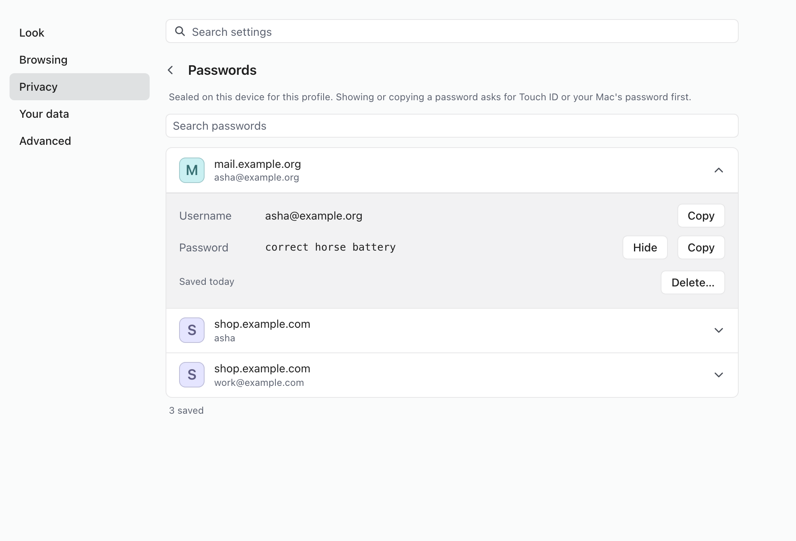

# Passwords

The logins Project B keeps for a profile. **The first slice, built 2026-11-20:** they come
over from another browser or a file, are kept sealed, and are listed in Settings, where one
can be shown, copied and deleted. Filling them on pages, offering to save a new one and
syncing them are not built. The keys under it are in [sync.md](sync.md#the-keys); bringing them over is in
[onboarding.md](onboarding.md).

## His words

- 2026-11-18: "username is not that critical": the site and the username are plain, the
  password is sealed.
- 2026-11-18, on bringing them over: "and password import as a second option under imports
  settings... so we have improt from browsers and imports from file.. like exported bookmarks
  password etc". A login that clashes with one saved: "both stays".
- 2026-11-20: "i need to be able to import passwords", from a browser Project B doesn't know
  by name, through its folder.

## What is kept (`core/passwords`)

One table of the profile's store, `logins`: an id, the site's origin (`scheme://host[:port]`),
the username, the password, when it was saved, last edited and last used.

- **The password is sealed** with the profile key (XChaCha20-Poly1305, `keys.Seal`), bound to
  its row's id and its origin: copied to another row or another site, it doesn't open.
- **The origin and the username are plain,** so the list is read with no key, and asks the
  person nothing.
- **Start fresh deletes them** (`keys.OnStartFresh`): a new profile key opens none.
- A profile whose key doesn't open on this device keeps what it has, shows none of it, and
  takes nothing new.

| Call | What it does |
|---|---|
| `Import(logins) (added, already, skipped)` | keeps what an import read. Already: the same origin, username and password. A login for an origin and username saved with another password is added beside it. Skipped: an origin that isn't a web page's, or no password; all of them when the profile's key doesn't open |
| `List()`, `Total()`, `Get(id)` | the logins without their passwords, by site and then username; how many; one |
| `Password(ctx, id)` | the password, after the device has checked the person (`Verify`): Touch ID or the Mac's password, the phone's screen lock. `ErrNone` for a login that isn't there asks nothing |
| `Delete(id)` | deletes one |

## Settings, Privacy, Passwords

A row under Privacy, over Passkeys: "Passwords", "The logins Project B keeps for your sites",
with how many there are. It opens a list page. **Not on a phone yet:** Android keeps each
app's data from the others, so a phone has no import, and nothing else brings a login to it
until they sync or are saved from a page; its list could only be empty.

- **Over the list:** "Sealed on this device for this profile. Showing or copying a password
  asks for Touch ID or your Mac's password first." (On a phone, when it has the page: "your
  screen lock".)
- **Search passwords:** keeps the logins whose site or username has what was typed. Escape
  empties it. None matching: "No saved password matches “…”".
- **A row a login:** its site's mark, the site, the username ("No username" when it has
  none), and a chevron down. It opens in place, one at a time, on `--accent-tint`:
  - Username, with Copy.
  - Password, hidden as dots, with Show and Copy. Show has the device check the person,
    then the password is there in monospace with Hide, until it is hidden, the row closes,
    another opens, or the window or the page is left: nothing still shows it on return.
    Copy has the device check the person and puts the password on the clipboard in Go, so
    the page never has it for a copy, and marked as a secret (`system.CopySecret`): on the
    Mac the pasteboard's concealed and transient types, which clipboard managers and
    Universal Clipboard's history leave out; on Android the clip's sensitive flag, which
    also hides the system's preview of it from Android 13, written and built into the APK,
    and not yet reached by anything on a phone. A username is copied plainly.
  - A line that says when it was saved, and answers the last press for two seconds:
    "Password copied", "Username copied". With no screen lock on the device, in `--danger`:
    "Set a screen lock on this device to show passwords". A check the person refuses says
    nothing.
  - Delete…, which asks: "Delete this password?", "Your saved password for **site**
    (username) is deleted from this profile. Your account on site isn't changed.", Cancel
    and Delete, the danger.
- **Under the list:** "3 saved".
- **None:** "No saved passwords yet. Bring them from another browser under Bring your things
  over."

## Messages

| The page sends | Go answers |
|---|---|
| `passwordsList` | `passwords {passwords}`: each `{id, site, origin, username, created}`, never a password. Sent again to every Settings page after a change |
| `passwordShow {id}` | `passwordShown {id, password}` to the asking page alone, or `{id, error}`: `denied`, `noScreenLock`, `notHere`, `gone`, `failed` |
| `passwordCopy {id, what}` | `passwordCopied {id, what}`, with `error` as above. `what` is `password`, after the device's check, put on the clipboard as a secret, or `username`, with no check, plainly. Go writes the clipboard |
| `passwordDelete {id}` | the list and the count again |

The snapshot has `passwordCount`, and `passwordCount {passwordCount}` follows each change.

## Not in it yet

- Filling a login on a page, offering to save or update one, a generator.
- Syncing them.
- Adding or editing one by hand, and exporting them.
- Clearing the clipboard a while after a password was copied.
- Profile Lock, a passphrase over them: designed, on hold.

## Tests

- `core/passwords`: import, the list and a password after the check, with the store's file
  holding no password plain; brought again, and a clash keeping both; a password bound to
  its row; delete; Start fresh; a profile whose key doesn't open.
- `core/app` (`TestSettingsPasswords`): the four messages, the device's check for Show and
  Copy and none for a username, a password copied as a secret and a username plainly, and
  each refusal.
- `shell/e2e/password-settings.cjs`, in the one-page and Sections layouts: the row and its
  count, the list, the search, a row opening, Show and Hide, Copy of both, the check refused
  and with no screen lock, Delete, and none left; and that a phone has no Passwords row.
- `shell/e2e/imports.cjs`: passwords brought from a browser and from a file are counted on
  the row and listed on the page.
