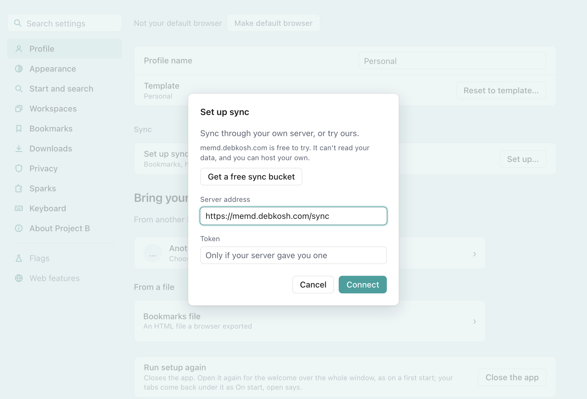
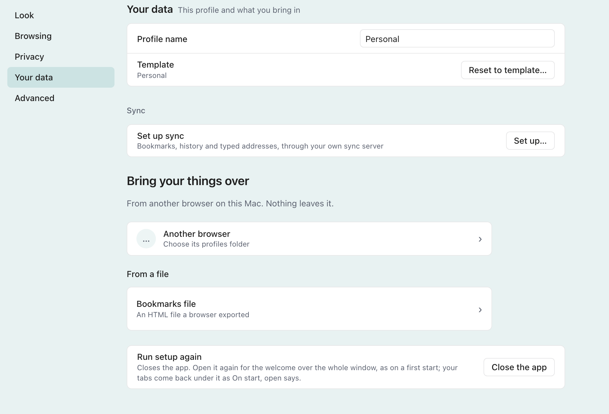
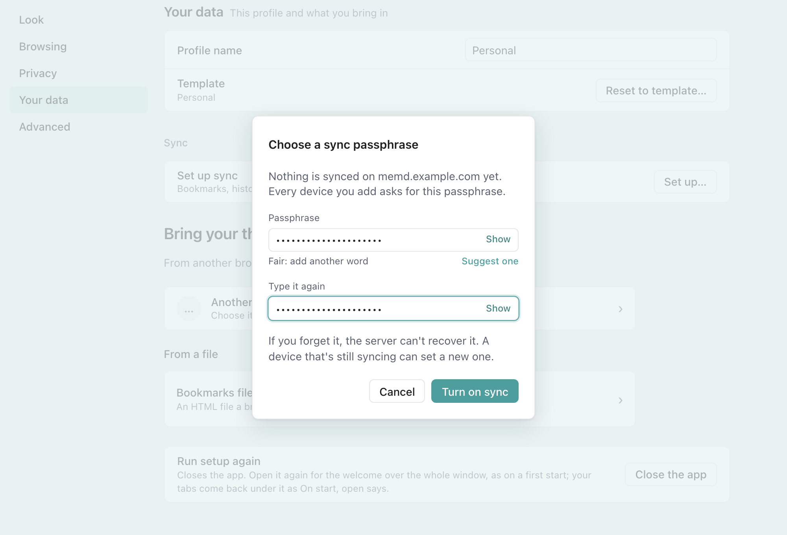
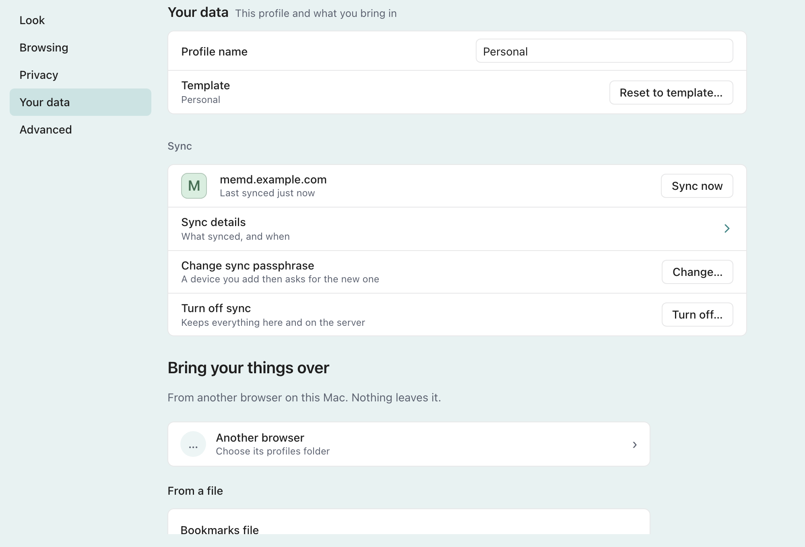
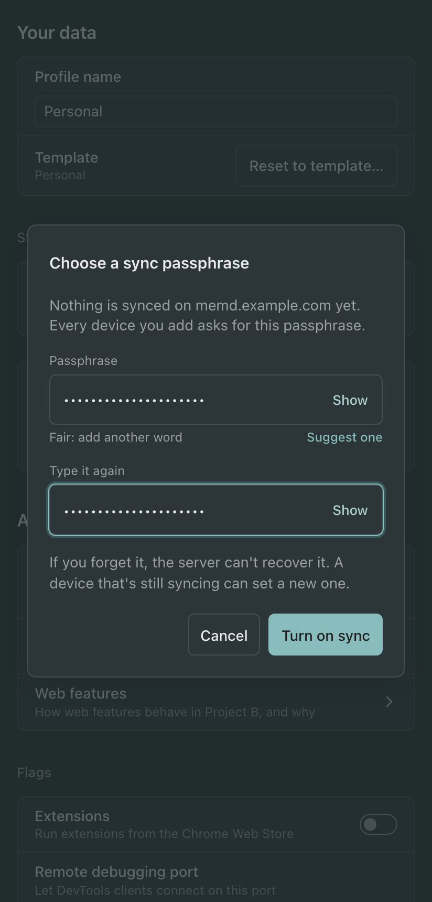
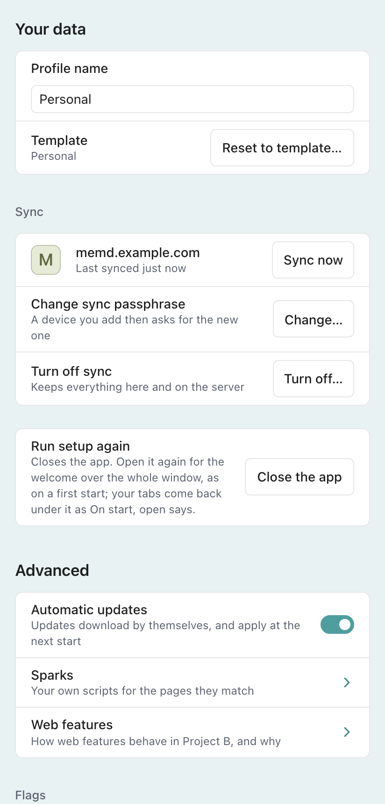
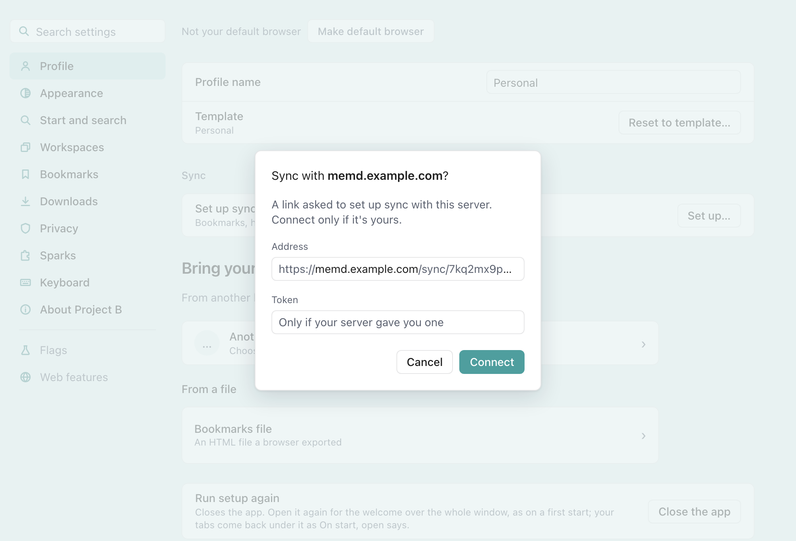
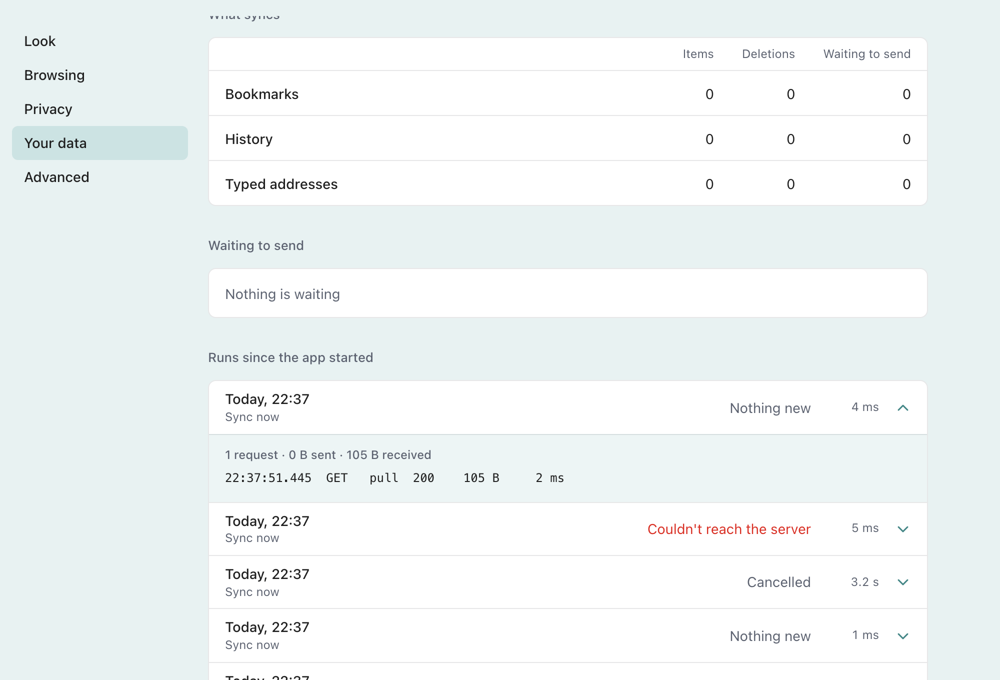
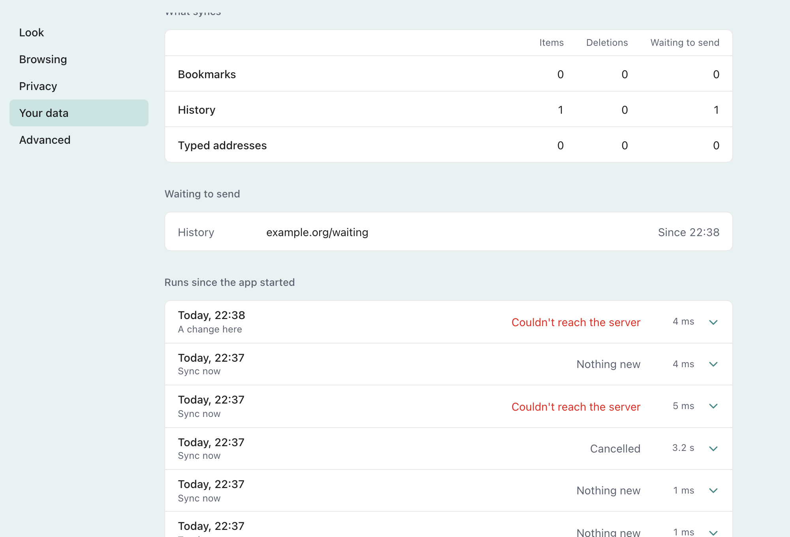
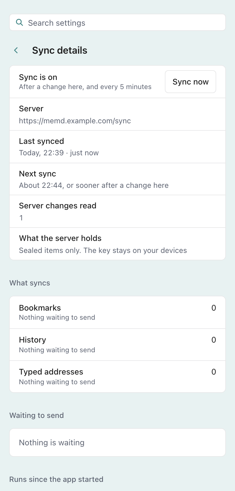

# Setting up sync

How to sync Project B between your devices, for example a Mac and a phone. The design behind
it is [sync.md](sync.md); this page is only the steps.

## What sync gives you

- **What syncs:** bookmarks and their folders, history, the addresses you type, saved
  passwords and passkeys.
- **What doesn't:** open tabs, workspaces, pinned tabs, downloads and settings stay on each
  device.
- **End to end encrypted.** Every item is sealed on your device before it leaves. The server
  holds sealed items only. The key stays on your devices and is never shown.
- **One passphrase.** You choose it on the first device. Every device you add asks for it.

## What you need

- Project B on each device, from the
  [latest release](https://github.com/sudiptadeb/project-b/releases/latest).
- **A sync server.** There are two ways to get one:
  - [Option A](#option-a-try-the-small-hosted-server): a small server at
    [memd.debkosh.com/synckosh](https://memd.debkosh.com/synckosh) that you can use to try
    sync out.
  - [Option B](#option-b-run-your-own-server): your own. The server is
    [synckosh](https://github.com/sudiptadeb/synckosh), a Go library, not a ready-made
    program: you put it in a small Go program of your own. One is below.
- The server must be reachable over `https` from every device. Project B refuses a plain
  `http` address.

Either way the server is treated as untrusted. synckosh seals everything on your device
before it leaves, and the key never leaves your devices. The server can't read your
bookmarks, history, passwords or passkeys. It can still see some things about them: how many
items you have of each kind, how big each is and when they change. The whole list is under
[What the server can and can't do](#what-the-server-can-and-cant-do).

## Option A: try the small hosted server

The project's author runs a sync server at
[memd.debkosh.com/synckosh](https://memd.debkosh.com/synckosh). It is a small personal VPS,
there for trying sync out. There is no promise that it stays up or that it keeps your bucket:
your devices hold the real copy, so nothing on them is lost if it goes away. Move to your own
server whenever you like.

1. Open [memd.debkosh.com/synckosh](https://memd.debkosh.com/synckosh) and press **Sign in
   with Google**. In Project B the same page opens from **Settings**, **Sync**, **Set up…**,
   **Get a free sync bucket**.

   

2. Press **+ New bucket**, give the bucket a name and press **Create**.
3. The page shows the bucket's address, which carries its token. Then either:
   - press **Open in Project B** on a device that has Project B. It opens the set-up with
     the address filled in; or
   - press **Copy**, and paste the address into Project B yourself. That address carries its
     token, so leave Token empty.
4. Go on from step 2 of [Turn it on, on the first device](#turn-it-on-on-the-first-device).

Your buckets stay listed on that page, each with its address (**Show** and **Copy**),
**Open in Project B** for your other devices, **Reset** and **Delete**. **Reset** empties the
bucket on the server, sealed key included, and keeps its address: each device then stops
syncing and asks to set sync up again, the first with a new passphrase and the others joining
with it.

Treat the address as a secret: it holds the bucket's token. To replace the token, so the old
one stops working on every device at once, use **New token** on the bucket in memd's own
dashboard at [memd.debkosh.com](https://memd.debkosh.com).

Besides what any sync server sees, this one knows the account you signed in with.

## Option B: run your own server

This is the shortest way we know. You need [Go](https://go.dev/dl/) 1.26 or newer, a machine
your devices can reach, and a domain name for it.

**1. The program.** Make a folder and save this in it as `main.go`. It serves one bucket,
guarded by one token, and keeps its items in `server.db` in that folder.

```go
// A sync server for your own devices: one bucket, one token, items in server.db.
package main

import (
	"errors"
	"log"
	"net/http"
	"os"

	"github.com/sudiptadeb/synckosh/bolt"
	"github.com/sudiptadeb/synckosh/server"
)

func main() {
	token := os.Getenv("SYNC_TOKEN")
	if token == "" {
		log.Fatal("set SYNC_TOKEN to a long random string")
	}
	store, err := bolt.OpenStore("server.db")
	if err != nil {
		log.Fatal(err)
	}
	srv := server.New(store, server.Bearer(func(t string) (string, error) {
		if t != token {
			return "", errors.New("unknown token")
		}
		return "mine", nil
	}))
	http.Handle("/sync/", http.StripPrefix("/sync", srv))
	log.Fatal(http.ListenAndServe("127.0.0.1:8484", nil))
}
```

**2. A token.** Any long random string. It is a secret: keep it like a password.

```sh
openssl rand -hex 32
```

**3. Run it.**

```sh
go mod init syncserver
go mod tidy
SYNC_TOKEN=<token> go run .
```

It now answers on `127.0.0.1:8484`, on that machine only. Check it:

```sh
curl http://127.0.0.1:8484/sync/v1
```

It prints `{"version":1}`.

**4. Put https in front.** Use any reverse proxy that holds a certificate your devices trust
and passes requests on to `127.0.0.1:8484`. With [Caddy](https://caddyserver.com), which gets
the certificate itself, that is one command:

```sh
caddy reverse-proxy --from sync.example.com --to 127.0.0.1:8484
```

Then `https://sync.example.com/sync/v1` answers `{"version":1}` from anywhere, and your sync
address is `https://sync.example.com/sync`.

Keep both running, and keep `server.db`. The program above is a starting point: it has one
bucket and no limit on how much is stored or how often.

## The address

Project B takes a sync address in two forms:

- `https://<host>/sync`, with the token typed in apart. The program in Option B works this
  way.
- `https://<host>/sync/<token>`, one address that carries its token. Then you leave Token
  empty. The hosted server in Option A shows both forms.

Only `https` is taken, with no user name, query or fragment in the address.

## Turn it on, on the first device

1. Open **Settings**, then **Profile**. Under **Sync** is one row, **Set up sync**. Press
   **Set up…**.

   

2. Paste your server's address into **Address**. Type the token into **Token** if your
   address doesn't carry it. Press **Connect**.

3. The server holds nothing yet, so Project B asks you to **Choose a sync passphrase**. Type
   it twice. It must be at least 12 characters. **Suggest one** fills in five random words.
   Write the passphrase down somewhere safe.

   

4. Press **Turn on sync**. The Sync card now shows your server and when it last synced.

   

5. Project B then offers a **backup code**, as step 2 of 2: a code that opens your sync if you
   forget the passphrase. **Copy** it, **Save as file**, or show it as a QR code, keep it
   somewhere apart from this device, and press **I've saved it**. **Skip for now** leaves it
   for later: the Sync card has it under **Backup code**, where **Check…** tells you whether a
   code is this sync's and **New code…** makes a new one, which stops the old one working.

The pictures show an example host, `memd.example.com`. Yours shows your own.

Sync then runs by itself: after a change on the device, and every 5 minutes. **Sync now** runs
it at once. A first sync of a long history can take a while.

## Add a second device

On the phone, or any other device, do the same: **Settings**, **Profile**, **Set up…**, then
the same address and token.

The server now holds your sealed items, so this time Project B asks you to **Enter your sync
passphrase**, once. A wrong passphrase changes nothing; try again.

| Choosing the passphrase, on a phone | Sync on, on a phone |
|---|---|
|  |  |

A server's own page can also offer a link that starts with `project-b://sync?address=`.
Opening it fills in the address, and the token when the link gives one, and nothing more. Project B shows the host and asks first.
Connect only if the server is yours.



## Sync details

**Sync details**, on the Sync card, shows what sync is doing on this device:

- the server, when it last synced and when it will next;
- each kind of thing that syncs, with its count and how many wait to be sent;
- what is waiting to go out;
- every run since the app started: when, why, what it received and sent, and how long it took.
  A failed run shows the error's own words. A run opens to show its requests.

The token is never shown here.







When sync fails, the Sync card says which it was:

| It says | What it means |
|---|---|
| Couldn't reach the server | The server gave no answer |
| The server answered with an error | It was reached and said it failed |
| Stopped: nothing arrived for 30 seconds | A request stalled |
| The server has no sync bucket at this address | Something answered there, but not a sync server |
| The server signed this device out | The server refused the token. **Reconnect…** asks for it again |
| The sync bucket was reset | The server's copy was reset. **Set up again…** asks for a passphrase |

## Change the passphrase

On a device where sync is on: **Change sync passphrase**, **Change…**, then the new one twice.
It doesn't ask for the old one. Devices that already sync carry on as they are. A device you
add from then on asks for the new passphrase.

Changing the passphrase does not change the key. It does not lock out a device that already
syncs.

## Turn it off

**Turn off sync**, then **Turn off**. It stops sync on that device only. Nothing is deleted:
everything stays on the device and on the server.

## If you forget the passphrase

- **You saved the backup code:** on the device that asks, press **Use backup code instead**
  and type it. On an Android phone, **Scan QR code** at the end of the field reads it from
  the code's QR instead, with the camera. Then choose a new passphrase. The backup code
  keeps working.
- **A device still syncs:** set a new passphrase there with **Change sync passphrase**. It
  doesn't need the old one.
- **No device still syncs:** nobody can recover it. The server never had the passphrase or
  the key. Your devices still hold their own bookmarks, history, passwords and passkeys. Reset
  the bucket on the server. On the hosted server, press **Reset** on the bucket's card. With
  the program in Option B: stop it, move `server.db` away and start it again. Each device
  then says **The sync bucket was reset**. Press **Set up again…** on one and choose a new
  passphrase, then enter it on the others. Each device sends what it holds.

## What the server can and can't do

The same goes for anyone who breaks into the server or sits on the connection.

**It cannot:**

- read anything you sync: no address, title, bookmark, username, password or passkey;
- change an item, forge one, mark one deleted or move one. Your devices refuse it, and it
  changes nothing on them.

**It still can:**

- see how many items you have of each kind, how big each is and when they change;
- see that two items are the same thing, though not what the thing is;
- keep items back, stop answering or lose its copy. Your devices keep what they hold;
- hand a device an older version that one of your devices once really wrote. A device you add
  can then get old data or miss a delete;
- say the bucket was reset, which stops sync until you set it up again;
- try passphrases against its sealed copy of the key, for as long as it likes. Each try costs
  it 64 MiB of memory and three passes of Argon2id. A passphrase someone could guess is the
  weak point, so choose a long one.

**The token and the passphrase are two different secrets:**

- With neither, nothing of your bucket can be reached.
- With the token and no passphrase, someone can't read anything and can't make your devices
  take anything. They can spoil or erase the server's copy. Your devices keep what they hold.
- With the passphrase and the token, a device is trusted in full. It reads and writes
  everything, and what it deletes goes from every device.

**Not there yet:**

- No removing one device, and no changing the key. Resetting the bucket and setting sync up
  again with a new passphrase is the only way to shut a device out.
- Sync protects what leaves a device, not the device. On the device, history and bookmarks
  are plain files in the profile's folder. Saved passwords and passkeys are sealed there.

**On a Mac, after each update,** macOS asks for your Mac password before Project B can open
its key again. Until you answer, the Sync card shows **Set up sync**. This is because the app
is not yet signed with an Apple Developer ID.

The full account, with the reasons: [sync.md](sync.md#who-can-do-what).
