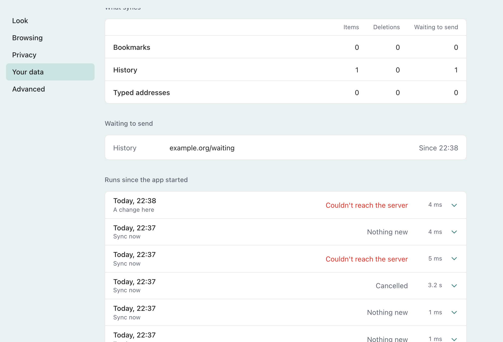
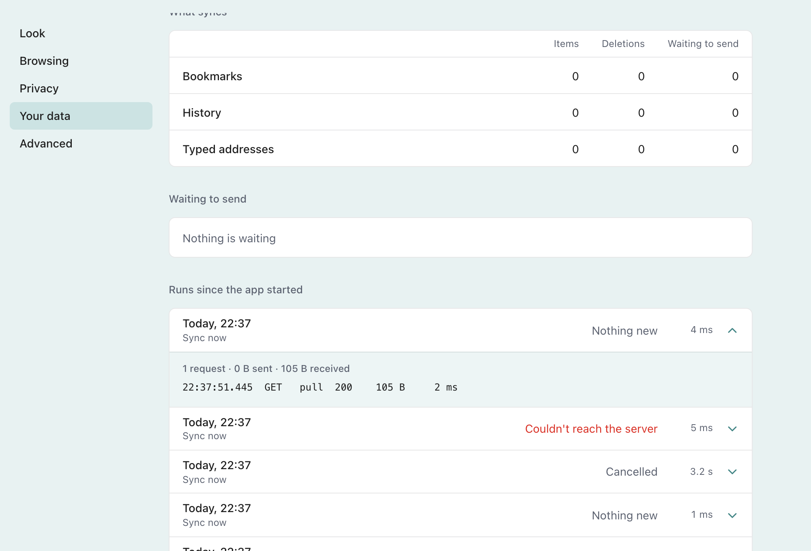
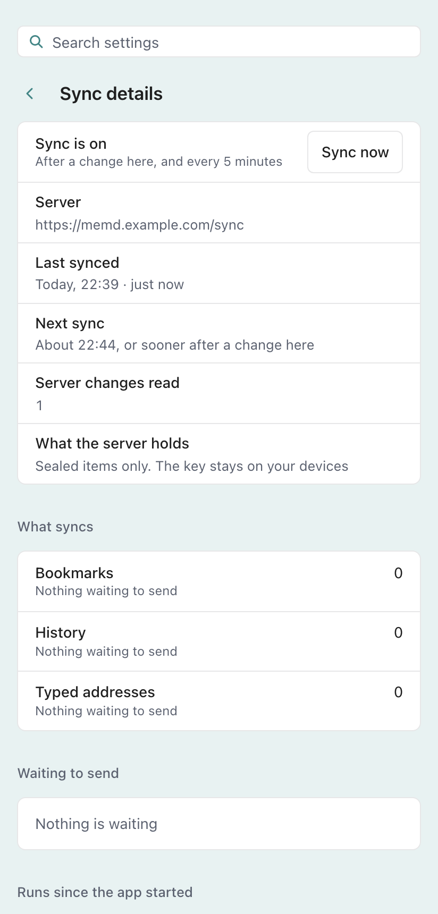

# Sync details

A page of Settings that shows what sync holds right now on this device: the server and the
state, what syncs with its counts, what waits to go out, and the runs since the app started.
**Built 2026-11-19,** as the mocks the ux review approved that day have it (the research repo's
`daily-driver-2026-11-16/mocks/syncd.js`), in `shell/src/apps/settings/SyncDetails.vue` and
`core/sync/details.go`. Sync itself is
[sync.md](sync.md).

## His words

- 2026-11-19: "we need to have a page which shows the details about the sync.. like when done,
  how many or what pulled, pushed, when etc... just all the info about sync"
- 2026-11-19: Chrome's sync-internals as the reference. Ours is smaller.
- 2026-11-19, on the first mocks, which kept a log of a hundred runs with the names of what
  each moved, and saved a report to a file: the page only shows what synckosh has at hand,
  "like the queue and last pushes kind of stuff and nothing extra is stored". So no table is
  added for this page, nothing of it survives the app closing, and there is no report.
- 2026-11-19, on the mocks redone that way: "i like the page..."

## The page

- **The way in:** a row on the Sync card, second, under the server's: "Sync details", "What
  synced, and when", with a chevron as a row that leads to a page has. Only while sync is on.
  It opens one of Settings' list pages (`ListPage.vue`, `syncDetails` in `arrange.js`, which
  `within` says is reached from the Sync block), with Back to the section that holds Sync.
- **The head:** Back and the title. No action of its own.
- **The state,** the first card's first row, with the Sync card's own control: "Sync is on",
  "After a change here, and every 5 minutes", Sync now; a run a person asked for reads
  "Syncing…" at once with Sync now disabled, and Cancel and Retry after a second; a failed one
  reads "Couldn't reach the server" in `--danger`, "Trying again in 8 minutes", Try again; a
  refused token, "The server signed this device out", Reconnect…, which goes back to the Sync
  card and opens its set-up. The card and this row share one piece of code, `syncRun.js`.
- **Then, a label and its value each:** Server (`https://<host>/sync/•••`, the host in
  `--text`), Last synced ("Today, 14:32 · 2 minutes ago"), Next sync ("About 14:37, or sooner
  after a change here"), Server changes read ("9,214", synckosh's cursor), and What
  the server holds: "Sealed items only. The key stays on your devices". On a phone the value goes
  under its label.
- **What syncs:** Bookmarks, History, Passkeys and Typed addresses, each with Items, Deletions (its
  tooltip: "Kept so your other devices remove them too") and Waiting to send. A table on a
  desktop. On a phone one row each: the name with its count at the right, and one muted line,
  "2 waiting to send" or "Nothing waiting to send", with "· 3 deletions" when there are some.
- **Waiting to send,** the queue: what changed here and hasn't gone out, with its kind, its
  name, a bookmark's title, a history or typed address's address without its "https://" (any other
  scheme stays), a passkey's site, read from its row, and since when (nothing, in the seconds before sync has looked at it). A delete has no row left to name it: "One deleted here"; history cleared is "Everything
  cleared here". Three columns on a desktop;
  on a phone the name, and under it "History · since 14:33", or "Bookmark · deleted · since
  14:35". Twenty at most, then "and 180 more". Empty: "Nothing is waiting".
- **Runs since the app started,** newest first. A row: when, why, what it did, how long, and a chevron
  down.
  - Why: "Sync now" (also Retry and Try again), "A change here", "Scheduled", "Starting the
    app", "Turning sync on", "Changing the sync passphrase".
  - What it did: "Received 3, sent 1", "Sent 2", "Nothing new", "Cancelled" for one a person
    cut short, muted as "Nothing new" is, or the problem's sentence in `--danger`: "Couldn't reach the server", "The
    server signed this device out", else "Couldn't sync".
  - How long: "180 ms", "2.1 s"; nothing for a row of several.
  - **A run sync started itself that moved nothing and ended as the one before it, started
    the same way, joins that one's row:** "Scheduled, 18 times", "Today, 13:02 to 14:27". One
    a person asked for always has its own row, so a press on Sync now shows its result. So a quiet day is one row, and a server out
    of reach for an hour is one row.
  - The run going on is the first row: "Now", "Syncing…".
  - On a phone the row is two lines: when, then why and what it did.
- **A run opens under its row,** on `--accent-tint`, its chevron turned up:
  - Received and Sent, each a list of what moved, by kind and name: a bookmark's title, a
    history or typed address's address. One that was deleted has no name left: "One deleted on
    another device", "One deleted here", and "Everything cleared on another device" for history
    cleared there. Twenty each way at most, then "and 8,719 more: 212
    bookmarks, 8,411 history, 96 typed addresses".
  - Its requests, in monospace, under "2 requests · 612 B sent · 2.1 KB received": the time,
    GET pull or POST push, the status or "no answer", the size both ways, how long. Twenty at
    most, then "and 3 more". Sizes are the app's own (`ui/size.js`).
  - A failed run: the error's own words, in monospace and muted. This is the one page that shows
    them outright; everywhere else they are a tooltip.
  - A row of several runs says so: "Each of the 4 ended the same way, the last at 12:10", and
    shows the last one's requests.
## The token never shows

An address may carry its token (`https://<host>/sync/<token>`). The page shows `/sync/•••`, an
error's words name the host alone (`sync.Words`), and a request is shown by its last part
(`pull`, `push`).

## Where it comes from (`core/sync`)

Nothing is stored for this page. What it shows is read when the page asks:

- **The page asks** as it opens, whenever the status changes, and every ten seconds while it
  is open, which is how often sync looks for changes: `Manager.Details` reads beside a run,
  never waiting for one, and answers on the main thread.
- **From synckosh's bookkeeping,** which sync keeps anyway ([sync.md](sync.md)): Items, the
  collection's items in `sync_items` that aren't deleted; Deletions, those that are; Waiting
  to send, its marks in `sync_changes` and its pending items; Read up to, the cursor in
  `sync_meta`.
- **A waiting item's name** is the feature's to give, from its row: a `Mapping` gains
  `Name(tx, key) string`.
- **From sync's memory:** the state, Last synced and Next sync, as today; and the runs since
  the app started, the newest 100 rows, each with why, how long, its error's words, the counts
  received and sent per collection, the names of up to twenty items each way, and up to twenty
  requests. They are gone when the app closes, and when sync is turned off.
  - **Received** is a version from the server that changed a row here; **sent** is an item of
    this device's that the server took. Both are counted in sync's `Local`, where synckosh
    hands them over, as synckosh's `Sync` answers only an error.
  - **A request** is measured in the http client sync already wraps to name problems
    (`checked`).
  - **Why** is known where a run starts: `SyncNow`, a mark found, the timer, the start,
    `Connect`.

## Messages

| The page sends | Go answers |
|---|---|
| `syncDetails` | `syncDetails {details}`: `sync.Details`, the address as `scheme`, `host` and `rest` with the token left out, `next`, `cursor`, `kinds` (`collection`, `items`, `deletions`, `waiting`), `waiting` and `waitingMore`, `running` and `runs` |

Sync now, Cancel, Retry, Try again and Reconnect… are the Sync card's own messages.

## Not in it

- Anything stored for the page: a log of runs kept across starts, when a kind last received or
  sent, when sync was turned on here.
- A report saved to a file.
- A browser of every synced item, as sync-internals has: Bookmarks and History already list
  them.
- Protocol and user events, and a live traffic log apart from the runs.

## Tests

- `core/sync` (`details_test.go`): the counts and the queue with its names, from two profiles'
  changes; what a run received and sent, by name, and why it ran; its requests, by the last
  part of their path, with no token; quiet runs on the timer sharing one row, and refused ones, their error with no token, while
  a run a person asked for keeps its own; a new manager over the same store starting with only its start's run, no
  table added, and turning sync off forgetting the runs. `core/app`: `syncDetails` answered
  with sync off.
- `shell/e2e/sync.cjs`, in the one-page and Sections layouts and on a phone: the row on the
  Sync card; the page asking Go; the state's control as the card's; the server with no token;
  the three kinds; a run opening and closing, and a failed one's own words; a page visited
  while the server is out of reach waiting in the queue by its address, then going with Try
  again, the run naming it; Sync now from the page; Back. Its pictures are 24, 25 and 26 under
  `build/sync-screens/`.
