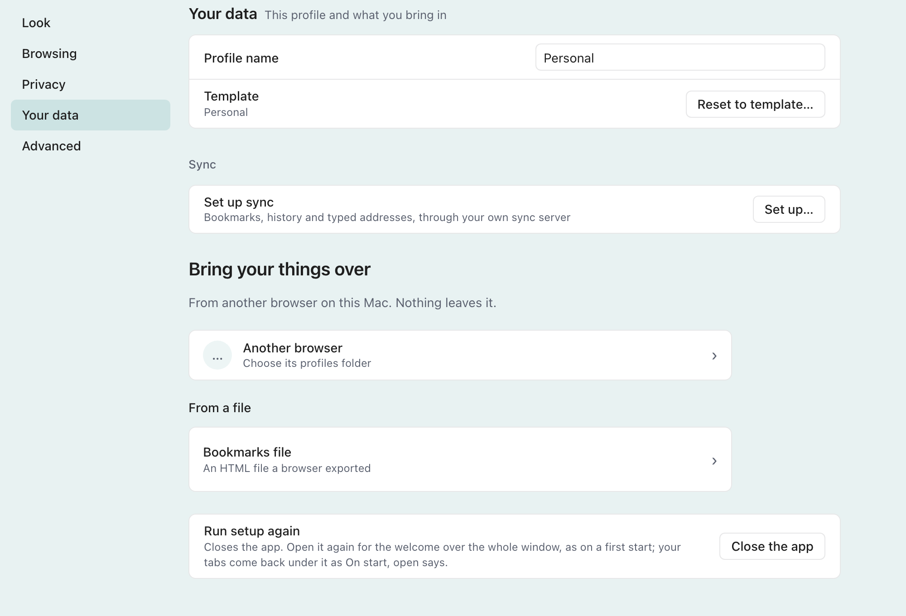
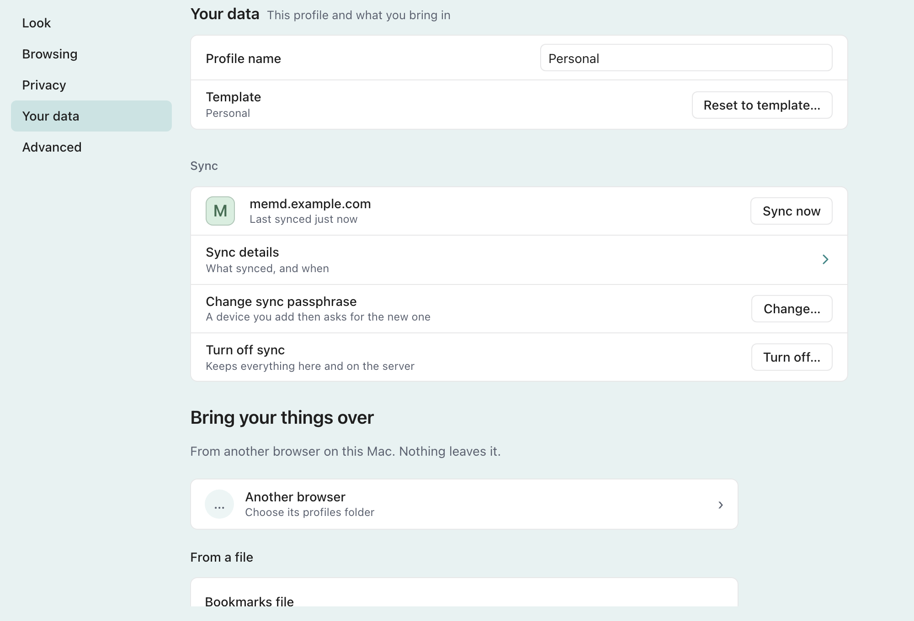
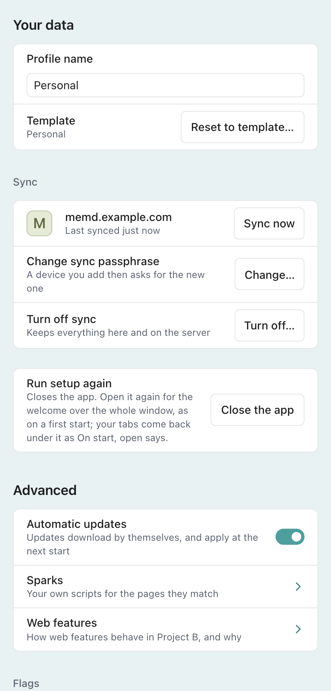

# Sync

A profile's bookmarks, history, typed addresses, passkeys and saved passwords, the same on
every device a person links, through a sync server that holds them sealed and can't read
them ([who can do what](#who-can-do-what)). **Built 2026-11-19:** the Go side, then Settings'
screens and the deep link, as the mocks the ux review approved that day have them ([the
screens](#the-screens), [the link](#the-link)). The protocol and the library
are [synckosh](https://github.com/debkosh/synckosh): its SPEC.md is the protocol, and the core
uses its Go `client` package. The store it works over is [store.md](store.md).

## His decisions

- 2026-11-18: "sync should always be with a passphrase"
- 2026-11-18: "yes keychain default, passphrase lock over it... and enterprises can later force
  passphrases via policy". The keychain is built; the passphrase lock over it is not.
- 2026-11-18: "lets not go the app only level for now... since we cannot give the same level in
  windows and linux": the device key is an ordinary keychain item, not one only this app's
  signature can read.
- 2026-11-19: "keychain prompt every update is fine": the key stays in the keychain, though macOS
  asks about it after each update (below).
- 2026-11-18: "profiles should be as isolated as possible... we would have to keep the dek in
  profile and kek in keyring"
- 2026-11-18: "moving profiles should work, just the passwords would not"
- 2026-11-19: "individual visits are not synced"
- 2026-11-19: "host sync server inside memd for now... users can sync by first configuring sync
  bucket url and token... then sync start asks for passphrase"
- 2026-11-19: "we should build some deep link which we can click from the memd page to set the
  sync server details on the app in mac and android"
- 2026-11-20: "our readme and docs should reflec our end to end ecrypted sync where arogue
  server cannot do anything to the licnets.. and vise versa": [who can do what](#who-can-do-what),
  with what a server and an app still can do beside what they can't.
- Agreed in the discussion of 2026-11-19: local storage is ours, and synckosh is given its storage
  interface over it; sealing on disk is ours, field by field; history and bookmarks stay plain on
  disk, sealed only for the wire, by synckosh; the sync key is apart from the profile key.

## What syncs

| Collection | One item per | What it carries |
|---|---|---|
| `bookmarks` | bookmark or folder, by its id | the folder it is in, its kind, title, address, when it was added and last changed, its place |
| `history` | address | the address, its title, how many visits, the last visit |
| `typed` | address typed | the address, how many times, the last time |
| `passkeys` | passkey, by its credential ID | its site, user handle, names, when it was made and its key ([passkeys.md](passkeys.md)) |
| `logins` | saved login, by its id | its site, username and password, when it was saved, last changed and last used ([passwords.md](passwords.md)) |

**Not synced:** each visit (the `visits` table), the sites (`sites`, made from history on each
device), the folder a bookmark was last saved in, and everything kept in JSON files (prefs,
workspaces, pins, the session, downloads).

Everything an item carries is in its private part, which synckosh seals with the sync key before
it leaves the device. Its public part is empty. The server learns the collections' names, each
item's id, when it changed and how big it is, and nothing else. A history or typed item's id is
made from its address with the sync key, so the same address on two devices is one item, and the
server can't tell from the id which address it is.

**When two devices change one item:**

- **History and typed** take the larger count and the later time, and the title of the version
  visited later (a title over none, then the later visit, then the greater title, so every device
  picks the same).
- **Bookmarks:** the newest change wins, by when it was made (the entry's `modified`).

A delete is an item too. Clearing all history is one item for each of `history` and `typed`,
synckosh's delete-before, which the server applies at once; clearing a time range deletes each
address's item.

## The keys

| Key | What it is | Where it lives |
|---|---|---|
| Device key | 32 random bytes, one for the app on this device | The Mac's login keychain, a generic password: service `Project B`, account `device key`. On Android, `files/device.key` in the app's folder, wrapped by an AES key of the Android Keystore, `project_b_device_key` |
| Profile key | 32 random bytes per profile, made the first time something is sealed | `profile.key` in the profile folder, wrapped by the device key, the profile's id bound in |
| Sync key | synckosh's data key, one per bucket, the same on every device in it | The profile's `secrets` table, sealed with the profile key. Joining devices get it from the server's sealed copy, opened with the passphrase |

The keychain and the Keystore are asked only once something is sealed in the profile, which today
is sync turned on: a profile that never syncs never touches them.

**Which key wraps a profile's key.** A profile in the profile list uses the device key. A folder
opened as it is with `--user-data-dir`, as every test and driver run is, never touches the keychain:
its profile key is wrapped by `folder.key`, a key in that same folder. So tests need no keychain,
and a listed profile's folder copied and opened with `--user-data-dir` gets nothing from the
keychain. Android's profile is the one folder Android gives the app, its only profile, and uses
the device key.

**Moving a profile.** History, bookmarks and the rest move with the folder. What was sealed does
not open on another device, whose device key differs, nor under another id: the profile key
is then *locked*.

**Never rekeyed silently.** When the device key doesn't open the profile key (a moved folder, a
lost or replaced keychain item), sealing and opening fail with a plain error, nothing is
overwritten, sync is off and its status says why. One call, `StartFresh`, deletes what was sealed:
the secrets, and each feature's own sealed rows, which the feature deletes in the same job
(`keys.OnStartFresh`; the passkeys do), and makes a new profile key. History and bookmarks are untouched. A device key is made only when
a new profile key needs one, never in place of one that is there.

**The OS is asked for the device key only when something needs it.** Asking may put a question
to the person: a Linux keyring to unlock, the Mac's keychain after an update. So a start asks
only when sync is on, which `sync.address` being kept tells without opening anything sealed;
with sync off the first ask is the person's own doing: a saved password shown or filled, a
passkey, turning sync on. A locked profile key is then found when sync is turned on, which
says `locked` as a start with sync on does.

**A keyring that gives no key leaves sync on.** On Linux the device key may not come: the
person said no to the keyring's question, or the keyring refuses everything until the next
login. That is `keys.ErrKeyring`, the status's `keyring` problem with `on` and no `host`, and
`SyncNow` asks again.

**A start waits before sync does anything of its own.** Sync's first load is one of the app's
background jobs, which all wait for the one timer after a start, ten seconds
([startup.md](startup.md)): at once sync only reads whether it is on, and says so in the
status, `on` with no `host` yet. When the wait is over the app calls `Wanted`, and sync asks
for the device key, opens its server and runs. Settings showing sync's state doesn't end
the wait; what a person does there does, as Sync now or turning sync off, which finds sync
loaded first.

**macOS asks after every update.** The app is signed with the project's own certificate and has
no Apple team id, so macOS files the keychain item under the code hash of the build that made it.
Measured in a VM on 2026-11-19 with two builds signed with the project's identity: every new
build is asked "Project B wants to access key 'Project B device key'" and needs the person's Mac
password; Always Allow covers that one build only; an access rule of any application doesn't
avoid it, as the partition list still holds only the creator's code hash; and the
data-protection keychain refuses a binary with no team id (`errSecMissingEntitlement`, -34018).
So a profile with sync on asks once after each update, and until it is answered Sync shows Set up
sync. Signing with an Apple Developer ID, whose team id lets every build read the item, ends it.

**Sealing on disk** (`core/keys`): XChaCha20-Poly1305, with the table, the row's id, the column
and any other values the row binds in as additional data, so a sealed value can't be moved to
another row or column. A fresh random nonce each time; the stored value is the nonce, then the
sealed bytes. The `secrets` table holds named sealed values; sync keeps its address, token and
sync key there.

## Who can do what

Sync is end to end encrypted: an item is sealed on the device, under the bucket's sync key,
before it leaves, and opened only on a device that holds that key. The server never has the
key. This is what that does and doesn't give, each line checked against synckosh's
SPEC.md ("What sealing protects") and `core/sync`. A claim we can't back is here as a limit.

**What leaves a device.** An item's private part, sealed with XChaCha20-Poly1305: the whole
row as `core/sync` reads it, so an address and its title, a bookmark, a passkey with its key,
a login with its username and password. Project B puts nothing in an item's public part.
Outside the seal, and so read by the server: the collection's name (`bookmarks`, `history`,
`typed`, `passkeys`, `logins`) and datatype, the item's guid, which is random and says
nothing of the row, its timestamp, whether it is deleted, its size, and its identity, a
hash keyed from the sync key that is the same for two items that are one thing. The seal
binds the collection, datatype, guid, timestamp and the deleted mark with the content, so
none of them can be changed apart from it.

**The sync server, anyone who controls it, and anyone on the connection.**

| It cannot | Why |
|---|---|
| Read what is synced | It has no key. The key reaches a new device only as a copy sealed under the passphrase, which the server never sees |
| Change an item, forge one, or move one to another guid or collection | The seal doesn't open, and the device rejects the item: it changes nothing there, and Sync details says "not taken" |
| Delete an item on a device, or clear a collection there | A delete is sealed like any edit, and so is a delete of everything before a time |
| Learn an address or a site by guessing it | Guids are random; an identity is a hash under a key it doesn't have |

| It still can | What that means |
|---|---|
| See how many items of each kind there are, their sizes and when they change | Roughly when and how much a person browses, saves or deletes; never what |
| See which two items are one thing | Their identities are equal; nothing more |
| Keep items back, refuse a push, stop answering | Sync stalls or a device misses changes. Sync details says what failed |
| Lose or delete its copy | Devices keep their rows: nothing a server sends deletes them. A device then refills the server, or says the bucket was reset |
| Hand over an older version that a key holder really wrote | A device being added can get old data or miss a delete. A device holding a version with a later timestamp keeps its own |
| Say the bucket was reset (a new store id, with no sealed copy of the key) | Devices push nothing and say "The sync bucket was reset" until sync is set up again, under a new key. Nothing becomes readable |
| See how many keys open the bucket, and when each was added | Each sealed copy of the key is an item with a label in the clear, "Passphrase" or "Backup, 22 Nov", and its date. It learns that a backup code exists and when a passphrase or a code was changed; never what either is |
| Try passphrases against the sealed copy of the key, offline | Each try costs Argon2id at 64 MiB and 3 passes. Settings takes no passphrase under 12 characters. A passphrase a person could guess is the weak point |

**A profile on a device.** A device that was given the passphrase holds the sync key, and
is trusted in full: every device that holds the key can read and write everything, and a
delete it makes reaches every other device. The key never shows on screen and has no
export. There is no removing one device and no changing the key yet: resetting the bucket
and setting sync up again with a new passphrase makes a new key, and a device that isn't
given that passphrase is out.

**An app or a person without the key.**

- **With no token for the bucket:** nothing. The server asks its host which bucket a request
  is for, and each bucket's items are apart; a token names one bucket.
- **With the bucket's address and token, and no passphrase:** it can't read an item and
  can't make a device take one. It can push junk, push over an item's version on the
  server, and push a delete of everything before a time, which the server follows without
  being able to check it. So it can spoil or erase the server's copy, and stall sync, and a
  device added then gets less. The devices that hold the key keep their rows. The token is
  a secret: sync takes only `https` addresses, the token is kept sealed on disk beside the
  sync key, and Sync details never shows it. Resetting the bucket and setting sync up again
  puts a spoiled bucket right.
- **How much it can store.** The protocol caps one item (1 MiB sealed) and one push (1000
  items, 16 MiB). How much a bucket may hold in all, and how often it may be written, are
  the server's own to limit; synckosh's server sets neither.

**On the connection.** Sync trusts the certificates the system does, which on Android
include ones a person added. Someone who can read the connection gets what the server gets,
and the token.

**Not sync's to protect.** What is on a device: history and bookmarks are plain in the
profile's folder, and passkeys' keys and saved passwords are sealed there with the profile
key ([the keys](#the-keys)).

## The address

Decided 2026-11-23, the owner: "we cannot know if the users' sync server uses the same
thing.. we cannot split stuff... we just take a url and an optional bearer token that's it".

Sync takes two things, and reads nothing into either:

- **The address:** the server's, used exactly as it is given. Only `https`, with a host, no
  user, query or fragment. Its path is any server's to shape: the app never splits it and
  never looks in it for a token.
- **A token, optional:** a bearer token. Given, every request carries it as
  `Authorization: Bearer <token>`; left empty, nothing is sent. A server that wants one and
  gets none, or gets another, refuses, and the page says so under Token.

So both of the memd server's forms work as they are: `https://<host>/sync` with its token in
Token, and `https://<host>/sync/<token>`, the one address, with Token empty.

Status shows the host alone, and so does an error's text, in the status, on the page and in
the timeline (`Words`): Go's own error for a request names the whole address, and an address
given with no token is itself what lets a device in.

**A server to start with.** Decided 2026-11-23, the owner: "the browser should prefill our
address and also guide the users to create a sync bucket from our service from the browser
itself.. currently someone just installing the browser cannot find synckosh service". The
set-up opens with Server address filled with `https://memd.debkosh.com/sync`
(`links.SyncServer`), there to be changed to any other server's, and offers **Get a free sync
bucket**, which opens `https://memd.debkosh.com/synckosh` (`links.SyncBucket`) in a tab. That
page makes a bucket and its Open in Project B comes back as the deep link. Nothing goes to
that server before Connect, as with any other. The dev server answers for that address itself
(`core/cmd/dev/syncserver.go`), so no test reaches it.

**The deep link** the memd page offers is

```
project-b://sync?address=<the https address, percent-encoded>
```

with `&token=<the token, percent-encoded>` after it when the server gives its token apart.

It only fills in what Settings would connect to, the address and, when the link has one, the
token, hidden in its field: it never connects by itself. Settings shows the host and waits for
Connect, then asks for the passphrase. How it reaches the app is [the link](#the-link).

## Turning it on

1. The address, from the deep link or typed: `Propose` checks it.
2. `Inspect` looks at the bucket without changing it: an empty bucket is a new one, so the page
   asks for a new passphrase twice; one holding items asks for its passphrase once.
3. `Connect` makes the bucket's sync key with synckosh's `Create` when it is empty, with a sealed
   copy under the passphrase, or opens the sealed copy with `Join` when it holds items. A wrong
   passphrase changes nothing. It keeps the address, the token and the sync key sealed, hands every
   row of the three collections to synckosh once, and answers: sync is on. Its first run follows,
   on sync's goroutine, which the status shows, so the set-up closes without waiting for a first
   run of all the profile's history.

The passphrase is never kept: the device holds the sync key, so changing the passphrase needs no
old one.

## Backup code

Decided 2026-11-22, the owner approving the mocks: "the backup mock looks nice go ahead".

- **What it is.** A second passphrase, random, that the app shows once for a person to keep
  apart from the device: 120 random bits as six groups of four, `7K4Q-M2XH-9RTD-WC6F-3NVA-8PSE`,
  in Crockford's alphabet, which has no O, I, L or U. It has a sealed copy of the sync key of its
  own in the bucket, as the passphrase has (synckosh's `AddBackupCode`). **The sync key itself is
  never shown**, as a code, a file or a QR.
- **What it does.** It opens the bucket wherever the passphrase does: a device joins with it, and
  a person who forgot the passphrase gets in with it and can then choose a new passphrase, which
  needs no old one. It is taken as typed: small letters, no dashes, spaces, O for 0, I or L for 1.
- **One at a time.** synckosh allows many; this app keeps one. A new code is made as its card
  opens, and both open the bucket until the person says "I've saved it", which takes the old one
  away; leaving the card any other way takes the new one away and leaves the old. Until it is
  kept, the Sync card tells of what was there before: a code just made is the bucket's backup
  code only once the person says they saved it (`Manager.backup`, `core/sync/backup.go`).
- **It stays** when the passphrase changes (synckosh's `SetPassphrase` replaces the passphrases'
  copies and keeps the codes'), and it is as strong as its 120 bits: the server can try guesses
  against its sealed copy as it can against the passphrase's, to no end.
- **Making and removing are changes in the profile**, which the next run sends: neither needs the
  server at that moment. Until a removal has been sent, the server still holds the old copy.
- **What the server knows.** Each copy has a label in the clear, "Passphrase" or "Backup, 22
  Nov", and when it was made, so memd's page can list the keys that open a bucket.
- **Skipped at set-up**, the Sync card says "No backup code" and offers to make one.
- **Scanning, on Android only** (the owner, 2026-11-22: "scanning only for android", "use
  lib for scanning"): an icon button at the end of the backup code's field, **Scan QR code**, in the join step
  and in Check…, opens ZXing's own scanner screen over
  the app (`engine/android/third_party/zxing`, used as published), which asks for the
  camera the first time and reads QR codes only; what it reads goes into the field: the
  person then turns sync on, and Check… checks it at once. The join step says "Type or scan"
  there. A computer has no scanner: the code is typed there.
  `System.CanScanCode` and `ScanCode` (`core/system`), `scan_code` in
  `engine/abi/pb_system_android.h`, `GoSystem.scanCode`.

`core/sync/backup.go`: `MakeBackupCode`, `KeepBackupCode`, `DropBackupCode`, `CheckBackupCode`,
and `Status.Backup`, `{made}` or nil. The page, `shell/src/apps/settings/SyncBackup.vue`.

## How it runs (`core/sync`)

**Local storage is ours.** `core/sync` is synckosh's `client.Local` over `store.db`:

| Table | What it holds |
|---|---|
| `sync_items` | synckosh's bookkeeping per item: its sequence, base, timestamp, pending, sent, and the row it is (the feature's key: the address, the bookmark's id, the passkey's credential ID), which is how a row's guid is found again. An item's content is the feature's own row, never a second copy. Only what has no row is kept whole: a deleted item, without its content; one sealed under a key this device doesn't hold, as it came; the sealed copies of the sync key; a delete-before |
| `sync_meta` | synckosh's values: its clock, cursor, store id and last pull |
| `sync_changes` | the rows changed here since the last run: collection, the row's key, deleted, and `stuck`, why a row couldn't be handed over, empty for one that only waits |
| `sync_state` | one row: whether changes are marked, which is whether sync is on |

Each synced feature gives a mapping (`sync.Mapping`): its collection and datatype, its table and
the column that names a row, the row as an item's private part, and the private part back as the
row; deleting a row; and `Join`, the row after taking in another version, which never loses what
the row holds that is newer. History's and typed's `Join` is their merger too. `Name` is what a
person calls a row, for [Sync details](sync-details.md): a bookmark's title; without it, the key,
as an address is.

**An item's guid says nothing of its row.** It is a random one (`synckosh.NewGUID`, a UUIDv7),
given when the row first goes out, and `sync_items` remembers which row it is (`guidOf`). It is
only a unique name in the bucket: nothing is worked out from it, and nothing of the row is put
into it. Sudipta, 2026-11-20: "since we just want a unique key".

**The row's key is in the item's private part**, sealed, and the mapping's `KeyOf` reads it
there: the address for history and typed, the bookmark's own id, the passkey's credential ID.

**Two devices' items of one row are made one by the item's identity.** `core/sync` gives
synckosh the row's key as what makes an item one thing (`client.Config.Identity`), and
synckosh sends a hash of it beside the sealed item, which the server keeps one live item
for in a collection. So when two devices each have a row before they sync, or set sync up
again after a bucket was reset, each sends it under a guid of its own, the first is kept,
and the second device is handed that one: it stores it, joined into its row as any version
is, and forgets its own guid (`Remove`, which leaves a row that is another item's
unmarked). A row deleted and made again goes out under the guid it had; made again on
another device it is a new item, and the old item's delete leaves that row alone.

**A feature whose rows are one thing by more than their key says so** (`Mapping.Identity` and
`Twin`): a saved login is one with another by its site, username and password, as each
device gives a login it brings in an id of its own. When the first device's item arrives,
`Twin` finds the row this device made of the same login, and that row goes as the item's row
takes its place: both devices then hold the login under one id.

**Writing first, then telling sync.** Features write their rows as before. While sync is on,
triggers on their tables write a mark in `sync_changes`, in the same transaction; with it off,
none. A mark takes the place of the row's earlier one by deleting it and writing it again: an
`INSERT OR REPLACE` in a trigger is overridden by the statement that fired it, and an upsert's
update aborts on a conflict, which would fail the feature's own write. Clearing all history replaces its marks with one, which becomes the delete-before. A run:

1. Drains the marks into synckosh: a delete-before first, then a changed row as `Replica.Put`, a
   deleted one as `Replica.Delete`, which finds the item by its bookkeeping though the row is gone.
   **A row that can't be handed over is set aside, and the rest goes.** synckosh takes a batch
   whole or not at all, so a batch it refuses is handed over again a row at a time; a row it
   still refuses (too big for one item, say), or one that doesn't read, keeps its mark with
   why in the mark's `stuck` column. Sync's own runs leave such a mark be; a run a person
   asked for, the first of a start, and the row changing again try it anew. The status
   counts them (`unsent`), with what the server refused in the last run, and Sync details
   names each with its reason. Before this one such row failed every run of the profile.
2. `Replica.Sync`: pull, push.
3. A version from the server is joined into its row (`Join`), on the store's worker, with the
   triggers quiet. When the row then differs from it, the row holds something newer, and is
   marked to go out. A row with a delete waiting is left alone. A deleted item takes its row. The
   features that changed are told on the main thread: the bookmarks read their tree again, and
   tell the shells.

synckosh keeps deleted items (`KeepDeleted`), so it never removes an entry for a delete, and a
removal (a device away past the server's cleanup starts over) only forgets the bookkeeping: the
rows stay, and go out again.

**When it runs:** after the start's wait when sync is on ([startup.md](startup.md)), within ten seconds of a change (it looks for marks
that often), every five minutes, and on `SyncNow`. On a goroutine of its own, never the main
thread; one run at a time. A failed run waits 30 seconds, then twice as long each time, up to half
an hour, and its error is in the status. `SyncNow` doesn't wait.

**A damaged store.db**, which the store moves aside and makes again ([store.md](store.md)), takes
the secrets and the bookkeeping with it: sync is off, and is connected again with the passphrase.

**When the bucket has a new store id,** one test decides what a device does: does the bucket
still hold a sealed copy of the key this device holds? His words, 2026-11-20: "reserting on my
mind means server data gone... setup sync again with the first device asking to setup
passphare and next one asking that... but auto healing when bucket might have lost some data
but not the key shoudl also be there".

- **It does** (a server restored from a backup, or one that lost items): the device heals it
  by itself. synckosh pushes back everything the device holds, read from the rows, deletes
  included.
- **It doesn't** (the bucket was reset, so it is empty; or another device has set it up again
  with a new key): the device pushes nothing. synckosh's `Sync` answers
  `client.ErrBucketReset`, the status's problem is `reset`, and sync does nothing more until
  it is set up again here: `InspectAgain` looks at the bucket with the address and the token
  the device holds, and `ConnectAgain` makes the bucket's key with a passphrase when it is
  empty, or opens it when another device was first, and only then forgets what the device
  kept of sync and begins anew. A wrong passphrase changes nothing. Every row stays, and is
  handed over again.

The library's own items, the sealed copies of the key and each collection's delete-before,
live in one collection, `_synckosh`; a delete-before names the collection it clears in its
public part.

## The functions (`core/sync`)

Every answer comes on the main thread, where the calls are made. Only `Propose`, `Link`, `Status`
and `OnStatus` answer at once; the rest run on sync's goroutine, after what was asked before them.

| Function | What it does |
|---|---|
| `Link(link) (address, error)` | the address in a `project-b://sync?address=` link |
| `Propose(address) (Proposal, error)` | checks an address and says what would be connected: `Address`, `Host`. Changes nothing |
| `Link(link) (address, token string, err error)` | a deep link's address, and its token when it has one |
| `Inspect(address, token, answer func(isNew bool, err error))` | whether the bucket is empty, so new (synckosh's `client.Look`). Changes nothing |
| `InspectAgain(answer)`, `ConnectAgain(passphrase, done)` | the same two for the bucket sync is on with, after it was reset: the address and the token are the ones held |
| `Connect(address, token, passphrase, done func(error))` | starts the bucket or joins it, keeps its details sealed, and syncs. `errors.Is(err, sync.ErrPassphrase)` for a wrong passphrase |
| `ChangePassphrase(passphrase, done func(error))` | in one write, a sealed copy under the new passphrase and the others gone (synckosh's `SetPassphrase`) |
| `Disconnect(done func(error))` | stops syncing and forgets the address, token and sync key; every row stays |
| `SyncNow()` | a run now |
| `Wanted()` | has sync open what it is on with and run, as nothing has before: the app's background job after a start (`core/later`) |
| `CancelRun()` | cuts the run going on short: it ends with no error and no longer wait, and the next comes when it would have |
| `Address() string` | the bucket's address while sync is on, for Reconnect |
| `Problem(err) string` | what went wrong reaching a bucket, by name: `address` (not one Propose takes), `unreachable` (no answer), `server` (the server answered that it failed, 500 and up: it was reached), `stalled` (a request with nothing going or arriving for `StalledAfter`, 30 seconds, which is ended), `notBucket` (not found, or not JSON), `token` (refused), `keyring` (the desktop's keyring gave no device key, `keys.ErrKeyring`), or `""` for anything else, as a request the server won't take or a row that can't be written. A request's answer is looked at before synckosh reads it, and its error wraps `ErrAddress`, `ErrNeedsToken`, `ErrUnreachable`, `ErrServer`, `ErrStalled`, `ErrNotBucket` or `ErrToken` |
| `Words(err) string` | an error's text, a failed request as the request and then the cause, `GET v1/pull?after=1: EOF`: the request named from `v1` on, as the address before it may carry its token, and without the words the page's own sentence says. What the status, the page's answers and the timeline say of an error |
| `Details(answer func(Details))` | what the Sync details page shows ([sync-details.md](sync-details.md)): the address with no token, the counts, the queue, and the runs since the app started, kept in memory only |
| `StartFresh(done func(error))` | for a locked profile key: `keys.StartFresh`, so sync is forgotten and off |
| `MakeBackupCode(done func(code string, err error))` | a run, a new backup code with its sealed copy (`AddBackupCode`, labelled "Backup, 22 Nov"), a run; the code is answered once and kept nowhere |
| `KeepBackupCode(done)`, `DropBackupCode(done)` | the code just made becomes the bucket's one, every other backup copy removed; or it is removed and the others stay. A run follows, and one that can't reach the server sends the change later |
| `CheckBackupCode(typed, answer func(is bool, err error))` | whether what was typed is written as a code and opens a copy of the key, as of the last run; no server is asked |
| `Status() Status`, `OnStatus(func(Status))` | `on`, `syncing`, `host`, `lastSynced` (Unix ms, 0 for never), `error`, `problem` (the last run's, by `Problem`'s names: `token` when the server signed this device out), `locked` |

**The settings page's messages** (`core/app/sync_settings.go`). Go sends `{"t": "sync", "sync":
<Status>}` to every settings page and shell when it changes, and both snapshots carry `sync`; the
settings page's message carries `address` too, and its snapshot `syncAddress`, which Reconnect
fills in. A `project-b://sync` link reaches the page as `syncLink {link}`, after its snapshot or at
once ([the link](#the-link)). Every answer with an `error` carries its `problem`, by `Problem`'s
names. The page sends:

| Message | Go answers |
|---|---|
| `syncGetBucket` | nothing: the server to start with's bucket page opens in a tab beside Settings |
| `syncPropose {address}`, or `{link}` for a deep link's | `syncProposal {address, host, token}`, the token a link's or "", or `{error, problem, address}`, the address as given |
| `syncInspect {address, token}`, or `{again}` after a reset | `syncBucket {new}` or `{error}` |
| `syncConnect {address, token, passphrase}` | `syncConnected {wrongPassphrase}`, with `error` when it failed |
| `syncChangePassphrase {passphrase}` | `syncPassphraseChanged {}` or `{error}` |
| `syncDisconnect` | `syncDisconnected {}` or `{error}` |
| `syncNow` | the status, as it changes |
| `syncDetails` | `syncDetails {details}`, for [the Sync details page](sync-details.md) |
| `syncCancel` | the status, the run cut short (`CancelRun`) |
| `syncSuggest` | `syncSuggested {passphrase}`: five words from `core/words`' list of 662, picked at random |
| `syncStartFresh` | `syncStartedFresh {}` or `{error}` |
| `syncBackupMake` | `syncBackupMade {code, qr}` to the asking page alone: the code, and its QR as rows of 0 and 1, which the page draws only when asked; or `{error}` |
| `syncBackupKeep`, `syncBackupDrop` | `syncBackupSettled {kept}` or `{error}`, to the asking page; the status follows with `backup` |
| `syncBackupCheck {code}` | `syncBackupChecked {is}` or `{error}`, to the asking page |
| `syncBackupScan` | `syncBackupScanned {code, ok}` to the asking page: what a phone's scanner read, or `ok` false when the person left it. The snapshot's `canScan` says whether there is a scanner |
| `syncBackupCopy {code}` | `syncBackupCopied {}`: Go put it on the clipboard as a secret, as a saved password is copied |

Each answer goes to the page that asked, alone, except `syncDetails` and the status, which
every Settings page hears. What a Dialog asks for an answer carries a number, `n`, which the
answer brings back (`numbered`, `shell/src/apps/settings/state.js`), and a Dialog takes the
answer to what it asked last and no other. An answer can come late: the one to a making that
was left arrives after the backup code's card was opened again and has asked for a code of its
own, and taken as that card's it would show a code about to be taken away, and then shut the
card; the one to a bucket looked at before Cancel arrives after the set-up was opened again,
and taken as its own would move it on to a passphrase for another address.

## The screens

Settings' Sync, as the mocks of 2026-11-19 have it, every word theirs (the research repo's
`daily-driver-2026-11-16/mocks/sync.js`), in `shell/src/apps/settings/Sync.vue`. Every state's
picture, light and dark, desktop and phone, is made by `shell/e2e/sync.cjs` under
`build/sync-screens/`.








- **Where:** a card in Profile, after the profile's card and before Import. Its address is
  `sync` (`arrange.js`), and searching for sync or passphrase finds its rows.
- **Off:** one row, Set up sync, "Bookmarks, history, passwords and passkeys, through your own sync
  server", Set up….
- **On:** the server's row, its letter on its tile as a site's, with "Last synced 2 minutes ago"
  ("just now" in its first minute, "Not synced yet" before a first run ends) and Sync now; then
  Sync details, which opens [a page of its own](sync-details.md); then Change sync passphrase
  and Turn off sync. It names nothing that syncs.
  - "Syncing…" with quiet Cancel and Retry, Retry a little apart
    ([ux-guide.md](ux-guide.md#anything-that-takes-time)). Cancel cuts the run short; Retry cuts
    it and runs again. A run sync starts by itself says so only after a second. One a person
    asked for, with Sync now, Retry or Try again, says so at once and for a second at least,
    so a run too quick to see still answers the press, and then reads "Last synced just now".
    For that second Sync now stays where it is, disabled, so a second tap lands on nothing;
    Cancel and Retry come only if the run is still going after it.
  - A run that failed says what it was, in `--danger`, then "· Last synced …", with Try again
    and the error's own words in the row's tooltip (`syncRun.js`, by the status's `problem`):
    "Couldn't reach the server" only when the server gave no answer; "The server answered with
    an error" when it was reached and said it failed; "Stopped: nothing arrived for 30
    seconds" when a request stalled, the same words as the updater's and an import's
    ([ux-guide.md](ux-guide.md#anything-that-takes-time)); "The server has no sync bucket at
    this address"; and "Couldn't sync" for anything else. The words themselves are on Sync
    details, under the run.
  - Until sync has opened its server, for the wait after a start, the row's label is "Sync is
    starting" on the page's quiet tile, and its hint "Starts in a few seconds"; Sync now starts
    it at once. The rows for what is the bucket's, Change sync passphrase and the backup
    code, come with the server: until then the page doesn't know whether there is a backup
    code, and "No backup code", with Make one…, would have a person who has one replace it. A Linux keyring that gave no device key leaves it as
    a failed row, "Sync can't start", saying "Your keyring is locked. Unlock it when asked;
    if it doesn't ask, log out and back in." (`keyring.js`): the one line for a question the
    person said no to and for a keyring that answers nothing until the next login, which the
    app can't tell apart. Try again asks the keyring again. The set-up Dialog says the same
    line when turning sync on meets it. Learn more after the line, wherever it shows
    (`KeyringHelp.vue`), opens a Dialog that says why: the key is kept in the desktop's
    keyring; Cancel pressed on its question means try again and unlock it; a keyring that
    never asks (on GNOME, one an app closed on while its question was up) mends by logging out
    and in. Its Read more opens the help page, [help/keyring.md](help/keyring.md), in a tab:
    the app's pages name a help page and Go has its address, in `core/links` with every other
    address the app opens or reads. The page has the way round logging out.
  - A run goes on saying "Syncing…" for as long as it does. Go ends a request that stalls;
    the page keeps no clock of its own. A first sync against a bucket that holds a lot takes
    as long as it takes.
  - A token the server refuses: "The server signed this device out", Reconnect…, which opens the
    set-up with the address filled in and the focus on Token. Connecting from it lets the old
    bucket go first and joins again.
  - A bucket that was reset: "The sync bucket was reset", Set up again…, which asks for no
    address and no token, as Go holds them: it looks at the bucket and opens the Dialog at
    the passphrase, "Choose a sync passphrase" for the first device and "Enter your sync
    passphrase" for the next (`syncInspect` and `syncConnect` with `again`).
- **Keys that don't open here** (`locked`): "Sync can't run on this device", "This profile's
  saved sync details can't be opened here", Set up again…, the reason in the tooltip. A state,
  not an error. Set up again… opens the set-up empty; Turn on sync then starts the profile's keys
  afresh (`syncStartFresh`) before it connects.
- **Setting up is one Dialog** whose title follows the step:
  - **Set up sync:** "Sync through your own server, or try ours.", then muted
    "memd.debkosh.com is free to try. It can't read your data, and you can host your own.", and
    under it the button Get a free sync bucket, which opens that server's page in a tab and
    closes the Dialog. Server address, filled with the server to start with, the focus in it,
    and Token ("Only if your server gave you one"). The token is hidden as it is typed, with Show and Hide at the field's
    end once it holds something. An address that can't become https is refused as it is typed: "Sync
    needs an https address". Connect reads "Connecting…" while Go looks at the bucket, and Cancel
    still works. Under Server address: "Couldn't reach memd.example.com", "That address isn't a sync
    bucket"; under Token: "The server didn't accept that token", or "This server needs a token" when none
    was given; for the server to start with that line goes on, "Get a free sync bucket to make
    one.", its first words a link that does what the button does. The typed text stays.
  - **Choose a sync passphrase**, for an empty bucket: twice, Passphrase and Type it again, the
    strength in words under the first ("Fair: add another word", "Strong"; four words of three
    letters or more, or 24 characters, are strong), and Suggest one, which fills in five words,
    shown, and waits on Type it again. Turn on sync refuses one under 12 characters ("Use at least
    12 characters") and two that differ ("The passphrases don't match").
  - **Enter your sync passphrase**, for a bucket in use: once. A wrong one: "That's not the sync
    passphrase", and "Forgot it? Use your backup code, or set a new one on a device that's still
    syncing." Under the field, **Use backup code instead** turns the step into **Enter your
    backup code**: "Type the backup code you saved. Then you can choose a new passphrase.", the
    field shown as it is typed, a wrong one "That's not this sync's backup code", and Use the
    passphrase instead to go back. In with a code, the Dialog goes on to **Choose a new sync
    passphrase**, "You're in with your backup code, which still works.", with Not now.
  - **Save your backup code**, "Step 2 of 2", after a bucket this device just made: "If you
    forget your passphrase, this code opens your sync. Keep it somewhere apart from this
    device.", the code in two lines of three groups, its zero slashed, Copy (as a secret), Save
    as file (a text file, "Project B backup code.txt", where the device's downloads go), Show as
    QR, which draws it only then, Skip for now, and I've saved it. The code is made as the
    card opens, and while it is the card says "Making your backup code…". Leaving the card
    without I've saved it takes the code away again, whether it had shown yet or not: the
    page sends `syncBackupDrop` either way, and Go, which does what is asked of sync in
    turn, drops it once it is made.
- **The Backup code row**, while sync is on: "Made 22 Nov 2026", Check… and New code…; with no
  code, "No backup code", "A way back in if you forget your passphrase", Make one….
  - **Check your backup code:** one field; "This is your backup code." with a tick, or "That's
    not this sync's backup code.", which is an answer and no error. Done and Check.
  - **Make a new backup code?** "Your current code stops working once you've saved the new
    one.", Cancel and Make new code; then the code's card, with Cancel in place of Skip for now.
- **Change sync passphrase:** only the new one, twice, with the same checks and Suggest one.
- **Turn off sync on this device?** with a plain primary Turn off: nothing is destroyed.
- **A phone** uses the same Dialog. Sync's buttons there are drawn at the touch size, 40px,
  inside 48px targets, as the Mobile shell's pill and field are; its fields are 48px.

**Decided here, which the mocks didn't say:** "This address needs a token" under Token, for an
address ending in `/sync` given none; "Couldn't set up sync with <host>" for an error with no
name, its words in the field's tooltip; an https address Propose refuses (a query, a user, no
host) reads "That address isn't a sync bucket"; "Not synced yet" before a first run; the strength
shows nothing under 12 characters.

## The link

`project-b://sync?address=<the https address, percent-encoded>` reaches the app three ways, and
each ends in one Go function, `App.OpenAppLink` (`core/app/sync_settings.go`): Settings opens at
Sync in that window, and the page is told the link (`syncLink`), whose address it asks Go to read
(`syncPropose {link}`). The Dialog opens as "Sync with **memd.example.com**?", "A link asked to set
up sync with this server. Connect only if it's yours.", the address filled in and read only, and
nothing is sent to the server or kept until Connect. An address that isn't https opens the plain
set-up with the address and its error. Any other `project-b:` link does nothing.

- **From another app on the Mac:** the bundle's Info.plist names the `project-b` scheme among its
  URL types (`tools/package.sh`), so macOS hands the link to Go's `core/system` as it does a web link,
  and `App.Handover` gives an app link to `OpenAppLink` instead of a tab.
- **From another app on Android:** the activity has an intent filter for the scheme
  (`engine/android/AndroidManifest.xml.jinja2`); its `VIEW` intent reaches `core/system` and
  `Handover` as a web link's does.
- **Pressed in a page in Project B:** the engine's navigation gate (`engine/browser/events.cc`)
  drops every navigation to a `project-b:` address, and only for one a user's gesture started at
  the top of a tab's page, at its start, raises `PB_EVENT_APP_LINK` (81), which Go hears as the
  `Listener`'s `AppLink`. A page's script going there, a frame's link and a redirect are dropped
  unheard, so a page can't open the Dialog by itself.

## Not built

- The passphrase lock over the keychain, and a policy forcing it.
- Any sealed field but the secrets, the passkeys' keys and the saved passwords.
- A token per device: every device uses the bucket's token.

## Tests

`core/keys`: sealing binds its table, row, column and bound values; a folder named outright uses
its own key and never a device key; a profile key that doesn't open is locked, overwrites nothing,
and `StartFresh` makes a new one; the Mac's keychain, under a test-only service, deleted after.
`core/history`: joining two versions of a page, whichever is the row.
`core/sync`: two profiles syncing bookmarks, history and typed addresses through synckosh's server
in-process, in both address forms; one address visited on both, one row with the larger count; a
bookmark deleted on one gone from the other; clearing history reaching the other; no visit and no
readable title or address on the server; a wrong passphrase; joining; a changed passphrase, which a
third profile joins with while the old one fails; a backup code joining a device as typed,
staying when the passphrase changes, a new one taking the old one's place only once kept, and one
dropped leaving the old; Disconnect keeping the rows; a server that
kept the bucket's key refilled, and a bucket reset stopping both devices, pushing nothing, until
each sets sync up again, a wrong passphrase changing nothing; a locked profile key turning sync off; a start asking for the device key only with sync on, and a locked key found when sync is turned on; a start with sync on saying so at once and asking for no device key until something is asked of sync, as the app's `Wanted` after its start's wait; sync on at start running with what was kept.
`core/sync` also: each problem reaching a bucket named, and a signed-out device's status; a run cut
short; Connect answering before its first run; the address while on. `core/words`: the list and a
passphrase of it. `core/abi`: `AppLink`'s values.
`core/app`: the settings page's status, a deep link only proposed, problems by name, Suggest one;
a link from another app opening Settings at Sync with `syncLink` after the snapshot, another
`project-b:` link doing nothing; a link pressed in a page doing the same, and a script's doing
nothing. `core/cmd/lib`: a folder named outright gets no device key.

`shell/e2e/sync.cjs` (in `tools/test.sh mock`), in the one-page and Sections layouts and on a
phone, against synckosh's server, which the dev server runs with `-sync-server` and sync reaches
as memd.example.com (`/mock/sync` counts its requests, signs a token out, drops connections,
holds requests, answers each with a failure, shortens the wait before a request stalls, or empties itself as a reset does; `/mock/open` hands a link over as another app does): where the card is and search
finding it; a new bucket and one in use; a short passphrase, two that differ, a wrong one, an http
address, a server out of reach, an address that isn't a bucket, a refused token; Suggest one and
the strength; the backup code as a new bucket's second step, copied as a secret, saved as a file
and shown as a QR only when asked, its row, Check… with a wrong code and the right one typed
loosely, New code… cancelled and kept, joining with the code and choosing a new passphrase, and
"No backup code" when it was skipped; Sync now, syncing with Cancel, out of reach with Try again, the server's own
failure, a failure of another kind with its words in the tooltip, a run with nothing arriving
that goes on saying it syncs and then ends as stopped, a bucket reset with Set up again… going straight to a new passphrase, signed out with Reconnect; Change and Turn off; keys that don't open and Set up again; the link from another app
and pressed in a page with no request reaching the server before Connect, an http link's error,
and a page's script going there doing nothing; on a phone, the buttons' 48px targets and the
fields' 48px.

`tools/drive_first_app.py`, part `applink`, on the real app: a press on a page's sync link opens
Settings at Sync with the link's Dialog, and a server the link names hears nothing until Connect;
a script's navigation, a press in a frame, a redirect and another `project-b:` link do nothing.

**Checked by hand on 2026-11-19, in a throwaway clone of the test VM** (docs/vm-testing.md), with
a sync server in the VM whose own CA the VM's system keychain was told to trust: on a listed
profile, turning sync on made the login keychain's `Project B` / `device key` item and
`profile.key`, with no prompt, and sync was still on after a restart; the profile's folder
copied and opened with `--user-data-dir` showed "Sync can't run on this device"; `open` on a
sync link, with the app running and with it quit, opened Settings at Sync with the link's Dialog,
and a port the link named heard nothing until Connect. A new build of the app, signed again, is
asked about by the keychain once ("Project B wants to access key 'Project B device key'"), as
`keychainPrompts` expects; until it is answered, Sync shows Set up sync.

`tools/drive_android.py`, part `sync_on_the_phone`, on the emulator: a sync link from another app
opens Settings at Sync with the link's Dialog, the app running or stopped; turning sync on against
`core/cmd/syncserver`, a test server over https whose own CA is put in the emulator's user CA folder
(which Go reads), makes `files/device.key`, wrapped by the Keystore, and `profile.key`; a restart
syncs again with what was kept; DeviceKey logs no exception.

**Not tested here:** the Mac's keychain test skips where the shell's
keychain list has no login keychain, as an agent's shell over ssh has.
