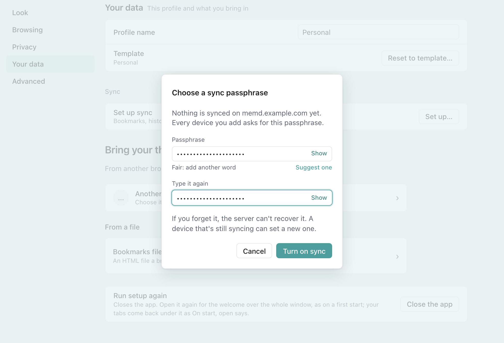
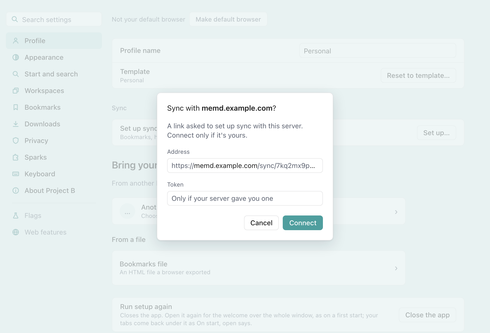
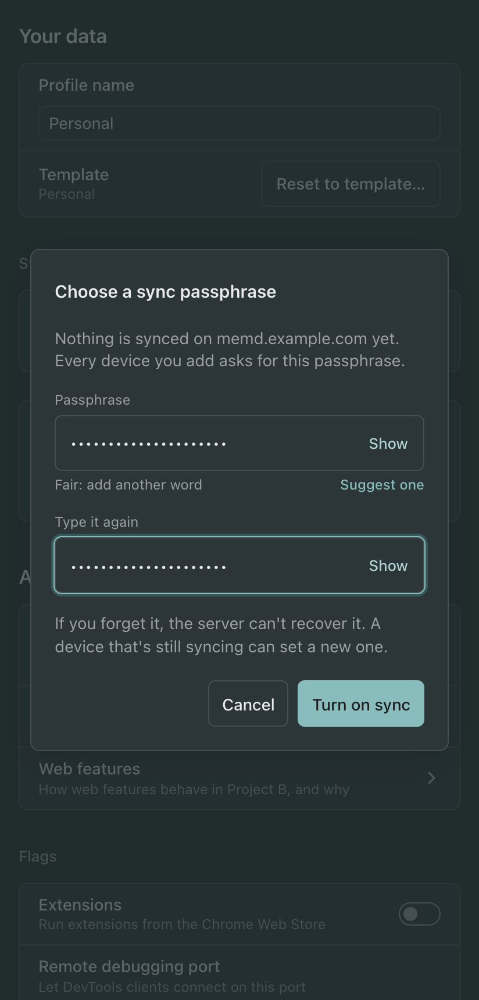

# Sync

A profile's bookmarks, history and typed addresses, the same on every device a person links,
through a sync server that holds them sealed. **Built 2026-11-19:** the Go side, then Settings'
screens and the deep link, as the mocks the ux review approved that day have them ([the
screens](#the-screens), [the link](#the-link)). The protocol and the library
are [synckosh](https://github.com/sudiptadeb/synckosh): its SPEC.md is the protocol, and the core
uses its Go `client` package. The store it works over is [store.md](store.md).

## His decisions

- 2026-11-18: "sync should always be with a passphrase"
- 2026-11-18: "yes keychain default, passphrase lock over it... and enterprises can later force
  passphrases via policy". The keychain is built; the passphrase lock over it is not.
- 2026-11-18: "lets not go the app only level for now... since we cannot give the same level in
  windows and linux": the device key is an ordinary keychain item, not one only this app's
  signature can read.
- 2026-11-19: "keychain prompt every update is fine": the key stays in the keychain, though macOS
  asks about it after each update (below).
- 2026-11-18: "profiles should be as isolated as possible... we would have to keep the dek in
  profile and kek in keyring"
- 2026-11-18: "moving profiles should work, just the passwords would not"
- 2026-11-19: "individual visits are not synced"
- 2026-11-19: "host sync server inside memd for now... users can sync by first configuring sync
  bucket url and token... then sync start asks for passphrase"
- 2026-11-19: "we should build some deep link which we can click from the memd page to set the
  sync server details on the app in mac and android"
- Agreed in the discussion of 2026-11-19: local storage is ours, and synckosh is given its storage
  interface over it; sealing on disk is ours, field by field; history and bookmarks stay plain on
  disk, sealed only for the wire, by synckosh; the sync key is apart from the profile key.

## What syncs

| Collection | One item per | What it carries |
|---|---|---|
| `bookmarks` | bookmark or folder, by its id | the folder it is in, its kind, title, address, when it was added and last changed, its place |
| `history` | address | the address, its title, how many visits, the last visit |
| `typed` | address typed | the address, how many times, the last time |
| `passkeys` | passkey, by its credential ID | its site, user handle, names, when it was made and its key ([passkeys.md](passkeys.md)) |

**Not synced:** each visit (the `visits` table), the sites (`sites`, made from history on each
device), the folder a bookmark was last saved in, and everything kept in JSON files (prefs,
workspaces, pins, the session, downloads).

Everything an item carries is in its private part, which synckosh seals with the sync key before
it leaves the device. Its public part is empty. The server learns the collections' names, each
item's id, when it changed and how big it is, and nothing else. A history or typed item's id is
made from its address with the sync key, so the same address on two devices is one item, and the
server can't tell from the id which address it is.

**When two devices change one item:**

- **History and typed** take the larger count and the later time, and the title of the version
  visited later (a title over none, then the later visit, then the greater title, so every device
  picks the same).
- **Bookmarks:** the newest change wins, by when it was made (the entry's `modified`).

A delete is an item too. Clearing all history is one item for each of `history` and `typed`,
synckosh's delete-before, which the server applies at once; clearing a time range deletes each
address's item.

## The keys

| Key | What it is | Where it lives |
|---|---|---|
| Device key | 32 random bytes, one for the app on this device | The Mac's login keychain, a generic password: service `Project B`, account `device key`. On Android, `files/device.key` in the app's folder, wrapped by an AES key of the Android Keystore, `project_b_device_key` |
| Profile key | 32 random bytes per profile, made the first time something is sealed | `profile.key` in the profile folder, wrapped by the device key, the profile's id bound in |
| Sync key | synckosh's data key, one per bucket, the same on every device in it | The profile's `secrets` table, sealed with the profile key. Joining devices get it from the server's sealed copy, opened with the passphrase |

The keychain and the Keystore are asked only once something is sealed in the profile, which today
is sync turned on: a profile that never syncs never touches them.

**Which key wraps a profile's key.** A profile in the profile list uses the device key. A folder
opened as it is with `--user-data-dir`, as every test and driver run is, never touches the keychain:
its profile key is wrapped by `folder.key`, a key in that same folder. So tests need no keychain,
and a listed profile's folder copied and opened with `--user-data-dir` gets nothing from the
keychain. Android's profile is the one folder Android gives the app, its only profile, and uses
the device key.

**Moving a profile.** History, bookmarks and the rest move with the folder. What was sealed does
not open on another device, whose device key differs, nor under another id: the profile key
is then *locked*.

**Never rekeyed silently.** When the device key doesn't open the profile key (a moved folder, a
lost or replaced keychain item), sealing and opening fail with a plain error, nothing is
overwritten, sync is off and its status says why. One call, `StartFresh`, deletes what was sealed:
the secrets, and each feature's own sealed rows, which the feature deletes in the same job
(`keys.OnStartFresh`; the passkeys do), and makes a new profile key. History and bookmarks are untouched. A device key is made only when
a new profile key needs one, never in place of one that is there.

**macOS asks after every update.** The app is signed with the project's own certificate and has
no Apple team id, so macOS files the keychain item under the code hash of the build that made it.
Measured in a VM on 2026-11-19 with two builds signed with the project's identity: every new
build is asked "Project B wants to access key 'Project B device key'" and needs the person's Mac
password; Always Allow covers that one build only; an access rule of any application doesn't
avoid it, as the partition list still holds only the creator's code hash; and the
data-protection keychain refuses a binary with no team id (`errSecMissingEntitlement`, -34018).
So a profile with sync on asks once after each update, and until it is answered Sync shows Set up
sync. Signing with an Apple Developer ID, whose team id lets every build read the item, ends it.

**Sealing on disk** (`core/keys`): XChaCha20-Poly1305, with the table, the row's id, the column
and any other values the row binds in as additional data, so a sealed value can't be moved to
another row or column. A fresh random nonce each time; the stored value is the nonce, then the
sealed bytes. The `secrets` table holds named sealed values; sync keeps its address, token and
sync key there.

## The address

A bucket on the memd server is reached two ways, and both are taken as they are:

- `https://<host>/sync`, with the token sent as `Authorization: Bearer <token>`;
- `https://<host>/sync/<token>`, the one address, with no token apart.

Only `https`, with a host, no user, query or fragment. An address whose path ends in `/sync` needs
its token given; one that goes on past it carries its token. Status shows the host alone, and
so does an error's text, in the status, on the page and in the timeline (`Words`): Go's own error
for a request names the whole address.

**The deep link** the memd page offers is

```
project-b://sync?address=<the https address, percent-encoded>
```

It only fills in what Settings would connect to: it never connects by itself. Settings shows the
host and asks for the passphrase (and the token, for an address without one), and only then
connects. How it reaches the app is [the link](#the-link).

## Turning it on

1. The address, from the deep link or typed: `Propose` checks it.
2. `Inspect` looks at the bucket without changing it: an empty bucket is a new one, so the page
   asks for a new passphrase twice; one holding items asks for its passphrase once.
3. `Connect` makes the bucket's sync key with synckosh's `Create` when it is empty, with a sealed
   copy under the passphrase, or opens the sealed copy with `Join` when it holds items. A wrong
   passphrase changes nothing. It keeps the address, the token and the sync key sealed, hands every
   row of the three collections to synckosh once, and answers: sync is on. Its first run follows,
   on sync's goroutine, which the status shows, so the set-up closes without waiting for a first
   run of all the profile's history.

The passphrase is never kept: the device holds the sync key, so changing the passphrase needs no
old one.

## How it runs (`core/sync`)

**Local storage is ours.** `core/sync` is synckosh's `client.Local` over `store.db`:

| Table | What it holds |
|---|---|
| `sync_items` | synckosh's bookkeeping per item: its sequence, base, timestamp, pending, sent, and the row it is (the feature's key, the address or the bookmark's id). An item's content is the feature's own row, never a second copy. Only what has no row is kept whole: a deleted item, without its content; one sealed under a key this device doesn't hold, as it came; the sealed copies of the sync key; a delete-before |
| `sync_meta` | synckosh's values: its clock, cursor, store id and last pull |
| `sync_changes` | the rows changed here since the last run: collection, the row's key, deleted, and `stuck`, why a row couldn't be handed over, empty for one that only waits |
| `sync_state` | one row: whether changes are marked, which is whether sync is on |

Each synced feature gives a mapping (`sync.Mapping`): its collection and datatype, its table and
the column that names a row, the row as an item's private part, and the private part back as the
row; deleting a row; and `Join`, the row after taking in another version, which never loses what
the row holds that is newer. History's and typed's `Join` is their merger too. `Name` is what a
person calls a row, for [Sync details](sync-details.md): a bookmark's title; without it, the key,
as an address is.

An item's guid is made from the row's key under the sync key (history and typed, whose key is an
address), or is the key itself (a bookmark's id, a passkey's). A synckosh guid can't start with
an underscore, and a passkey's id, random bytes in base64url, does one time in 64: such a key,
and one that starts with a `~`, goes with a `~` before it, and comes back without it.

**Writing first, then telling sync.** Features write their rows as before. While sync is on,
triggers on their tables write a mark in `sync_changes`, in the same transaction; with it off,
none. A mark takes the place of the row's earlier one by deleting it and writing it again: an
`INSERT OR REPLACE` in a trigger is overridden by the statement that fired it, and an upsert's
update aborts on a conflict, which would fail the feature's own write. Clearing all history replaces its marks with one, which becomes the delete-before. A run:

1. Drains the marks into synckosh: a delete-before first, then a changed row as `Replica.Put`, a
   deleted one as `Replica.Delete`, which finds the item by its bookkeeping though the row is gone.
   **A row that can't be handed over is set aside, and the rest goes.** synckosh takes a batch
   whole or not at all, so a batch it refuses is handed over again a row at a time; a row it
   still refuses (too big for one item, say), or one that doesn't read, keeps its mark with
   why in the mark's `stuck` column. Sync's own runs leave such a mark be; a run a person
   asked for, the first of a start, and the row changing again try it anew. The status
   counts them (`unsent`), with what the server refused in the last run, and Sync details
   names each with its reason. Before this one such row failed every run of the profile.
2. `Replica.Sync`: pull, push.
3. A version from the server is joined into its row (`Join`), on the store's worker, with the
   triggers quiet. When the row then differs from it, the row holds something newer, and is
   marked to go out. A row with a delete waiting is left alone. A deleted item takes its row. The
   features that changed are told on the main thread: the bookmarks read their tree again, and
   tell the shells.

synckosh keeps deleted items (`KeepDeleted`), so it never removes an entry for a delete, and a
removal (a device away past the server's cleanup starts over) only forgets the bookkeeping: the
rows stay, and go out again.

**When it runs:** at start when sync is on, within ten seconds of a change (it looks for marks
that often), every five minutes, and on `SyncNow`. On a goroutine of its own, never the main
thread; one run at a time. A failed run waits 30 seconds, then twice as long each time, up to half
an hour, and its error is in the status. `SyncNow` doesn't wait.

**A damaged store.db**, which the store moves aside and makes again ([store.md](store.md)), takes
the secrets and the bookkeeping with it: sync is off, and is connected again with the passphrase.

**A server reset** (the server gives the bucket a new store id and forgets its items): synckosh
pushes back everything this device holds, read from the rows, deletes included.

## The functions (`core/sync`)

Every answer comes on the main thread, where the calls are made. Only `Propose`, `Link`, `Status`
and `OnStatus` answer at once; the rest run on sync's goroutine, after what was asked before them.

| Function | What it does |
|---|---|
| `Link(link) (address, error)` | the address in a `project-b://sync?address=` link |
| `Propose(address) (Proposal, error)` | checks an address and says what would be connected: `Address`, `Host`, `NeedsToken`. Changes nothing |
| `Inspect(address, token, answer func(isNew bool, err error))` | whether the bucket is empty, so new. Changes nothing |
| `Connect(address, token, passphrase, done func(error))` | starts the bucket or joins it, keeps its details sealed, and syncs. `errors.Is(err, sync.ErrPassphrase)` for a wrong passphrase |
| `ChangePassphrase(passphrase, done func(error))` | puts a sealed copy under the new passphrase and deletes the others |
| `Disconnect(done func(error))` | stops syncing and forgets the address, token and sync key; every row stays |
| `SyncNow()` | a run now |
| `CancelRun()` | cuts the run going on short: it ends with no error and no longer wait, and the next comes when it would have |
| `Address() string` | the bucket's address while sync is on, for Reconnect |
| `Problem(err) string` | what went wrong reaching a bucket, by name: `address` (not one Propose takes), `needsToken`, `unreachable` (no answer), `server` (the server answered that it failed, 500 and up: it was reached), `stalled` (a request with nothing going or arriving for `StalledAfter`, 30 seconds, which is ended), `notBucket` (not found, or not JSON), `token` (refused), or `""` for anything else, as a request the server won't take or a row that can't be written. A request's answer is looked at before synckosh reads it, and its error wraps `ErrAddress`, `ErrNeedsToken`, `ErrUnreachable`, `ErrServer`, `ErrStalled`, `ErrNotBucket` or `ErrToken` |
| `Words(err) string` | an error's text, a failed request as the request and then the cause, `GET v1/pull?after=1: EOF`: the request named from `v1` on, as the address before it may carry its token, and without the words the page's own sentence says. What the status, the page's answers and the timeline say of an error |
| `Details(answer func(Details))` | what the Sync details page shows ([sync-details.md](sync-details.md)): the address with no token, the counts, the queue, and the runs since the app started, kept in memory only |
| `StartFresh(done func(error))` | for a locked profile key: `keys.StartFresh`, so sync is forgotten and off |
| `Status() Status`, `OnStatus(func(Status))` | `on`, `syncing`, `host`, `lastSynced` (Unix ms, 0 for never), `error`, `problem` (the last run's, by `Problem`'s names: `token` when the server signed this device out), `locked` |

**The settings page's messages** (`core/app/sync_settings.go`). Go sends `{"t": "sync", "sync":
<Status>}` to every settings page and shell when it changes, and both snapshots carry `sync`; the
settings page's message carries `address` too, and its snapshot `syncAddress`, which Reconnect
fills in. A `project-b://sync` link reaches the page as `syncLink {link}`, after its snapshot or at
once ([the link](#the-link)). Every answer with an `error` carries its `problem`, by `Problem`'s
names. The page sends:

| Message | Go answers |
|---|---|
| `syncPropose {address}`, or `{link}` for a deep link's | `syncProposal {address, host, needsToken}` or `{error, problem, address}`, the address as given |
| `syncInspect {address, token}` | `syncBucket {new}` or `{error}` |
| `syncConnect {address, token, passphrase}` | `syncConnected {wrongPassphrase}`, with `error` when it failed |
| `syncChangePassphrase {passphrase}` | `syncPassphraseChanged {}` or `{error}` |
| `syncDisconnect` | `syncDisconnected {}` or `{error}` |
| `syncNow` | the status, as it changes |
| `syncDetails` | `syncDetails {details}`, for [the Sync details page](sync-details.md) |
| `syncCancel` | the status, the run cut short (`CancelRun`) |
| `syncSuggest` | `syncSuggested {passphrase}`: five words from `core/words`' list of 662, picked at random |
| `syncStartFresh` | `syncStartedFresh {}` or `{error}` |

## The screens

Settings' Sync, as the mocks of 2026-11-19 have it, every word theirs (the research repo's
`daily-driver-2026-11-16/mocks/sync.js`), in `shell/src/apps/settings/Sync.vue`. Every state's
picture, light and dark, desktop and phone, is made by `shell/e2e/sync.cjs` under
`build/sync-screens/`.







- **Where:** a card in Profile, after the profile's card and before Import. Its address is
  `sync` (`arrange.js`), and searching for sync or passphrase finds its rows.
- **Off:** one row, Set up sync, "Bookmarks, history, typed addresses and passkeys, through your own sync
  server", Set up….
- **On:** the server's row, its letter on its tile as a site's, with "Last synced 2 minutes ago"
  ("just now" in its first minute, "Not synced yet" before a first run ends) and Sync now; then
  Sync details, which opens [a page of its own](sync-details.md); then Change sync passphrase
  and Turn off sync. It names nothing that syncs.
  - "Syncing…" with quiet Cancel and Retry, Retry a little apart
    ([ux-guide.md](ux-guide.md#anything-that-takes-time)). Cancel cuts the run short; Retry cuts
    it and runs again. A run sync starts by itself says so only after a second. One a person
    asked for, with Sync now, Retry or Try again, says so at once and for a second at least,
    so a run too quick to see still answers the press, and then reads "Last synced just now".
    For that second Sync now stays where it is, disabled, so a second tap lands on nothing;
    Cancel and Retry come only if the run is still going after it.
  - A run that failed says what it was, in `--danger`, then "· Last synced …", with Try again
    and the error's own words in the row's tooltip (`syncRun.js`, by the status's `problem`):
    "Couldn't reach the server" only when the server gave no answer; "The server answered with
    an error" when it was reached and said it failed; "Stopped: nothing arrived for 30
    seconds" when a request stalled, the same words as the updater's and an import's
    ([ux-guide.md](ux-guide.md#anything-that-takes-time)); "The server has no sync bucket at
    this address"; and "Couldn't sync" for anything else. The words themselves are on Sync
    details, under the run.
  - A run goes on saying "Syncing…" for as long as it does. Go ends a request that stalls;
    the page keeps no clock of its own. A first sync against a bucket that holds a lot takes
    as long as it takes.
  - A token the server refuses: "The server signed this device out", Reconnect…, which opens the
    set-up with the address filled in and the focus on Token. Connecting from it lets the old
    bucket go first and joins again.
- **Keys that don't open here** (`locked`): "Sync can't run on this device", "This profile's
  saved sync details can't be opened here", Set up again…, the reason in the tooltip. A state,
  not an error. Set up again… opens the set-up empty; Turn on sync then starts the profile's keys
  afresh (`syncStartFresh`) before it connects.
- **Setting up is one Dialog** whose title follows the step:
  - **Set up sync:** "Paste the address from your sync server.", Address and Token ("Only if your
    server gave you one"). An address that can't become https is refused as it is typed: "Sync
    needs an https address". Connect reads "Connecting…" while Go looks at the bucket, and Cancel
    still works. Under Address: "Couldn't reach memd.example.com", "That address isn't a sync
    bucket"; under Token: "The server didn't accept that token". The typed text stays.
  - **Choose a sync passphrase**, for an empty bucket: twice, Passphrase and Type it again, the
    strength in words under the first ("Fair: add another word", "Strong"; four words of three
    letters or more, or 24 characters, are strong), and Suggest one, which fills in five words,
    shown, and waits on Type it again. Turn on sync refuses one under 12 characters ("Use at least
    12 characters") and two that differ ("The passphrases don't match").
  - **Enter your sync passphrase**, for a bucket in use: once. A wrong one: "That's not the sync
    passphrase", and "Forgot it? Set a new one on a device that's still syncing."
- **Change sync passphrase:** only the new one, twice, with the same checks and Suggest one.
- **Turn off sync on this device?** with a plain primary Turn off: nothing is destroyed.
- **A phone** uses the same Dialog. Sync's buttons there are drawn at the touch size, 40px,
  inside 48px targets, as the Mobile shell's pill and field are; its fields are 48px.

**Decided here, which the mocks didn't say:** "This address needs a token" under Token, for an
address ending in `/sync` given none; "Couldn't set up sync with <host>" for an error with no
name, its words in the field's tooltip; an https address Propose refuses (a query, a user, no
host) reads "That address isn't a sync bucket"; "Not synced yet" before a first run; the strength
shows nothing under 12 characters.

## The link

`project-b://sync?address=<the https address, percent-encoded>` reaches the app three ways, and
each ends in one Go function, `App.OpenAppLink` (`core/app/sync_settings.go`): Settings opens at
Sync in that window, and the page is told the link (`syncLink`), whose address it asks Go to read
(`syncPropose {link}`). The Dialog opens as "Sync with **memd.example.com**?", "A link asked to set
up sync with this server. Connect only if it's yours.", the address filled in and read only, and
nothing is sent to the server or kept until Connect. An address that isn't https opens the plain
set-up with the address and its error. Any other `project-b:` link does nothing.

- **From another app on the Mac:** the bundle's Info.plist names the `project-b` scheme among its
  URL types (`tools/package.sh`), so macOS hands the link to Go's `core/system` as it does a web link,
  and `App.Handover` gives an app link to `OpenAppLink` instead of a tab.
- **From another app on Android:** the activity has an intent filter for the scheme
  (`engine/android/AndroidManifest.xml.jinja2`); its `VIEW` intent reaches `core/system` and
  `Handover` as a web link's does.
- **Pressed in a page in Project B:** the engine's navigation gate (`engine/browser/events.cc`)
  drops every navigation to a `project-b:` address, and only for one a user's gesture started at
  the top of a tab's page, at its start, raises `PB_EVENT_APP_LINK` (81), which Go hears as the
  `Listener`'s `AppLink`. A page's script going there, a frame's link and a redirect are dropped
  unheard, so a page can't open the Dialog by itself.

## Not built

- The passphrase lock over the keychain, and a policy forcing it.
- Saved logins, and any sealed field but the secrets.
- A token per device: every device uses the bucket's token.
- A backup code (synckosh's `BackupCode`).

## Tests

`core/keys`: sealing binds its table, row, column and bound values; a folder named outright uses
its own key and never a device key; a profile key that doesn't open is locked, overwrites nothing,
and `StartFresh` makes a new one; the Mac's keychain, under a test-only service, deleted after.
`core/history`: joining two versions of a page, whichever is the row.
`core/sync`: two profiles syncing bookmarks, history and typed addresses through synckosh's server
in-process, in both address forms; one address visited on both, one row with the larger count; a
bookmark deleted on one gone from the other; clearing history reaching the other; no visit and no
readable title or address on the server; a wrong passphrase; joining; a changed passphrase, which a
third profile joins with while the old one fails; Disconnect keeping the rows; a server reset
refilled; a locked profile key turning sync off; sync on at start running with what was kept.
`core/sync` also: each problem reaching a bucket named, and a signed-out device's status; a run cut
short; Connect answering before its first run; the address while on. `core/words`: the list and a
passphrase of it. `core/abi`: `AppLink`'s values.
`core/app`: the settings page's status, a deep link only proposed, problems by name, Suggest one;
a link from another app opening Settings at Sync with `syncLink` after the snapshot, another
`project-b:` link doing nothing; a link pressed in a page doing the same, and a script's doing
nothing. `core/cmd/lib`: a folder named outright gets no device key.

`shell/e2e/sync.cjs` (in `tools/test.sh mock`), in the one-page and Sections layouts and on a
phone, against synckosh's server, which the dev server runs with `-sync-server` and sync reaches
as memd.example.com (`/mock/sync` counts its requests, signs a token out, drops connections,
holds requests, answers each with a failure, or shortens the wait before a request stalls; `/mock/open` hands a link over as another app does): where the card is and search
finding it; a new bucket and one in use; a short passphrase, two that differ, a wrong one, an http
address, a server out of reach, an address that isn't a bucket, a refused token; Suggest one and
the strength; Sync now, syncing with Cancel, out of reach with Try again, the server's own
failure, a failure of another kind with its words in the tooltip, a run with nothing arriving
that goes on saying it syncs and then ends as stopped, signed out with Reconnect; Change and Turn off; keys that don't open and Set up again; the link from another app
and pressed in a page with no request reaching the server before Connect, an http link's error,
and a page's script going there doing nothing; on a phone, the buttons' 48px targets and the
fields' 48px.

`tools/drive_first_app.py`, part `applink`, on the real app: a press on a page's sync link opens
Settings at Sync with the link's Dialog, and a server the link names hears nothing until Connect;
a script's navigation, a press in a frame, a redirect and another `project-b:` link do nothing.

**Checked by hand on 2026-11-19, in a throwaway clone of the test VM** (docs/vm-testing.md), with
a sync server in the VM whose own CA the VM's system keychain was told to trust: on a listed
profile, turning sync on made the login keychain's `Project B` / `device key` item and
`profile.key`, with no prompt, and sync was still on after a restart; the profile's folder
copied and opened with `--user-data-dir` showed "Sync can't run on this device"; `open` on a
sync link, with the app running and with it quit, opened Settings at Sync with the link's Dialog,
and a port the link named heard nothing until Connect. A new build of the app, signed again, is
asked about by the keychain once ("Project B wants to access key 'Project B device key'"), as
`keychainPrompts` expects; until it is answered, Sync shows Set up sync.

`tools/drive_android.py`, part `sync_on_the_phone`, on the emulator: a sync link from another app
opens Settings at Sync with the link's Dialog, the app running or stopped; turning sync on against
`core/cmd/syncserver`, a test server over https whose own CA is put in the emulator's user CA folder
(which Go reads), makes `files/device.key`, wrapped by the Keystore, and `profile.key`; a restart
syncs again with what was kept; DeviceKey logs no exception.

**Not tested here:** the Mac's keychain test skips where the shell's
keychain list has no login keychain, as an agent's shell over ssh has.
