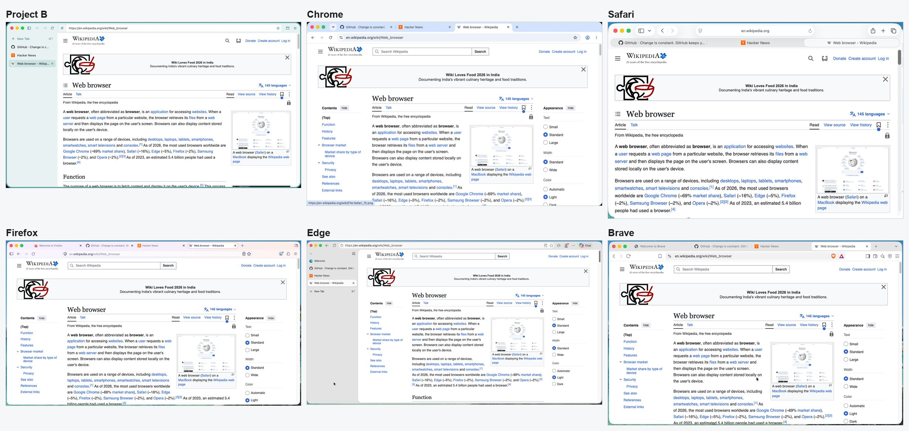
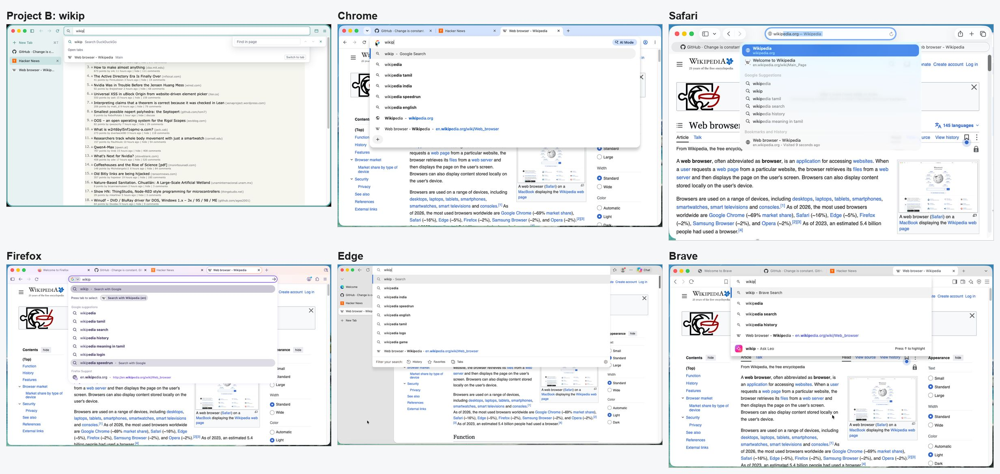
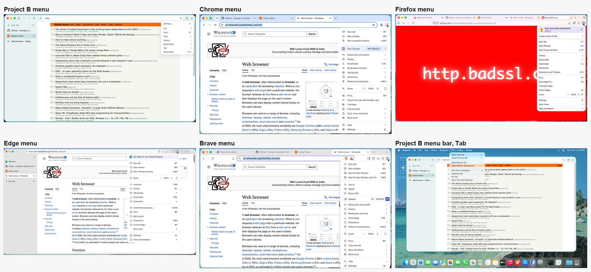
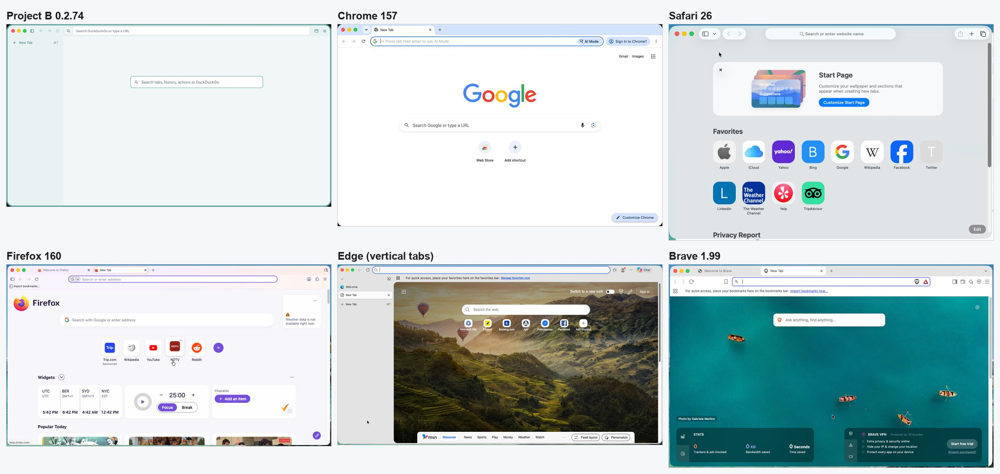
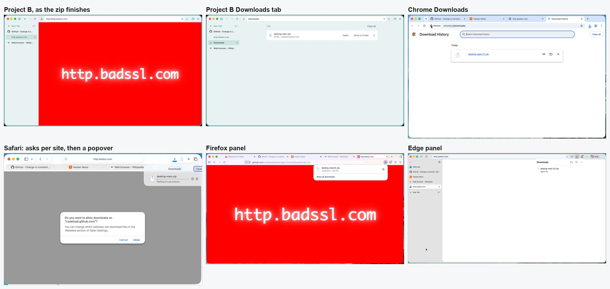
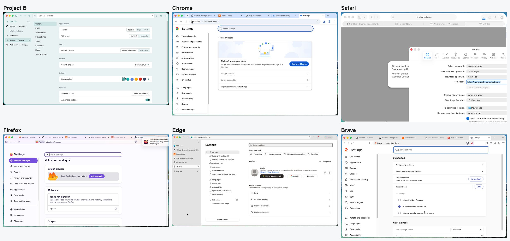
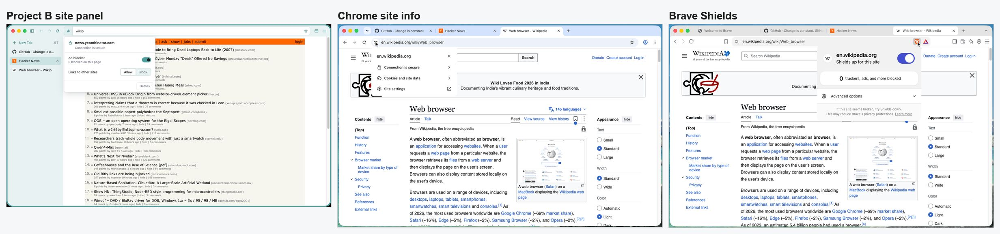
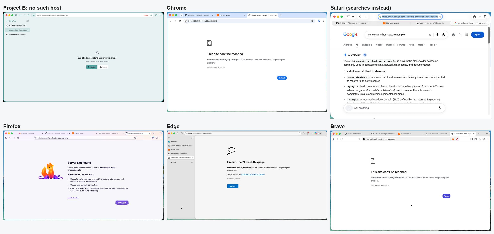
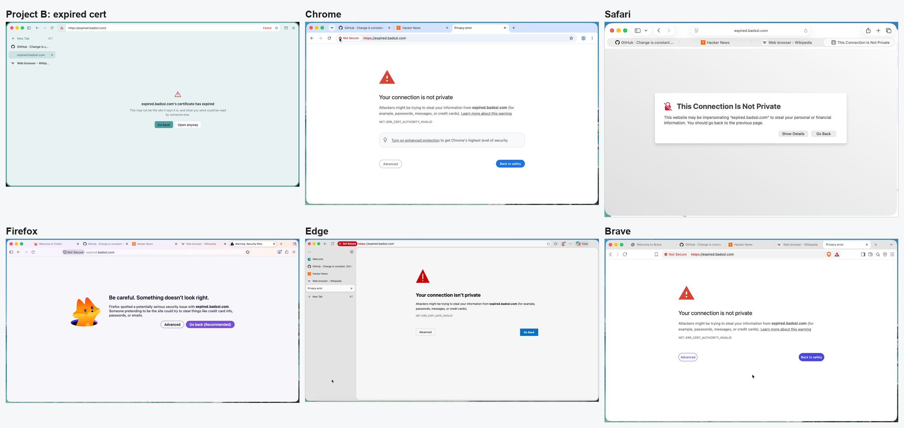
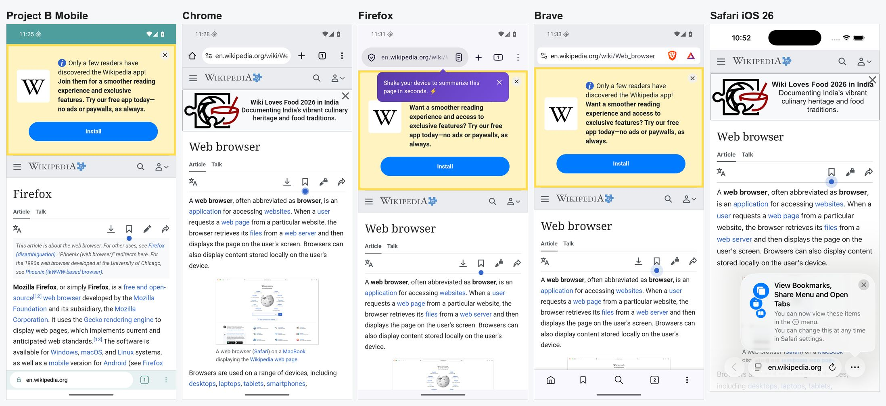

# Standard and Mobile against the industry browsers

This compares our Standard shell (Mac) and Mobile shell (Android) with Chrome, Safari, Arc,
Firefox, Edge and Brave, area by area, and ends in a ranked list of what to do. It was made
on 2026-11-16 from release 0.2.74 and real screenshots. It is research only: nothing here
is built, and the mocks are pictures, not code.

**What was run**

- **Mac:** a clean macOS 26.6 VM (a deskrig clone, deleted afterwards). Installed there:
  0.2.74's DMG, Chrome 157, Safari 26, Firefox 160, Edge (with its vertical tabs chosen, as
  the nearest to our sidebar) and Brave 1.99. Every browser got the same steps: three tabs,
  `wikip` typed in the address field, the main menu, the site's panel, a host that doesn't
  exist, `expired.badssl.com`, `http.badssl.com`, one download, the downloads list and
  settings.
- **Arc** no longer takes new accounts: its first screen says so and points to Dia
  ([picture](screenshots/ux-comparison/desktop-first-run.jpg)). Arc is described from what
  it is known for, without a screenshot of a session.
- **Phone:** the Android 16 emulator (`emulator-5602`) with 0.2.74's APK, Chrome, Firefox
  160 and Brave 1.99. Edge has no APK outside the Play Store and was left out. Safari on
  iOS 26.5 was taken in Xcode's simulator (one picture).

Each picture below is a sheet of one area across the browsers, with labels. The sources
and the mocks' HTML are in [screenshots/ux-comparison/](screenshots/ux-comparison/).

## Found while testing

Before the comparison, three faults in 0.2.74. They come before anything below.

1. **The Mac app crashed on Quit** in the VM: `EXC_BAD_ACCESS` at `0xefefefefefefefef`
   (memory already freed) in `libproject_b_content.dylib`, and macOS showed its Problem
   Report. Four tabs were open (one was Downloads, after one download) and settings had been
   opened and closed. It may be the same holder as the dev-only dangling `raw_ptr` at exit in
   [todo.md](todo.md#small-fixes), but this was the official build.
2. **The Android app crashed once** (SIGSEGV at address 0 in `libproject_b_content.so`)
   right after Back was pressed with the site sheet open, then a long press on the page.
   It didn't happen again in three more tries. On the next start the restored tab showed
   its page while the pill said "Search or type an address".
3. **Mobile's error message is wrong for a host that doesn't exist.** It says "No internet
   connection" and `ERR_INTERNET_DISCONNECTED` while other pages load. The Mac says
   `ERR_NAME_NOT_RESOLVED` for the same address, and Chrome on the same emulator says "This
   site can't be reached".

## Where we already do well

- **Tabs down the side by default,** with New Tab and its key at the head of the list.
  Edge's vertical tabs are nearly the same picture, and Arc made the layout popular.
  Chrome, Safari, Firefox and Brave start with tabs on top.
- **The command box** for a new tab ("Search tabs, history, actions or DuckDuckGo") is
  Arc's best idea, and nobody else has it on the desktop.
- **The site panel** puts the connection, the ad blocker with its count, Links to other
  sites and the site's permissions in one small panel. Brave's Shields is the only other
  panel of this kind, and it has less in it. Chrome's goes one level deeper for each thing.
- **Error and certificate pages on the Mac** are plain, short and in our look, with the
  right buttons (Try again and Go back; Go back and Open anyway).
- **One look throughout.** The frame colour runs through the window, the side list and
  settings. Settings is one short page with segmented controls. Next to it, Chrome, Edge
  and Firefox each show a sign-in pitch first.
- **Mobile's bar at the foot,** with the menu and the sheets at the thumb. Safari on iOS
  has the same shape. Chrome and Brave keep the address on top, and Firefox now starts on
  top too.
- **Mobile's long-press link sheet** offers "Open in new tab in group" first, as Chrome
  does.

## What to do, ranked

Size: **S** is about a day, **M** a few days, **L** a week or more, or engine work. Items
marked *for the owner* touch something he decided or listed for discussion.

**Done:** items 1 to 10, in 0.2.76 and 0.2.77, and printing (15) in 0.2.76. One part of 9
is left: asking for the phone's notification permission with a reason first. Items 11 to 20
wait in [todo.md](todo.md) for the owner, and the first run (13) is being designed as our
own page. Settings (12) is built but for what needs the engine: search, a Privacy group with
Clear browsing data and Block ads, Ask where to save, Import and the default browser, in two
layouts to choose between ([settings.md](settings.md)); cookies by site, the download folder
and clearing cookies at quit wait on the engine ([todo.md](todo.md)).

| # | What | Why | Who does it well | Size |
|---|---|---|---|---|
| 1 | Fix the two crashes and the wrong error message above | A crash on Quit is the last thing a user sees. A wrong error sends them to check their Wi-Fi | — | M |
| 2 | **Mobile: the certificate warning.** Draw Go's notice (`tab.notice`, kind `certificate`), as Standard does | Today an expired certificate says "Can't reach expired.badssl.com" and Try again, which can never work. The user isn't told why, and can't go back or go on ([picture](screenshots/ux-comparison/phone-certificate.jpg), [mock](screenshots/ux-comparison/mock-phone-certificate.jpg)) | Chrome, Firefox: a full warning with the safe answer at the thumb | S |
| 3 | **A new tab page,** desktop and phone: the command box stays, with shortcuts (pinned and most visited), Recently closed, and the other workspaces' tabs under it. All of it comes from Go's history, with nothing fetched | The Mac shows the box on an empty frame and the phone a white page with the keyboard. Every one of the six fills this page ([desktop](screenshots/ux-comparison/desktop-new-tab.jpg), [phone](screenshots/ux-comparison/phone-new-tab.jpg), [mock](screenshots/ux-comparison/mock-desktop-new-tab.jpg)). *For the owner* (daily-use row 15) | Safari (Favorites, Frequently visited), Chrome and Edge (shortcuts), Arc (command bar) | M |
| 4 | **Mobile: show something when the address bar is tapped** before anything is typed: the copied link, recent pages and open tabs, nearest the thumb | Today the list is empty until a letter is typed ([picture](screenshots/ux-comparison/phone-address.jpg), [mock](screenshots/ux-comparison/mock-phone-new-tab.jpg)) | Chrome, Safari | S |
| 5 | **Address suggestions from history and bookmarks, with inline completion,** all local | For `wikip`, after visiting Wikipedia, Standard offered one search row and one open tab. The others offer the visited page first and complete it in the field ([picture](screenshots/ux-comparison/desktop-suggestions.jpg), [mock](screenshots/ux-comparison/mock-desktop-address.jpg)). Search-engine suggestions stay off, as the owner decided | Safari, Chrome, Firefox | M |
| 6 | **Esc in the address field puts the page's address back** | After typing and two Escapes, Standard still shows `wikip`. Every other browser puts the address back ([picture](screenshots/ux-comparison/desktop-escape.jpg)) | All six | S |
| 7 | **"Not secure" in words** at the start of the field, for http pages and for a certificate passed with Open anyway, desktop and phone | Today only a small ⚠ shows. Chrome, Edge, Brave and Firefox write "Not Secure" ([picture](screenshots/ux-comparison/desktop-http.jpg), [mock](screenshots/ux-comparison/mock-desktop-address.jpg)). Daily-use already lists it as missing | Chrome, Edge | S |
| 8 | **Mobile: a phone-shaped menu.** The page's actions in a row, then a flat list (New tab, Find in page, Desktop site, Workspace), then History, Bookmarks, Downloads and Extensions as tiles, then Settings | Mobile's ⋮ now lists the Mac menu bar's File, View, History, Bookmarks and Tab as submenus, names that mean little on a phone ([picture](screenshots/ux-comparison/phone-menu.jpg), [mock](screenshots/ux-comparison/mock-phone-menu.jpg)). *For the owner:* on 2026-11-16 he decided that the shells draw Go's menu | Firefox (this shape), Chrome and Brave (flat lists) | M |
| 9 | **Downloads you can see happen.** On the Mac, the Downloads panel opens by itself under its button when a download starts. On the phone, a bar at the foot says "Downloading…" with Open once it's done, and the notification permission is asked with a reason first, not in the middle of a download | On the Mac only a button appears. On the phone the system's notification prompt pops over the page as the download starts, and nothing in the app says anything ([desktop](screenshots/ux-comparison/desktop-downloads.jpg), [phone](screenshots/ux-comparison/phone-downloads.jpg)) | Chrome, Firefox, Edge, Safari (desktop panels). Chrome on Android explains notifications at first run | S |
| 10 | **Mobile: page pictures in the tab switcher,** and a search over tabs | Mobile's cards show a favicon or a letter. All four others show the page as it last looked ([picture](screenshots/ux-comparison/phone-switcher.jpg), [mock](screenshots/ux-comparison/mock-phone-switcher.jpg)) | Chrome, Brave ("Search your tabs"), Firefox, Safari | M |
| 11 | **Mobile gestures:** pull down to reload, and a swipe up on the bar to open the switcher | Mobile has the sideways swipe along the bar only. Pull-to-reload is in Chrome, Firefox and Brave, and the swipe up is how Safari and Chrome reach the tabs | Safari on iOS, Chrome | M |
| 12 | **Settings for a daily browser:** a search field, a Privacy section (clear browsing data, cookies), where downloads go, and Import | Standard's settings is tidy but has none of these ([picture](screenshots/ux-comparison/desktop-settings.jpg)). Chrome, Edge, Firefox and Brave put search at the top of settings | Edge, Chrome | M |
| 13 | **Bring bookmarks, history and passwords over from another browser** on the first run | The first thing a switcher wants. Edge finds Chrome and Firefox and offers Import in its second screen ([picture](screenshots/ux-comparison/desktop-first-run.jpg)). Already planned for bookmarks ([todo.md](todo.md#daily-driver)) | Edge, Brave | L |
| 14 | **Saved passwords and autofill** | All six have it. Daily-use row 12, *for the owner* | Safari (with iCloud Keychain), Chrome | L |
| 15 | **Printing** | All six have Print in the menu and ⌘P. Daily-use row 13, *for the owner* | Chrome, Safari | L |
| 16 | **The ☰ menu: a zoom row and New window** at the top level | They are in View and the menu bar today. Chrome, Edge and Brave have − 100% + and full screen in one row ([picture](screenshots/ux-comparison/desktop-menu.jpg)) | Chrome, Edge | S |
| 17 | **Mobile error pages: the main button at the foot** | Mobile's Try again sits mid-screen. Chrome and Firefox put it where the thumb is ([picture](screenshots/ux-comparison/phone-errors.jpg)) | Chrome on Android | S |
| 18 | **The site panel: cookies and site data,** with Clear, and the certificate's details | Chrome's site info opens both from the same place ([picture](screenshots/ux-comparison/desktop-site-info.jpg)) | Chrome | S |
| 19 | **HTTPS first:** try https before http, with a warning page when a site has only http | Chrome, Edge and Brave stop at a warning before an http-only site. Firefox has it as a setting | Chrome | M |
| 20 | **Mobile: settings and downloads outside the tab count** | Opening Downloads and then Settings took the count from 1 to 3, and each needs closing. Chrome shows them as screens over the browser. *For the owner:* "our pages are tabs" was decided on 2026-11-14 ([windows.md](windows.md#our-own-pages-are-tabs-decided-2026-11-14)) | Chrome, Firefox | S |

## Area by area

### Tabs

Standard's side list is close to Edge's vertical tabs: favicon, title, close on the active
row, New Tab with ⌘T. Arc adds pinned favourites above and folders. Groups, pinning, a tab's
menu and dragging are in Standard since 0.2.60's gaps were written (`TabStrip.vue`,
`Sidebar.vue`, `TabMenu.vue`, `drag.js`). On the phone the switcher is a two-column grid as
in the others, but without page pictures (item 10).

### The address bar

The gap is what comes back for a few letters (item 5) and Escape (item 6). Edge adds
filters under the list (History, Favorites, Tabs). Brave and Chrome offer their AI as a row.
Safari completes the address in the field. On the phone, Mobile shows nothing until a
letter is typed, and then one row; Chrome and Firefox show several
([picture](screenshots/ux-comparison/phone-address.jpg)).

### Menus

Standard's ☰ draws the menu bar's tree compactly: Settings, File, Find, View, History,
Bookmarks, Tab, Downloads. Chrome, Edge and Brave lay out the common things flat with
their keys, then a zoom row, then the rest. That is quicker for a first-time user, and
it's the right shape on a phone (item 8). Standard's macOS menu bar follows Chrome's.

### A new tab

Everyone else fills this page; we show the command box alone (item 3). Brave and Edge fill
it with a photo and news; Chrome, Safari and Firefox with shortcuts. A calm page with
shortcuts and recent things fits our look better than a feed.

### Downloads

The Downloads page is good, as plain as Chrome's. What's missing is the moment a download
starts (item 9). Safari asks once per site before allowing downloads, which could be a
Links-to-other-sites-style per-site setting later.

### Settings

Ours is the cleanest of the six and the shortest (item 12). Since 2026-11-18 it has search
and a Privacy group, in two layouts ([settings.md](settings.md)).

### Site info

On a phone, Mobile's site sheet is the same as the Mac's panel
([picture](screenshots/ux-comparison/phone-site.jpg)).

### Errors

On the Mac ours are among the clearest. Safari sends an unknown host to a search, which
hides the error. On the phone, see items 2 and 17 and the wrong message at the top.

### Gestures

Mobile has the sideways swipe along the bar between tabs, a swipe on a card to close it,
long presses on links and cards, and the back key in a sensible order. Pull-to-reload and a
swipe up on the bar are what the others add (item 11). On the Mac a trackpad's two-finger
swipe for back and forward is what every Mac browser does; it wasn't checked here, as the
VM's input sends no trackpad swipes.

### Keyboard

Standard's keymap starts from Chrome's ([chrome-shortcuts.md](chrome-shortcuts.md)), with
its own keys listed in the menu bar. One difference to keep in mind: Ctrl+Tab goes to the
recent tab (as in Firefox's option and Arc), where Chrome goes to the next one. ⌘1 to 9
weren't checked here, because deskrig sends digits as other keys (⌘1 arrives as ⌘S).

### Look

Ours is the quietest: one frame colour, light surfaces, no brand art, no sign-in pitch,
no news. Chrome, Edge and Brave each open on a sign-in or a feed. On the phone the teal
status bar ties the app together; Chrome and Firefox give it the toolbar's colour. Mobile's
pages are white while the switcher and settings use the bar's colour, as in Firefox.

## The mocks

In our look, drawn in [mocks.html](screenshots/ux-comparison/mocks.html) (open it with
`?m=a` to `?m=f`):

- [A new tab page on the Mac](screenshots/ux-comparison/mock-desktop-new-tab.jpg) (item 3)
- ["Not secure", the Downloads panel and inline completion](screenshots/ux-comparison/mock-desktop-address.jpg) (items 5, 7, 9)
- [The phone's new tab and the bar tapped](screenshots/ux-comparison/mock-phone-new-tab.jpg) (items 3, 4)
- [The phone's menu](screenshots/ux-comparison/mock-phone-menu.jpg) (item 8)
- [The phone's certificate warning](screenshots/ux-comparison/mock-phone-certificate.jpg) (item 2)
- [The phone's switcher with page pictures](screenshots/ux-comparison/mock-phone-switcher.jpg) (item 10)

## Doing it again

The Mac: `deskrig vm create <name>` (where disk is short, `tart clone` the base image first
and `deskrig vm create` takes it), `deskrig install <URL>` for each browser's DMG, and Edge's
`.pkg` with `sudo installer` inside the VM (the image's password is `admin`). Open apps by
their path (`open /Applications/Firefox.app`), as Launch Services doesn't know them yet.
Take a whole-screen `deskrig shot` and crop to the app's largest window, because a popup is
a window of its own. First runs need clicks through: Firefox's and Brave's default-browser
question, Edge's three setup screens.

The phone: `adb install` the APKs. Open pages with `am start -a android.intent.action.VIEW
-d <url> -p <package>` rather than tapping each browser's field, then `adb exec-out
screencap -p`. Firefox and Brave come from `ftp.mozilla.org/pub/fenix/releases/` and Brave's
GitHub releases (`BraveMonoarm64.apk`).
